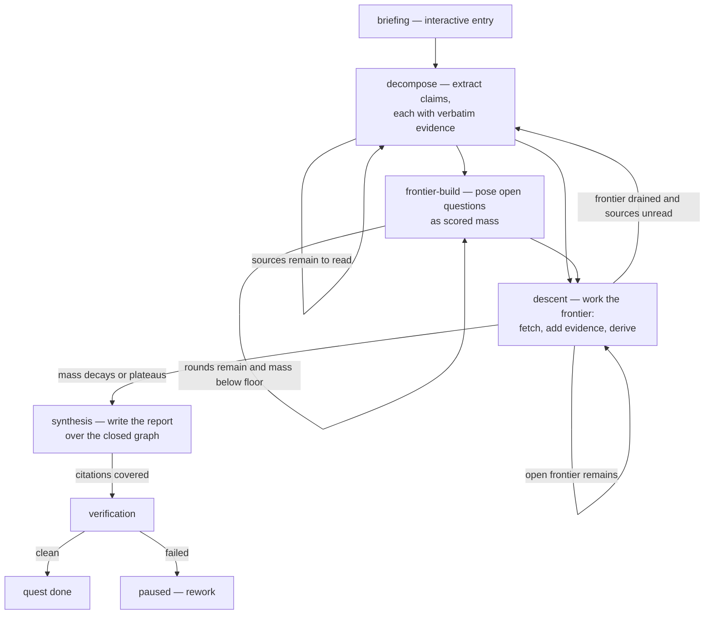
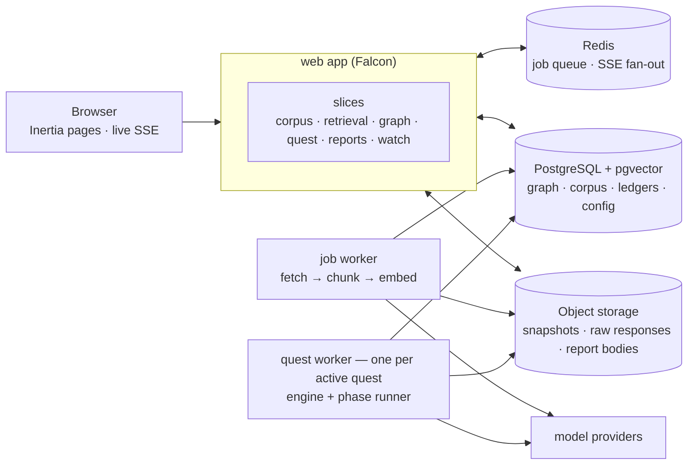

# kquest

**A claim-graph knowledge factory.** kquest turns a topic into a verified
claim graph, and the graph into a citable report — by driving an LLM
through disciplined phases where every assertion is anchored to verbatim
source text and every derivation bottoms out at a typed terminal.

**The graph is the asset; reports are views.**

> **Status: design complete — no product code yet.** This repository holds
> the complete design for kquest: eight design iterations covering 81
> traced requirements in 110 decision records, with 19 executable gates that
> prove the SQL, the state machines, and the checkers actually run. The
> application will be built from here ([roadmap](#status-and-roadmap)).

## The idea

LLMs write plausible prose. The hard part is not generating claims — it is
knowing which claims are *earned*. kquest's bet is that the discipline of a
good systematic review can be made mechanical:

> **Double-entry bookkeeping for knowledge: every claim must balance
> against verbatim text on file. Fabrication fails at write time, not at
> review time.**

Concretely:

- **A claim cannot exist without evidence, and evidence cannot exist
  without a fetched source.** An evidence span is proven byte-for-byte
  present in an immutable snapshot of the source *before* anything is
  written. A refusal creates nothing — and tells the agent exactly how to
  fix the call.
- **Every claim has a return address** — which span, which fetch, which
  session, which phase. If a falsehood is present, it is findable and
  attributable.
- **A claim is "done" only when its derivation path reaches a typed
  terminal**: a definitional-mathematical premise, a primary-empirical
  observation, or an explicitly recorded residual uncertainty. "Done" is a
  property of the graph, not of the model's confidence.
- **Unfinished work stays on the books.** Open questions live on a
  *frontier* — a scored queue weighted by uncertainty × relevance — so a
  hard question cannot be quietly dropped. A phase completes when the
  frontier's mass reaches zero, not when the model stops.
- **Knowledge compounds across quests.** Sources are shared and
  content-addressed; claims belong to the quest that earned them; a
  derived view shows where quests agree — or diverge — on the same claim.
  Divergence is a signal, never silently merged away.

## What it does and does not guarantee

kquest is deliberately honest about its bounds. Do not overclaim:

| Level | What holds |
|---|---|
| **Enforced** (at write time) | No claim without a verbatim span. No span without a fetched source on file. Citations in reports resolve mechanically to sources. |
| **Reduced** (behaviourally) | Misreadings and cherry-picking — rarer and catchable, through verification passes, a conflict ledger, and blind-spot metrics. Never impossible. |
| **Untouched** | Whether the sources themselves are true. Adversarial poisoning of sources. The logical validity of a derivation. |

The defensible claim: **fabrication can't happen for free, or silently.**

## How a quest runs

A *quest* is one build unit: a topic, a staged corpus of sources, and the
claim graph an agent builds from them. The agent is a native Ruby loop
(see [architecture](#architecture)) that works through five phase kinds
under a transition law that is *data*, not code:



*Simplified — `design/I06-quest-process/artifacts/transitions.tsv` is the law.*

- **decompose** — read the corpus and extract claims, each anchored to a
  verbatim span and assigned a terminal type.
- **frontier-build** — pose the open questions the corpus raises: what is
  unresolved, what is needed, how uncertain, how relevant.
- **descent** — work the frontier: fetch sources, add evidence, derive
  claims from claims until derivation paths reach terminals; close
  frontier entries as they resolve.
- **synthesis** — write the report over the closed graph, citing by local
  ordinal. A deterministic binding pass resolves ordinals to source URNs
  at finalization — the model never transcribes hashes.
- **verification** — check the report against the graph: citation
  coverage, closure, independence.

The phase runner never encodes a transition. It evaluates a 27-row
transition table against a 19-row stop-rule table, both loaded as
configuration. Stop rules cover budgets (web calls *and* token spend),
phase caps, plateaus, stalls, transcript ceilings and more. A quest that
runs out of budget at a finisher phase is never left reportless.

## The operator decides

A recurring lesson of the design phase: when a policy call is really a
judgment call, build the surface for making the judgment — not a policy
that pre-empts it.

kquest's **steering console** is that lesson as a UI. When a quest blows
a budget line, exhausts its retries, hits a transcript ceiling, or fails
verification, it **pauses and presents a menu** with the evidence. The
operator picks. The choice is recorded. Nothing auto-enforces: budget
lines are advisory by default, assurance tripwires signal but never act,
and the model-qualification ladder is a reviewable default, never a gate.

Steering happens through **pause** only. There is one active writer per
quest and configuration is re-read at every phase boundary — there is no
mid-run injection to race against.

## Design laws

Fifteen invariants (`L1`–`L15`) that every iteration preserves:

| | Law |
|---|---|
| L1 | **Verbatim span anchoring.** Evidence quotes byte-exact text from the immutable snapshot, proven at write time. Spans anchor against the snapshot, never against a chunk. |
| L2 | **Done = derivation paths reach typed terminals.** |
| L3 | **Independence = citation ancestry** — no shared citation ancestor. |
| L4 | **Frontier as mass** — Σ(uncertainty × relevance) over open entries; mass floors; re-entry (never one-way). |
| L5 | **Mutation-time constraints, refusals that teach, fused atomic forms, a dedup guard.** |
| L6 | **Closure contract** — terminal ∨ derives_from ∨ open frontier; three-zeros = phase complete; the agent's status view shows exactly what the gate enforces. |
| L7 | **Cold-boot resumability** — every session reconstructs from durable state; committed mutations survive killed sessions. |
| L8 | **Transcript as audit log** — every tool call recorded verbatim. |
| L9 | **Budgets as steering** — quantified configuration with proven defaults, re-readable at phase boundaries. |
| L10 | **Derived-ness** — anything derivable is rebuildable. |
| L11 | **Reports are views; the graph is the asset.** |
| L12 | **The parallelism door stays open** — the frontier is a partitionable work queue; dedup is a law independent of sequential execution. |
| L13 | **Interactive steering** — autonomous and interactive sessions share tools, constraints and audit; one active writer per quest. |
| L14 | **Determinism awareness** — seeds vary; the dedup guard breaks replay loops at the source. |
| L15 | **No systematic blind spots** — principled ordering and caps on every listing surface; "what the agent never saw" is measurable. |

Three further lessons shaped the design and are worth stating plainly:

- **Price every human-in-the-loop mechanism against operator competence
  and volume.** A proposed cross-quest claim-approval workflow was cut when
  it became clear it would ask the operator to canonicalize hundreds of
  claims per run with no yield; a derived view preserves its value at zero
  operator cost.
- **Integrity by detection, not prevention.** Quest results are protected
  by fingerprints that detect drift, not by locks that forbid it.
- **Ask "what breaks if this is empty?"** of every artifact. The closing
  iteration's consumption map names a real consumer for 215 artifacts
  inherited from the seven before it — a minimum its checker derives from
  those artifacts themselves.

## Architecture

kquest will be a [Hanami](https://hanamirb.org) 3 application, minted
from the [hanami-base](https://github.com/jetpks/hanami-base) template
and specialised. Foundational decisions (`D1`–`D10`) fixed before any
iteration began:

- **A native Ruby agent loop.** No shelling out to an external agent
  runtime. Model transport is the
  [fast-llm](https://github.com/jetpks/fast-llm) wire clients
  (`fast-completions`, `fast-embeddings`) speaking the OpenAI-compatible
  wire with per-provider dialects, so any provider sits behind it.
- **PostgreSQL, recursive CTEs, no graph database.** The four canonical
  graph queries (derivation paths, ancestry independence, neighborhood,
  dedup candidates) are named query objects. A graph database was
  evaluated and parked.
- **Shared sources, quest-scoped graphs, canonical claims as a derived
  view.** Sources fetch once per user under content-addressed URNs
  (`kb:src:…`, derived from the canonical URL and the snapshot hash);
  the same snapshot yields the same identity everywhere. Claims carry
  quest-scoped URNs (`kb:claim:…`). Cross-quest reads work by
  construction — the canonical view is an index, never a gate.
- **Embeddings from day one, modular.** A registry of embedding models
  (first: `bge-m3`, 1024-d dense, cosine) generates per-model `pgvector`
  tables. Hybrid retrieval fuses dense vectors with PostgreSQL full-text
  search by reciprocal rank fusion; BM25 is a designated slot.
- **Object storage for blobs** — source snapshots, raw responses, and
  report bodies. Multi-user from day one, with sharing as a visibility
  layer. A first-class spend ledger records every model and embedding
  call: model, tokens, cost, linked session → phase → quest → user.



- **Engine** — ten components in `lib/kquest/engine/` (loop driver,
  provider desk, retry governor, tool harness, transcript ledger, spend
  recorder, session supervisor, subagent runner, context budgeter, stream
  watch). Hosted only by the quest worker; no HTTP surface.
- **Tool surface** — 24 small, sharp tools: the tool *name* is the
  operation. Each has a canonical call and a frozen set of refusal texts
  that locate the fix (50 in total). Every mutating tool writes its
  mutation, its audit row and its transcript entry in one transaction.
- **Process topology** — one quest-worker process per active quest, so a
  wedged worker kills exactly one quest; one job worker drains the corpus
  pipeline.
- **UI** — React + Inertia pages over eight surfaces: dashboard, quest
  view, frontier inspector, graph browser, report view, steering console,
  cost views, alerting. Quests are watched live over Server-Sent Events.
- **Assurance** — 13 tripwire predicates (wedges, churn, stalls,
  transcript ceilings, empty-completion storms, replay loops, missing
  spend rows, cross-quest divergence, fingerprint drift…) that signal on a
  dedicated event channel. They never transition state.

## Repository layout

Each iteration is a directory under `design/` containing `DESIGN.md` (the
design), `DECISIONS.md` (numbered decision records with rationale and
alternatives), and `artifacts/` (machine-checkable files and their
`check-*.sh` gates).

| Iteration | Covers | Key artifacts |
|---|---|---|
| [I01 core-model](design/I01-core-model/) | The domain model: 17 tables, 5 views, the laws as constraints, URN identity, tenancy, the spend ledger | `schema.sql`, `seed.sql`, `canonical-queries.sql` |
| [I02 cross-quest](design/I02-cross-quest/) | What spans quests: the canonical-claims view, lineage, the fingerprint law, report versioning, visibility and sharing, citation binding | `schema-i02.sql`, `queries-i02.sql` |
| [I03 retrieval](design/I03-retrieval/) | The embedding model registry, registry-generated vector tables, the fetch→chunk→embed pipeline, hybrid retrieval with RRF, dedup | `schema-i03.sql`, `queries-i03.sql` |
| [I04 agent-loop](design/I04-agent-loop/) | The native Ruby agent loop: ten components, provider dialects, session lifecycle, subagents, context budgets, seed policy | `failure-modes.tsv` — 26 failure modes and how each is handled |
| [I05 tool-surface](design/I05-tool-surface/) | The 24 tools, their canonical calls and frozen refusal texts; status = gate parity | `fixtures/*.md` — one file per tool |
| [I06 quest-process](design/I06-quest-process/) | The phase set, transition law, stop rules, exit disciplines, model routing | `transitions.tsv` (27 rows), `stop-rules.tsv` (19 rows) |
| [I07 assurance](design/I07-assurance/) | The guarantee map, verification machinery, conflict adjudication, tripwires, metrics, blind spots, the model qualification ladder | `tripwires-i07.sql` — 13 executable predicates |
| [I08 app-architecture](design/I08-app-architecture/) | Hanami slices, job topology, SSE events, UI surfaces, the steering console, deployment, the implementation arc | `consumption-map.tsv` — 143 rows, each naming a consumer |

A good reading order is the one they were built in: the model first, then
what crosses quests, then retrieval, the loop, the tools, the process,
assurance, and finally the application that hosts it all.

## Running the gates

The design is executable. Nineteen checkers verify it — and each was
proven to *bite* before it was trusted (mutate the input, watch it fail,
restore it, watch it pass).

**Prerequisites:** PostgreSQL with the `pgvector` extension available, and
`psql` on your `PATH` (or at `/opt/homebrew/bin/psql`). Run from a git
clone, not a tarball: seven of the coverage checkers verify prior
iterations' files are unchanged against `HEAD`.

```sh
for s in design/*/artifacts/check-*.sh; do bash "$s" || echo "FAILED: $s"; done
```

The DDL gates create a scratch database, apply the schema and seed
fixtures, run constraint probes (including negative probes that must be
rejected), and drop the database. Nothing touches an existing database.
All 19 pass on the current tree.

## Reading the design docs

The design docs cite four numbered series. They are:

- **`L1`–`L15`** — the design laws, listed [above](#design-laws).
- **`D1`–`D10`** — the foundational architecture decisions, summarized in
  [Architecture](#architecture).
- **`DR-nn`** — decision records inside each iteration's `DECISIONS.md`.
- **`R-nnn`** — requirements from the design requirements catalog
  (`R-001`–`R-081`). Each design doc traces every requirement it owns to a
  section or a recorded deferral.

Some references point outside this repository. `BRIEF §n` is the project
brief — the durable contract spanning all eight iterations — which, along
with the requirements catalog, the plan, and the per-iteration judge
verdicts and ratification notes, is maintained in the project's design
workspace rather than here. Paths of the form
`…/20261110-knowledge-builder/…` cite evidence from the proof of concept
(see [Provenance](#provenance-and-prior-art)).

## Status and roadmap

The design phase ran 2026-11-22 to 2026-11-23: eight iterations, each
written to a frozen specification, gated cold, reviewed by a fresh
adversarial reviewer, integrated, and ratified. Every iteration ended
ratified.

The implementation arc, as proposed in
[I08 §12](design/I08-app-architecture/DESIGN.md#12-the-implementation-arc-sequencing-proposal-r-081):

| Entry | Scope |
|---|---|
| 0 | **Gems** — `fast-embeddings` and a small `fast-completions` patch, in the [fast-llm](https://github.com/jetpks/fast-llm) monorepo |
| 1 | **Mint** the application from hanami-base |
| 2 | **Schema + corpus** — the SQL in `design/` becomes migrations *verbatim*; the TSVs load as config tables; the blob uploader; the fetch→chunk→embed pipeline. The design checkers become CI regression gates. |
| 3 | **Engine + tools** — the ten loop components and the 24 tools, each built against its fixture file. *Blocking:* recalibrate the dedup thresholds against the real embedding model. |
| 4 | **Orchestrator** — the quest worker, phase runner, SSE events, assurance alerts, metrics, the model-qualification harness |
| 5 | **UI** — the eight surfaces, steering console last |

## Provenance and prior art

kquest productizes a proof of concept — the *knowledge-builder* PoC — a
file-and-shell pipeline that ran real quests and produced a detailed
failure taxonomy. The PoC's discipline is the product; the application
replaces its substrate (files → Postgres, a bash driver → jobs, a
terminal watch → live events), never the discipline.

- **Nanopublications** (Mons et al.) — assertion + provenance as a
  machine-checkable unit; kquest's claim → evidence → session chain is
  the same shape, with verbatim anchors in place of trust in a curator.
- **Argumentation frameworks** (Toulmin; Dung) — claim / grounds / warrant
  / rebuttal maps to claim / evidence / derives_from / conflict.
- **DARPA AIDA hypothesis graphs** — typed edges with strong provenance
  chains over documents; the closest engineering precedent.
- **Wikidata statement ranking** — the reference for canonical-claim
  merge semantics.

Positioning: *a systematic-review engine with argument-level synthesis —
Cochrane's methodology at software marginal cost.*
