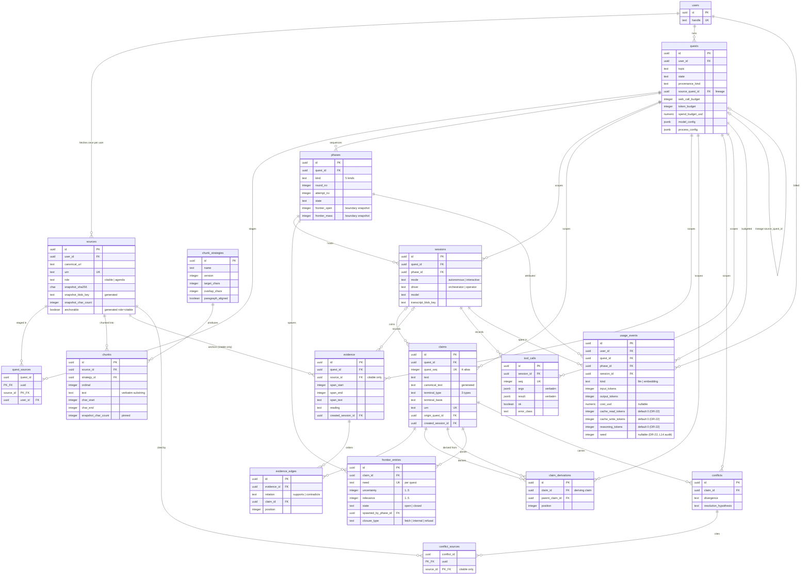

# I01 — core-model: DESIGN

Design document for kquest's core domain model. Everything later iterations
build on (cross-quest, retrieval, engine, tools, process, assurance, app)
consumes the entities, constraints, and placement decided here.

- Law: space BRIEF (§3 L1–L15, §4 D1–D10). Requirements owned: catalog §A
  R-001–R-018 (traceability in §11).
- Provenance: the PoC's proven schema
  (`20261110-knowledge-builder:repos/hermit-kb/quest/schemas/claim-graph-schema.json`)
  is the starting point — its field semantics are carried into DDL where
  schema-expressible and into the constraint catalog (§5) where not.
- Artifacts: `artifacts/schema.sql` (DDL + views), `artifacts/seed.sql`
  (self-verifying fixtures), `artifacts/canonical-queries.sql` (R-016),
  `artifacts/check-{ddl,constraints,coverage}.sh` (gates).
- Decision records: `DECISIONS.md` (DR-01…DR-21; DR-03 carries
  OPERATOR-RULING-NEEDED).

## 1. Scope and method

In scope: the entity/relationship set, schema-expressible constraints,
blob/row placement (D8), identity (URNs), tenancy posture (D6), the spend
ledger shape (D10), per-phase mass persistence (L4/I20), and executable
drafts of the four canonical queries (D2/R-016).

Out of scope (each with destination in §12): hub/merge/lineage semantics
beyond the R-011 provenance stamps (ENTRY 2), embedding registry and
chunk/embed pipeline mechanics (ENTRY 3 — the chunk/strategy ENTITIES are
here), session pause mechanics beyond the R-013 shape (ENTRY 4), tool-surface
behavior (ENTRY 5), phase transition law and stop rules (ENTRY 6),
verification machinery (ENTRY 7), anything application-shaped (ENTRY 8).

Method: every PoC schema element was mapped (§5.2 carry-over table); new
entities beyond the PoC (users, sources-with-roles, quest corpus membership,
phases, sessions, tool_calls, usage ledger, chunk strategies, blob keys,
provenance fields) were designed fresh against D1–D10 and the catalog. Every
law claim made in this document is either (a) enforced by a named constraint
in `schema.sql` (proven by `check-constraints.sh`), or (b) recorded in the
constraint catalog (§5) with its enforcement point and destination artifact.

## 2. Model overview

Sixteen domain tables and one config table, in five groups:

1. **Tenancy**: `users`; every domain row carries `user_id` (R-001 law,
   DR-01).
2. **Corpus** (shared per user, D3): `sources` (immutable snapshots in
   object storage; roles `citable`/`agenda`), `quest_sources` (a quest's
   staged corpus), `chunk_strategies` (config), `chunks` (derived, L10).
3. **Graph** (quest-scoped, D3 hermetic build unit): `claims`,
   `evidence`, `evidence_edges` (supports/contradicts), `claim_derivations`
   (derives_from), `frontier_entries`, `conflicts` + `conflict_sources`.
4. **Process**: `quests` (topic, state, budgets, model/process config,
   provenance), `phases` (kind/round/attempt, boundary mass snapshots).
5. **Audit/economics**: `sessions` (L13 modes, transcript blob),
   `tool_calls` (L8 verbatim), `usage_events` (D10 ledger).

Plus `chunk_strategies`, the one config table (R-005).

### 2.1 ERD

## 3. Entity specifications

Notation: constraints are named as they appear in `schema.sql`
(`ck_` CHECK, `fk_` foreign key, `uq_` unique) so every claim here is
checkable against `check-constraints.sh` output. All timestamps are
`timestamptz`. All ids are `uuid` (DR-15).

### 3.1 users — tenant root (R-001, D6)

| column | type | law |
|---|---|---|
| id | uuid PK | |
| handle | text | `ck_users_handle` `^[a-z0-9][a-z0-9_-]{1,31}$`, `uq_users_handle` |
| display_name | text nullable | |
| created_at | timestamptz | |

`handle` is the login-facing name; `id` is the tenancy key every domain row
carries. No visibility/scoping columns live here — access/visibility is an
additive layer (R-025, ENTRY 2), never baked scoping.

### 3.2 sources — fetched corpus units (R-002, R-003, D3, D6, D8)

| column | type | law |
|---|---|---|
| id | uuid PK | |
| user_id | uuid | `fk_sources_user` |
| url | text | `ck_sources_url` `^https?://` — the URL as fetched |
| canonical_url | text | `ck_sources_canonical_url` — DR-03 canonical form |
| urn | text | `ck_sources_urn_format` `^kb:src:[1-9A-HJ-NP-Za-km-z]{10}$`; `uq_sources_user_urn` — one row per (user, snapshot), D3 fetch-once per user |
| title | text | `ck_sources_title_nonempty` |
| role | text | `ck_sources_role` ∈ {citable, agenda} |
| published_at | timestamptz nullable | what the page claims |
| fetched_at | timestamptz | fetch completion time (DR-21) |
| snapshot_sha256 | char(64) | `ck_sources_snapshot_sha` lowercase hex |
| raw_sha256 | char(64) | `ck_sources_raw_sha` — raw HTTP response envelope |
| snapshot_blob_key | text GENERATED | `'blobs/sha256/<2>/<64>'` from snapshot_sha256 (DR-04) |
| raw_blob_key | text GENERATED | same template from raw_sha256 |
| snapshot_char_count | integer | `ck_sources_snapshot_chars` > 0 — the anchor bound (DR-08) |
| anchorable | boolean GENERATED | `role = 'citable'` — the citable discriminator (DR-07) |

Extra FK-target unique keys (DR-01/DR-07/DR-08): `uq_sources_id_user`,
`uq_sources_id_user_anchorable`, `uq_sources_id_user_anchorable_chars`.

Placement: this row is PG; the snapshot and raw bodies are object-storage
blobs (D8), addressed by the generated keys. **The snapshot blob is the
anchoring target of L1** — chunks and evidence spans carry char offsets into
THIS text, never into a chunk.

Role semantics (R-003): `agenda` sources are readable, chunkable, and
retrievable — and never anchorable or citable: `evidence` and
`conflict_sources` reference sources through a conditional FK that only
matches `anchorable = true` rows (DR-07), and the decompose gate view
(`v_unmined_sources`) filters `role = 'citable'` — both natively in schema,
no driver surgery (the C43 lesson, bitten twice).

Role mutability: a citable→agenda flip after evidence exists is refused
tool-time (the conditional FK would orphan existing evidence); catalog row
L1-note, enforcement at the graph ops layer (ENTRY 5).

### 3.3 quests — hermetic build units (R-011, D3, D5/L13)

| column | type | law |
|---|---|---|
| id | uuid PK | |
| user_id | uuid | `fk_quests_user`; `uq_quests_id_user` FK target |
| topic | text | `ck_quests_topic_nonempty` |
| state | text | `ck_quests_state` ∈ {active, paused, complete, stopped, archived} — `paused` is the D5 interactive-pause door |
| provenance_kind | text | `ck_quests_provenance` ∈ {fresh, from_corpus, graph_graft} |
| source_quest_id | uuid nullable | `fk_quests_source_quest` composite (same-user lineage); `ck_quests_provenance_pair` ties it to kind |
| web_call_budget | integer | `ck_quests_web_budget` ≥ 0 |
| token_budget | integer | `ck_quests_token_budget` ≥ 0 |
| spend_budget_usd | numeric(12,4) | `ck_quests_spend_budget` ≥ 0 |
| model_config | jsonb | per-phase-kind routing map (contents shaped by ENTRY 6, R-061) |
| process_config | jsonb | stop-rule/metabolism overlay (R-018 carrier; ENTRY 6 reads it) |
| created_at | timestamptz | |

Claims/evidence/edges/frontier/conflicts carry `quest_id` (D3: the quest is
the hermetic build unit; cross-quest reads work pre-merge, the hub is
ENTRY 2). Lineage stamps exist here for ENTRY 2 to build on; this iteration
only guarantees they are coherent (same-user, paired with kind).

### 3.4 quest_sources — quest corpus membership (DR-18, discovered mid-design)

PK `(quest_id, source_id)`; `user_id` coherence pinned by composite FKs to
both parents. Sources are fetched once **per user** (D3/D6), so a quest's
corpus must be an explicit set: staged seeds, agenda docs (R-062), fetches
made for the quest, and `from_corpus` inheritance (R-021) all write rows
here. The decompose gate reads this table (see `v_unmined_sources`).

### 3.5 chunk_strategies — chunking config rows (R-005)

`(name, version)` unique; `target_chars > 0`, `0 ≤ overlap_chars <
target_chars` (`ck_chunk_strategies_overlap_lt_target`), `paragraph_aligned`
flag. Re-chunking = a new version row + new chunk rows; old chunks are
retained in place (never deleted) — both generations coexist (demonstrated
in the seed: `para-800` v1 and `para-400` v1 over the same source).

Config-table posture (DR-01 scope note): `chunk_strategies` rows are global
registry/config, not tenant domain rows — they carry no `user_id`. The same
posture applies to the embedding registry in ENTRY 3.

### 3.6 chunks — verbatim substrings of the snapshot (R-004, L1, L10)

`(source_id, strategy_id, ordinal)` unique. `char_start`/`char_end` are
0-based half-open **character** offsets into the snapshot blob text
(`ck_chunks_start`, `ck_chunks_offsets`); bounds and length coherence are
write-time schema law: `ck_chunks_span_bounded` (`char_end ≤
snapshot_char_count`) and `ck_chunks_len_coherent` (`char_length(text) =
char_end − char_start`). `snapshot_char_count` is a pinned copy of the
source's value — the composite FK `fk_chunks_source` makes drift impossible
(DR-08). `source_anchorable` mirrors the source role (agenda sources ARE
chunkable — the mirror participates in the same conditional FK, unconstrained
in value). Exact-substring proof against blob bytes is tool-time (§5, L1
row); chunks are derivable from (blob, strategy) and rebuildable (L10).

### 3.7 claims — K-nodes (R-006)

| column | type | law |
|---|---|---|
| id | uuid PK | |
| user_id / quest_id | uuid | composite FKs (DR-01) |
| quest_seq | integer | `ck_claims_seq` ≥ 1; `uq_claims_quest_seq` — the K-alias ordinal (DR-15), assigned tool-time |
| text | text | `ck_claims_text_nonempty` (ASCII-trim nonempty) |
| canonical_text | text GENERATED | NFC + collapse ASCII-whitespace runs + ASCII strip — the PoC normalization, schema-enforced (DR-05) |
| terminal_type | text nullable | `ck_claims_terminal_type` ∈ {definitional-mathematical, primary-empirical, residual-uncertainty} |
| terminal_basis | text nullable | `ck_claims_terminal_pair` (iff type), `ck_claims_terminal_basis_nonempty` |
| urn | text | `ck_claims_urn_format`; `uq_claims_quest_urn`; minted per DR-06 |
| origin_quest_id | uuid nullable | `fk_claims_origin_quest` (same-user); non-NULL ⇒ grafted (R-021 stamp; semantics ENTRY 2) |
| created_session_id | uuid nullable | `fk_claims_created_session` (same quest) — the session half of the return address |

The PoC's `unique_per_label` becomes `uq_claims_quest_canonical` on the
generated canonical text: raw-text variants (extra spaces, wrapped lines)
collapse and collide — refusal at write time, not review. Extension door
(R-006, I21 seed): effect-size/SE fields on evidence and a pooled-estimate
terminal type are additive (nullable columns + one enum value); deferred to
ENTRY 7 where the verification machinery that consumes them lives.

### 3.8 evidence — E-nodes, verbatim spans (R-007, L1)

| column | type | law |
|---|---|---|
| id / user_id / quest_id | uuid | composite FKs |
| source_id | uuid | `fk_evidence_source` — **conditional FK** over (id, user_id, anchorable, snapshot_char_count) |
| source_anchorable | boolean | `ck_evidence_citable` forces TRUE — the R-003 anchorable-only law |
| snapshot_char_count | integer | pinned copy (DR-08) |
| span_start / span_end | integer | `ck_evidence_span_start` ≥ 0; `ck_evidence_span_order` end > start |
| span_text | text | `ck_evidence_span_nonempty`; `ck_evidence_span_len` = end − start |
| reading | text | `ck_evidence_reading_nonempty` — what the span says |
| created_session_id | uuid nullable | same-quest session |

Span semantics: `span_start`/`span_end` are 0-based half-open character
offsets **into the snapshot blob**, never into a chunk (the offsets law).
Schema proves the span is bounded, ordered, and length-coherent;
byte-exactness against blob bytes is proven at write time by the tool layer
(storage seam reads the blob and compares — the primary L1 enforcement
point, §5). `uq_evidence_quest_span` refuses re-anchoring an identical span
in the same quest: near-duplicates ATTACH edges, never clone rows (PoC
duplicate-span refusal class). Single-line vs multi-line spans are tool
policy, not schema (ENTRY 5, R-055 refusal-locates).

### 3.9 evidence_edges — supports / contradicts (R-008)

One row per ordered edge: `(evidence_id, relation, position)` unique
(`uq_evidence_edges_positions`), `relation ∈ {supports, contradicts}`
(`ck_evidence_edges_relation`). Both endpoints are pinned to the same quest
by composite FKs (`fk_evidence_edges_evidence`, `fk_evidence_edges_claim`) —
cross-quest edges are structurally impossible (probe C09). Ordering mirrors
the PoC `edge_out` arrays; positions are assigned by the fused creation op
(ENTRY 5). The PoC `edge_min` (≥1 support/contradicts per evidence) is
tool-time: the fused `node_add` for evidence creates node + edges
atomically and refuses edge-less evidence (L5, §5).

### 3.10 claim_derivations — derives_from (R-008, L2)

`(claim_id, parent_claim_id, position)`; `claim_id` is the deriving claim;
`uq_claim_derivations_positions` keeps the ordered list dense;
`ck_claim_derivations_no_self` refuses self-loops; both endpoints same-quest
by composite FKs. The PoC `exclude [["terminal","derives_from"]]` (a claim
must not have BOTH a terminal and derivations) is cross-table — tool-time
refusal + phase-gate sweep (DR-09, §5).

### 3.11 frontier_entries — the scored work queue (R-009, L4, L15)

| column | type | law |
|---|---|---|
| claim_id | uuid | `fk_frontier_claim` (same quest) — the posed claim |
| need | text | `ck_frontier_need_nonempty`; `uq_frontier_need` per quest — the distinct-needs law (duplicate need strings corrupt mass ranking; arc-run-20261121T §1 class f/(i)) |
| uncertainty / relevance | integer | `ck_frontier_uncertainty` / `ck_frontier_relevance`, 1..5 each (PoC range) |
| state | text | `ck_frontier_state` ∈ {open, closed}; closed rows RETAINED (history) |
| spawned_by_phase_id | uuid | `fk_frontier_spawned_phase` — which phase instance posed it |
| closed_at / closure_type | nullable | `ck_frontier_closure_pair`: closed ⇒ both present; closure_type ∈ {fetch, internal, refusal} |
| opened_at | timestamptz | |

Mass = `uncertainty × relevance` (integers; Σ per quest in `v_frontier_mass`).
Per-phase persistence (I20 shadow instrumentation made structural):
`phases.frontier_open` + `phases.frontier_mass` snapshot the boundary values
— history retained because phase rows are never deleted; the transition law
(ENTRY 6) reads them (DR-10). `uq_frontier_open_per_claim` (partial unique
index, `WHERE state = 'open'`) refuses re-posing a currently-open claim —
the PoC class-f storm, killed structurally; closed history does not block
future re-entry rounds. Ordering law: `v_frontier_open` implements the PoC
order `uncertainty*relevance DESC, claim ASC` (claim = `quest_seq`), with
entry id as final tiebreak; the listing index
`idx_frontier_open_order` covers its leading keys (quest_id, u×r DESC);
the `quest_seq`/id tiebreaks resolve in the view's small per-quest sort
(prefix-matching index, not a full match — the third index key is
`claim_id`, a random uuid). Listing caps are applied by callers
(ENTRY 5) — ordering is owned by the schema layer (L15).

### 3.12 conflicts + conflict_sources (R-010)

`conflicts`: `claim_id` (same quest), `divergence` (nonempty — what the
disagreement is), `resolution_hypothesis` (nullable, nonempty when present),
`created_session_id`. `conflict_sources`: PK `(conflict_id, source_id)` —
distinctness by construction of the key; agenda sources refused via the
citable-only conditional FK (R-003 "never … citable"). The ≥2-sources floor
is enforced tool-time by the conflict-detection routine that constructs
rows (it cannot arise from model authoring — conflicts are detector-owned);
adjudication workflow is ENTRY 7 (R-068). (DR-17.)

### 3.13 phases — process steps (R-012)

`kind ∈ {decompose, frontier-build, descent, synthesis, verification}`
(`ck_phases_kind` — the ENTRY 6 phase set, frozen here so the model and the
process share one vocabulary); `round_no` counts re-entries (L4's re-entry
transition law); `attempt_no` counts wall/retry attempts;
`UNIQUE (quest_id, kind, round_no, attempt_no)`; `state ∈ {pending,
running, complete, failed}`; `started_at`/`ended_at` ordered
(`ck_phases_times`); `wall_timeout_s` (config; elapsed wall is derived from
timestamps, L10); `result` jsonb (phase deliverables; shape owned by
ENTRY 6 phase contracts R-063); `frontier_open`/`frontier_mass` boundary
snapshots — `ck_phases_mass_pair` keeps them paired,
`ck_phases_snapshots_only_after_start` keeps them boundary-only.

### 3.14 sessions — agent runs (R-013, L7, L13, D5)

`mode ∈ {autonomous, interactive}` and `driver ∈ {orchestrator, operator}`
(L13: same tools, same constraints, same audit either way);
`model` (the model actually served); `transcript_blob_key`
(`sessions/<uuid>/transcript.jsonl`, object storage — the verbatim session
log); `phase_id NOT NULL` so the D10 chain session→phase→quest→user is
total (DR-13 — initiation work runs as decompose round 1). Pause semantics,
one-active-writer-per-quest, and cold-boot mechanics are ENTRY 4 (R-043);
the schema carries the door (`quests.state = 'paused'`) and the durable
state every reconstruction reads (L7). A partial unique "one unfinished
session per quest" was considered and rejected — killed sessions leave
unfinished rows until reaped, which would block cold-boot restarts (DR-12).

### 3.15 tool_calls — verbatim audit (R-013, L8)

One row per tool call: `(session_id, seq)` unique; `tool`, `op`; `args` and
`result` jsonb NOT NULL **verbatim** (refusals included — the PoC refusal
census ran on exactly this shape); `ok` + `error_class` shape-checked
(`ck_tool_calls_error_shape`). Quest coherence via `fk_tool_calls_session`
(probe C15). The wrapper writes the row in the same transaction as the
mutation (ENTRY 5 tool harness); tripwire predicates (ENTRY 7, R-069) run
over this table.

### 3.16 usage_events — the spend ledger (R-014, D10)

One row per LLM/embedding API call (DR-14): `kind ∈ {llm, embedding}`,
`model`, `input_tokens`/`output_tokens` ≥ 0, `cost_usd` numeric(12,6)
nullable (NULL = local/free — seeded example present). **AMENDED
2026-11-22 (DR-22, I04 DR-12, operator-ruled):** four additive
columns — `cache_read_tokens`/`cache_write_tokens`/`reasoning_tokens`
(integer NOT NULL DEFAULT 0, CHECK ≥ 0) and `seed` (integer NULL,
CHECK ≥ 0) — recording what the provider actually returns (providers
differ in which keys they return; absent keys stay default) and the
served seed per call (L14 audit). The chain
session→phase→quest→user is total and pinned: `fk_usage_session` requires
the session to belong to the row's phase, `fk_usage_phase` the phase to the
quest, `fk_usage_quest` the quest to the user (probe C22). Budget
enforcement (web calls AND token spend, L9) reads rollups over this table
plus `tool_calls` — used counters are derived, never stored (L10). Retries
and failed calls each record their own row (they cost tokens too).

### 3.17 Schema-owned query surface (L6, L15, R-003)

Five views, each the single definition its consumers share:

- **`v_unmined_sources`** — a quest's staged **citable** sources with no
  evidence anchored in that quest; **`v_decompose_remaining`** — the count.
  The decompose gate reads this; agenda exclusion lives in the SQL
  (R-003: excluded by schema, not surgery).
- **`v_frontier_open`** — the work queue in the principled order (L15).
- **`v_frontier_mass`** — Σ(u×r) and open count per quest (L4).
- **`v_claim_closure`** — per claim: has_terminal, terminal_type,
  derives_from_count, evidence_count, open_frontier_count, and `bare` (=
  closure violation). **L6 status parity:** the agent's status surface and
  the phase gate SELECT from this ONE view — there is no second validator;
  what the agent sees is exactly what the gate enforces. The mid-flight
  bare-claim signal the PoC lacked (2026-11-17 review Q2: 7 of 8 claims
  bare at kill, invisible in status) is one query over this view.

## 4. Identity: URNs and citations

- **Source URN (DR-02, frozen):** `kb:src:` + first 10 base58 chars of
  `sha256( utf8(canonical_url) || utf8(hex(sha256(snapshot_bytes))) )`.
  Same snapshot ⇒ same ID everywhere; changed page ⇒ new ID. Preimage
  ambiguity is impossible in practice because the suffix is fixed-length
  (64 hex chars); harmless anyway under SHA-256. The seed re-derives every
  URN through this exact algorithm in SQL (recursive-CTE base58, verified
  against a python reference) and fails the load on mismatch.
- **Claim URN (DR-06):** `kb:claim:` + first 10 base58 chars of
  `sha256( utf8(quest_uuid_string) || utf8(canonical_text) )` —
  quest-salted (D3: claims are quest-scoped pre-merge; two quests may hold
  the same canonical claim until the hub merge decides). Deterministic and
  cold-boot stable; the hub (ENTRY 2) re-addresses on merge.
- **Citations in prose (ENTRY 2, R-026):** local ordinals inline, a
  deterministic binding pass resolves ordinals → URNs at finalization; the
  model never transcribes hashes. The core model's obligation — globally
  merge-stable source identity — is discharged by DR-02.

## 5. Constraint catalog

### 5.1 The law L1–L15 → enforcement points

Each invariant maps to exactly one PRIMARY enforcement point; secondary
defense-in-depth noted after the artifact. This is the AC5 map.

| Law | Invariant | Primary enforcement point | Implementing artifact |
|---|---|---|---|
| L1 | Evidence spans quote the snapshot blob byte-exact; offsets law (chunks/spans anchor against the blob, never a chunk) | TOOL-TIME: storage seam reads the blob and proves `substring(blob, span) = span_text` before the write commits; refuses with nearest-fragment location | Graph ops spec ENTRY 5 (R-047 evidence_add, R-055 refusal-locates). Schema assists: `ck_evidence_span_*`, `ck_chunks_span_bounded`, `ck_chunks_len_coherent`, conditional FK pins `snapshot_char_count` (bounds half is write-time law). Seed self-verifies byte-exactness |
| L2 | Done = derivation paths reach typed terminals | PHASE-GATE: verification gate fails on `q1_l2_violations` (dangling derivation leaves with no open frontier) | `canonical-queries.sql` Q1/Q1V; gate wiring ENTRY 6 (R-063). Schema assists: typed-terminal CHECKs |
| L3 | Independence = citation ancestry | PHASE-GATE: verification/synthesis independence audit runs Q2 | `canonical-queries.sql` Q2; ENTRY 7 (R-067) samples; reports cite the pairs |
| L4 | Frontier as mass Σ(u×r); floors; re-entry transition law | PHASE-GATE: transition law reads `v_frontier_mass` and persisted `phases.frontier_mass` history | Views + phase snapshot columns here; transition table ENTRY 6 (R-056/R-059) |
| L5 | Mutation-time constraints, refusals-that-teach, fused atomic forms, dedup guard | TOOL-TIME: the graph ops layer refuses at the call and teaches | ENTRY 5 (R-047/R-048). Schema carries the dedup guard structurally: `uq_claims_quest_canonical`, `uq_evidence_quest_span`, `uq_frontier_need` |
| L6 | Closure contract (terminal ∨ derives_from ∨ open frontier; every closed claim named by ≥1 evidence); three-zeros; status shows exactly what the gate enforces | PHASE-GATE: three-zeros over `v_claim_closure`; the named-by-≥1-evidence arm is TOOL-TIME at fused evidence-edge creation (the atomic claim+evidence+edge form refuses evidence-free claims, ENTRY 5 R-047) with a PHASE-GATE sweep over `v_claim_closure.evidence_count = 0` as backstop | `v_claim_closure` is the ONE view both status and gate read — no asymmetric validator (§3.17); gate wiring ENTRY 6 (R-063); status op parity ENTRY 5 (R-051) |
| L7 | Cold-boot resumability | SCHEMA: every mutation is a committed transaction over durable rows; no in-memory-only state exists | This DDL (all ops transactional); cold-boot session mechanics + kill/reap rehearsal ENTRY 4 (R-043) |
| L8 | Transcript as audit log — every tool call verbatim | SCHEMA: `tool_calls` NOT NULL verbatim args/result, `(session_id, seq)` unique | This DDL; same-transaction write by the tool harness ENTRY 5; tripwire predicates over it ENTRY 7 (R-069) |
| L9 | Budgets as steering (web caps, phase walls, spend caps) | TOOL-TIME + PHASE-GATE: caps read from quests columns; walls/timeouts from phase config | `quests` budget columns here; enforcement points ENTRY 6 (R-059 stop-rule catalog) |
| L10 | Derived-ness: chunks from (blob, strategy); embeddings from (chunk, model); anything derivable rebuildable | SCHEMA: blob keys GENERATED from sha (DR-04); wall-clock derived from timestamps; usage counters derived from ledger | This DDL; re-chunk/re-embed jobs ENTRY 3 (R-031) |
| L11 | Reports are views; the graph is the asset | SCHEMA (posture): no report tables in the core model; reports are ENTRY 2 projections over this graph | ENTRY 2 (R-023) |
| L12 | Parallelism door stays open (frontier = partitionable scored queue) | SCHEMA: frontier entries are independent rows ordered by a score — the fan-out/reconcile shape composes on this | This DDL (`v_frontier_open`); parallel decompose/reconcile design ENTRY 4/ENTRY 6 |
| L13 | Autonomous/interactive same tools, constraints, audit; one active writer per quest | SCHEMA (modes): `sessions.mode`/`driver` recorded, no tool asymmetry | Pause + one-writer enforcement ENTRY 4 (R-043, D5) — schema partial-unique rejected in DR-12 because it conflicts with L7 cold-boot |
| L14 | Determinism awareness; dedup guard breaks replay loops | SCHEMA (dedup half): the canonical-text uniqueness IS the loop-breaker for replay storms | Seed/vary-seed policy ENTRY 4 (R-041) |
| L15 | No systematic blind spots: principled ordering + caps on every listing surface | SCHEMA (ordering): every view has a deterministic ORDER BY; caps applied by callers | Views here; listing caps + "never saw" metrics ENTRY 5 (R-047) / ENTRY 7 (R-071) |

### 5.2 PoC schema → kquest DDL carry-over

| PoC element (claim-graph-schema.json) | kquest home |
|---|---|
| `text.canonical {normalize: nfc, collapse_ascii_ws_runs, strip}` | `claims.canonical_text` GENERATED column, identical semantics (DR-05) |
| `unique_per_label` on canonical text | `uq_claims_quest_canonical` (quest scope per D3) |
| `terminal {type enum, basis nonempty}` | `terminal_type` CHECK enum + `ck_claims_terminal_pair`/`basis_nonempty` |
| `exclude [["terminal","derives_from"]]` | constraint catalog, tool-time + phase-gate (DR-09) — cross-table |
| `closure satisfy_one [terminal ∨ derives_from ∨ frontier_state=open]` | `v_claim_closure.bare` (gate + status share it) |
| `span substring_of corpus.snapshot_bytes` | offsets/bounds/length in schema; byte proof tool-time (L1 row) |
| `edge_min any_of supports/contradicts min 1` | tool-time fused creation op (L5) |
| edges `ordered` | `position` + unique positions on both edge tables |
| frontier `uncertainty/relevance 1..5`, `order u*r DESC, claim ASC` | CHECK ranges + `v_frontier_open` ordering + matching partial index |
| frontier `history: closed_entries_retained` | rows never deleted; closed state carries `closed_at`/`closure_type` |
| urn-stamped nodes | DR-02 (sources) / DR-06 (claims), minting verified in seed |
| corpus index as source of identity | `sources` + `quest_sources` (per-user sources, per-quest membership) |

## 6. Blob / row placement map (D8, R-015; AC7)

| Entity | PG rows | Object-storage blobs | Notes |
|---|---|---|---|
| users, quests, quest_sources, chunk_strategies | ✓ | — | |
| sources | ✓ (row = citation anchor) | snapshot blob (anchoring target) + raw response blob | keys GENERATED from sha256 (DR-04); unbounded content ⇒ blobs |
| chunks | ✓ | — | bounded by strategy (target_chars); text is a verbatim substring — offsets into the SNAPSHOT blob, per L1 |
| claims, evidence, evidence_edges, claim_derivations | ✓ | — | evidence spans carry offsets into the snapshot blob — never into a chunk |
| frontier_entries, conflicts, conflict_sources | ✓ | — | |
| phases | ✓ | — | result jsonb bounded by phase contract (ENTRY 6) |
| sessions | ✓ | transcript blob (`sessions/<uuid>/transcript.jsonl`) | full verbatim LLM session log |
| tool_calls | ✓ | — | args/result verbatim, size-capped at the tool layer (ENTRY 5 result-size caps; PoC Q8 result economy) |
| usage_events | ✓ | — | append-only ledger |
| report bodies (ENTRY 2) | metadata later | report blobs | placement decided now, tables later |

The offsets law, stated once: **`chunks.char_start/char_end` and
`evidence.span_start/span_end` are character offsets into the immutable
snapshot blob of the cited source.** No offset in this schema addresses a
chunk, a rendering, or anything mutable.

## 7. Tenancy and sharing posture (R-001, D6)

- Every domain row carries `user_id` NOT NULL; coherence is enforced by
  composite FKs to `(id, user_id)` unique keys on owners (DR-01). A
  cross-tenant citation is structurally impossible (probe C14).
- Sources are per-user; the content-addressed URN makes the same snapshot
  dedup to one row per user (fetch-once per user, D3) — cross-user sharing
  is a future access layer over the same rows (R-025, ENTRY 2), never a
  schema change.
- Quest lineage (from_corpus) is same-user by composite FK; cross-user
  graft is the sharing layer's problem, later.
- Config/registry rows (chunk_strategies now; embedding registry ENTRY 3)
  are global and carry no user_id (DR-01 scope note).

## 8. Canonical queries (R-016, D2)

Executable drafts in `artifacts/canonical-queries.sql`, each a recursive
CTE, each asserted non-empty against the seed:

1. **Q1 derivation paths to typed terminals (L2)** — walks `derives_from`
   transitively; positive half returns terminal-anchored paths; **Q1V**
   returns dangling-leaf violations (non-terminal, no derivations, no open
   frontier) — the query a phase gate fails on.
2. **Q2 citation-ancestry independence (L3)** — ancestry closure per claim
   (reflexive + derives_from), then evidence pairs sharing a source where
   one hangs off the other's claim-ancestry. Returns the audit agenda
   ("Morningstar and Fidelity both citing Bogle").
3. **Q3 neighborhood read (L15)** — bounded-radius (2), cycle-safe walk
   from a claim over the undirected graph (derivations both ways, evidence
   edges, frontier, sources), min-depth projection.
4. **Q4 dedup candidates via quest lineage (L5)** — for each claim in a
   quest, exact canonical-text matches among claims of ANCESTOR quests.
   ENTRY 3 (R-036) extends candidate generation with embedding near-dup;
   this structural seed stays the pre-embedding floor.

Cross-consistency assertions ride along: Q1V must be 0 on a healthy graph,
and persisted phase mass snapshots must equal live `v_frontier_mass`.

The named-query-object wrapper (storage seam, D2) is application shape —
ENTRY 8; the SQL here is the contract those objects run.

## 9. Metabolism constants (R-018)

Measured PoC economics (reference-claim-graph-mechanics §5), carried as
CONFIG DEFAULTS — never hard-coded behavior — via `quests.process_config`
overrides with the defaults below (documented values, consumed by ENTRY 6
stop rules/budgets; DR-20):

| constant | default | provenance |
|---|---|---|
| EVIDENCE_PER_SOURCE | 5.0 (4.6–5.1) | PoC extraction equilibrium |
| CLAIMS_PER_SOURCE | 2.7 (2.6–2.75) | PoC extraction equilibrium |
| EVIDENCE_TO_CLAIMS | 2.0 (≈2:1) | two corroborating spans per claim |
| FRONTIER_SEEDS_PER_SOURCE | 0.9 (0.8–1.0) | PoC decompose |
| SOURCES_PER_DECOMPOSE_PHASE | 3.5 (3–4) | PoC session/context economy |
| WEB_CALLS_PER_FETCH_CLOSURE | 6.11 | PoC descent closures |
| WEB_CALLS_PER_INTERNAL_CLOSURE | 1.21 | PoC descent closures |
| FRONTIER_FLOOR_MASS | 200 (0 = off) | muse-20261122T (I20 obverse) |
| FRONTIER_BUILD_MAX_ROUNDS | 3 | muse-20261122T build ruling |

## 10. Prior art and positioning

- **Nanopublications** (Mons et al.): assertion + provenance + publication
  info as machine-checkable triples — kquest's claim/evidence/session chain
  is the same shape with verbatim anchors instead of trust in curators.
- **Argumentation** (Toulmin; Dung): claim/grounds/warrant/rebuttal maps to
  claim/evidence/derives_from/conflict+residual; Dung's admissibility is
  the eventual semantics for the conflict ledger (ENTRY 7).
- **DARPA AIDA hypothesis graphs**: typed edges with strong provenance
  chains over documents; the closest engineering precedent for
  evidence-anchored multi-document graphs.
- **Wikidata statement ranking**: preferred/normal/deprecated ranks are the
  reference for the hub's canonical-claim merge semantics (ENTRY 2).
- Positioning (BRIEF §8): a systematic-review engine with argument-level
  synthesis — Cochrane's methodology at software marginal cost.

## 11. Traceability — R-001–R-018 (machine-checked by check-coverage.sh)

| R-item | Status | Carried by | Destination |
|---|---|---|---|
| R-001 | DESIGNED | §3.1, §7, DR-01 (user_id law + composite FKs; probe C14) | — |
| R-002 | DESIGNED | §3.2 sources + §4 URNs; DR-02/DR-03/DR-04 | — |
| R-003 | DESIGNED | §3.2 role semantics, conditional FK (DR-07), `v_unmined_sources` (probes C02/C24) | — |
| R-004 | DESIGNED | §3.6 chunks (offsets law, bounds, length coherence) | — |
| R-005 | DESIGNED | §3.5 chunk_strategies; seed demonstrates coexisting generations | — |
| R-006 | DESIGNED | §3.7 claims (canonical_text, terminals, urn, origin); DR-05/DR-06 | effect-size/SE door → ENTRY 7 |
| R-007 | DESIGNED | §3.8 evidence (span semantics; probe C03/C04/C21) | — |
| R-008 | DESIGNED | §3.9/§3.10 edges + derivations (DR-16; probes C09/C10/C11/C23) | — |
| R-009 | DESIGNED | §3.11 frontier (mass, history, closure types, distinct-needs, per-phase persistence; DR-10/DR-11) | — |
| R-010 | DESIGNED | §3.12 conflicts (junction, citable-only, ≥2 floor tool-time; DR-17) | — |
| R-011 | DESIGNED | §3.3 quests (state, budgets, provenance, model/process config) | routing map contents → ENTRY 6 |
| R-012 | DESIGNED | §3.13 phases (kinds, rounds, attempts, walls, boundary snapshots) | — |
| R-013 | DESIGNED | §3.14/§3.15 sessions + tool_calls (L8 verbatim; DR-13) | pause/cold-boot mechanics → ENTRY 4 |
| R-014 | DESIGNED | §3.16 usage_events (D10 chain pinned; DR-14; DR-22 provider-token detail + seed columns, amended 2026-11-22) | — |
| R-015 | DESIGNED | §6 placement map (D8) | — |
| R-016 | DESIGNED | §8 + artifacts/canonical-queries.sql (four recursive CTEs, non-empty asserted) | storage-seam wrapper → ENTRY 8 |
| R-017 | DESIGNED | artifacts/schema.sql (runs clean on scratch PG 18 + pgvector) | — |
| R-018 | DESIGNED | §9 metabolism constants + process_config carrier (DR-20) | enforcement → ENTRY 6 |

## 12. Deferrals and handoffs

| Concern | Destination |
|---|---|
| Canonical hub, merge workflow, exactMatch propose/approve, reversibility | ENTRY 2 (R-019, R-020) |
| Quest lineage semantics beyond provenance stamps; archive immutability | ENTRY 2 (R-021, R-022) |
| Report versioning, citation binding pass, cross-quest provenance in reports | ENTRY 2 (R-023, R-026, R-027) |
| Sharing/visibility access layer (workspaces, public doors) | ENTRY 2 (R-025) |
| Embedding registry, per-model pgvector tables, hybrid search, pipeline jobs | ENTRY 3 (R-028–R-037); schema leaves the door open (no conflicting objects) |
| Session pause, one-writer enforcement, cold-boot rehearsal, seed policy | ENTRY 4 (R-039–R-043) |
| Graph/corpus/web/report tool ops, fused atomic forms, refusal texts, listing caps | ENTRY 5 (R-047–R-055) |
| Phase transition table, stop-rule catalog, phase contracts, model routing map | ENTRY 6 (R-056–R-065) |
| Verification machinery, conflict adjudication, tripwires, metrics, qualification ladder | ENTRY 7 (R-066–R-072) |
| Storage seam + named query objects, job topology, SSE, UI, deployment | ENTRY 8 (R-073–R-081) |
