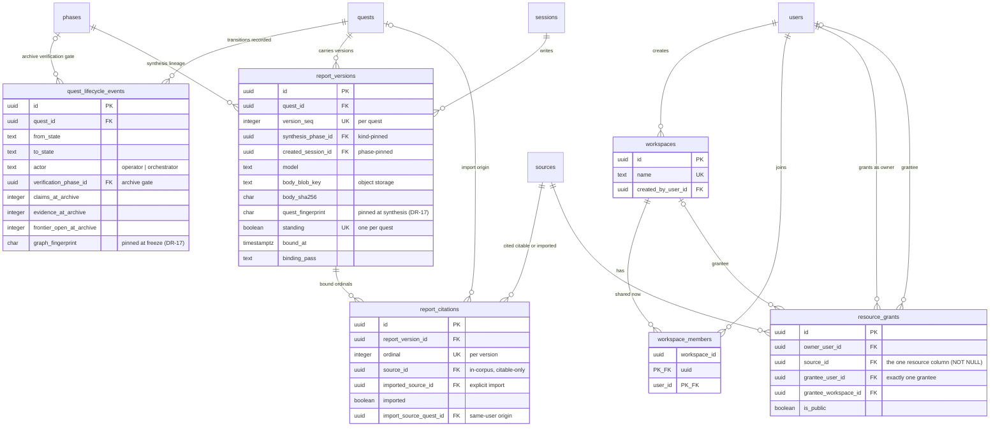

# I02 — cross-quest: DESIGN

Design document for everything that crosses quest boundaries: the canonical
hub VIEW and its exact-text reuse lookup, quest lineage and lifecycle, report
versioning with re-synthesis and stale-artifact hygiene, the sharing/
visibility access layer, and the citation-binding pass.

Amended 2026-11-22 per the operator rulings (ratification note
`notes/ratification-20261122T1550-cross-quest.md`): the hub is DEMOTED TO A
DERIVED VIEW (canonical_claims + merge_events tables and the approval
workflow are excised — DR-16), and archive-immutability is REPLACED by the
GRAPH FINGERPRINT mechanism (DR-17) — staleness is detected, not prevented.

- Law: space BRIEF (§3 L11 reports-are-views, L4/L12 frontier semantics
  consumed as frozen; §4 D3 shared sources + quest-scoped graphs + canonical
  hub, D6 multi-user with sharing as an additive access layer, D8 blob
  placement).
- Requirements owned: catalog §B R-019–R-027 (traceability in §11).
- Consumed as FROZEN law (read-only): ENTRY 1 design
  (`design/I01-core-model/`) — `v_claim_closure`, `v_frontier_mass`,
  `quest_sources`, `quests.provenance_kind`/`source_quest_id`,
  `claims.origin_quest_id`, DR-06 (quest-salted claim URNs — permanent;
  under the view hub no re-addressing ever occurs), DR-18 (quest corpus
  membership). I01 is byte-identical after this run (check-coverage
  verifies; AC7).
- Artifacts: `artifacts/schema-i02.sql` (additive DDL + 3 ALTER-unique-keys,
  DR-15 as amended), `artifacts/seed-i02.sql` (fixtures + self-verification),
  `artifacts/queries-i02.sql` (four canonical query families + binding-pass
  algorithm), `artifacts/check-{ddl,constraints,coverage}.sh` (gates).
- Decision records: `DECISIONS.md` (DR-01…DR-17; DR-01…DR-07 superseded by
  DR-16/DR-17 per the operator ruling of 2026-11-22).

## 1. Scope and method

In scope: the canonical hub view `v_canonical_claims` (identity, exact-text
reuse lookup, type-divergence surfacing), quest lineage semantics for the
I01 provenance stamps (from_corpus inheritance, graph graft, drained
continuations), the quest lifecycle state machine with archive gates and
GRAPH FINGERPRINTS (rework-in-place is legal; drift is a visible tripwire),
report versioning + re-synthesis + standing pointer + stale hygiene, the
visibility/access layer (workspaces, user grants, public door), and the
citation-binding pass with explicit import marking.

Out of scope, with destinations (§12): embedding-backed near-dup candidates
beyond the designated slot (ENTRY 3, R-036), agent/tool mechanics for any law
listed tool-time (ENTRY 4/5), phase transition law and stop rules including
the archive op's process home (ENTRY 6), verification/audit machinery
(ENTRY 7), application shape — UIs for hub review, workspace admin, report
rendering (ENTRY 8).

Method: every law this document states is either (a) enforced by a NAMED
constraint in `schema-i02.sql` (proven by `check-constraints.sh` — 28 probes
plus a positive control), or (b) a row in the constraint-catalog extension
(§10) with one named enforcement point and a destination artifact. Fixture
claims are proven by `check-ddl.sh` (37 seed-contract minimums) and
`queries-i02.sql` (11 non-empty + 9 zero assertions).

## 2. Model overview

Six new tables, four new views, three additive unique keys on frozen I01
tables (DR-15 as amended). Four groups:

1. **Canonical view** (D3, DR-16): `v_canonical_claims` — the hub as a
   DERIVED view over quest claims. No hub tables, no merge workflow, no
   approval state: identity = (user_id, canonical_text, terminal_type);
   nothing is adopted, nothing refused.
2. **Lifecycle** (R-022): `quest_lifecycle_events` — the audited quest state
   machine; archive rows carry the verification gate, the graph counts at
   freeze, and the pinned graph fingerprint (DR-17).
3. **Product** (L11, R-023/R-024/R-026/R-027): `report_versions` (the version
   chain about report bodies; bodies are object-storage blobs, D8; each
   version pins the quest fingerprint it was synthesized against),
   `report_citations` (the binding-pass output; in-corpus + explicit-import
   citation rows).
4. **Access** (D6, R-025): `workspaces`, `workspace_members`,
   `resource_grants` (one mechanism: sources now; reports/quests later as
   additive kinds; the canonical-claim kind is deferred with the
   materialized hub, DR-16).

Views: `v_canonical_claims` (the hub — derived, identity + members + the
type-divergence flag), `v_quest_graph_fingerprint` (the graph+corpus
fingerprint per quest, DR-17), `v_quest_lineage` (ancestor chain with
per-hop provenance labels), `v_resource_visibility` (effective scope per
shared resource).

Cross-quest reads work directly on quest-scoped rows by design (D3): every
query family in `queries-i02.sql` reads quest-scoped rows directly; the hub
view is a derived index over them, never a gate — and never a store (L10:
no derived data to invalidate).

### 2.1 ERD (new entities; I01 entities cited where related)

(The hub is not an ERD entity: `v_canonical_claims` is a DERIVED view over
`claims` — no table, no lifecycle, no relationships of its own. Membership
is computed, never stored.)

## 3. Entity specifications

Notation as I01: constraints named as they appear in `schema-i02.sql`, so
every claim here is checkable against `check-constraints.sh` output.

### 3.1 v_canonical_claims — the hub as a derived view (R-019/R-020, D3, D6, DR-16)

One view over `claims`; no table, no stored state (L10: nothing derived to
invalidate). Identity = **(user_id, canonical_text, terminal_type)** — the
operator's DR-06 ruling: exact-text matches with differing terminal types
COEXIST as distinct hub entries; nothing is adopted, nothing refused.

| column | type | derivation |
|---|---|---|
| user_id | uuid | the owner whose claims derive the entry |
| canonical_text | text | claims.canonical_text — the I01 DR-05 GENERATED normalization (NFC + ASCII-whitespace collapse + strip), so the derivation is exactMatch on the normalized form with NO second normalizer to drift (DR-02 = A, ruled) |
| terminal_type | text | the entry's typed axis, NULL = unterminated occurrences; grouping key alongside (user_id, canonical_text) |
| member_claim_ids | uuid[] | `array_agg(id ORDER BY quest_id, id)` — the computed membership (deterministic order) |
| quest_count | integer | `count(DISTINCT quest_id)` — how many quests hold this text/type |
| first_seen / latest_seen | timestamptz | min/max member created_at — informational, NOT part of identity |
| type_divergent | boolean | TRUE iff the (user_id, canonical_text) carries MORE THAN ONE distinct NON-NULL terminal_type — computable in the same view via `count(*) FILTER (WHERE terminal_type IS NOT NULL) OVER (PARTITION BY user_id, canonical_text) > 1` |

Semantics the fixtures prove (seed-i02 self-verification + M1):

- **Coverage**: every claim lands in exactly one hub entry — nothing is
  adopted, nothing refused, nothing lost.
- **Coexistence**: same text + differing types = sibling entries (k8
  primary-empirical vs d4 residual-uncertainty on the plateau text).
- **Divergence flag**: an unterminated claim (terminal_type NULL) is its own
  entry value and is NOT by itself divergence — conflicting TYPES are the
  ENTRY 7 tripwire signal (catalog H-DIV), adjudicated in the source quest
  (the hub is derived; it holds no state to fix).

Growth path (DR-16): materialize identity as a TABLE when ENTRY 3 embeddings
make near-dup real; the unsalted `kb:cclaim:` content-hash URN algorithm
(DR-03, superseded) is preserved in DECISIONS history for that era. The
canonical-claim grant kind (§8) returns with it.

### 3.2 quest_lifecycle_events — the audited state machine (R-022)

| column | type | law |
|---|---|---|
| from_state / to_state | text | `ck_quest_lifecycle_transition` — the legal pair set (below); both in the I01 `ck_quests_state` vocabulary |
| actor | text | `ck_qle_actor` ∈ {operator, orchestrator} — L13 parity: state changes record who drove them |
| verification_phase_id + kind/state literals | uuid + text | `ck_quest_lifecycle_archive_pair` (archive ⇔ phase present) + `fk_quest_lifecycle_verification` — the phase must be kind='verification' AND state='complete' (literals pinned by `ck_qle_verification_kind`/`_state` and the composite FK; DR-09) |
| claims/evidence/frontier_open_at_archive | integer | `ck_quest_lifecycle_archive_counts_pair` (archive ⇔ all three present) + nonneg CHECKs — the counts at freeze (historical recording; drift after freeze is LEGAL and detected via the fingerprint, DR-17) |
| graph_fingerprint | char(64) | `ck_quest_lifecycle_archive_fingerprint_pair` (archive ⇔ present) + `ck_qle_graph_fingerprint_format` — the graph+corpus fingerprint AT FREEZE (algorithm §6; DR-17) |
| occurred_at / note | | |

The legal transitions (the DESIGN §6 state diagram as a named CHECK):

| from | to | meaning |
|---|---|---|
| active | paused | interactive pause door (D5) |
| paused | active | resume |
| active/paused | complete | verification passed (never-reportless finisher honored, ENTRY 6) |
| active/paused | stopped | stop-rule/budget stop |
| stopped | active | phase-cap restart precedent (llm-trading v4) |
| complete/stopped | archived | the freeze (once-only: `uq_quest_lifecycle_archive_once`) |

Illegal by omission: complete→active (continuations are NEW quests, R-022 —
a LEDGER law that survives the fingerprint amendment), archived→anything
(as a recorded transition; the quest COLUMN is not an immutability gate —
see §6), active→archived (verification gate).

The ledger records transitions; keeping `quests.state` in sync is the
lifecycle op's job (catalog §10 Q-SYNC, ENTRY 6).

### 3.3 report_versions — the version chain about views (R-023, L11, D8)

| column | type | law |
|---|---|---|
| quest_id / version_seq | | `uq_report_versions_quest_seq` — dense chain per quest |
| synthesis_phase_id + kind literal | | `fk_report_versions_phase` over (id, quest_id, kind): the phase MUST be a synthesis phase — "report version without graph lineage" is structurally impossible |
| created_session_id | | `fk_report_versions_session` over (session, phase): the writer session ran in THAT synthesis phase |
| model | text | which model wrote this version — re-synthesis economics (R-061 consumes) |
| body_blob_key | text | `ck_report_versions_body_key` `^reports/<quest-uuid>/v<n>\.md$` — body in object storage (D8) |
| body_sha256 | char(64) | content hash of the blob (the storage seam proves equality, catalog §10 R-BODY) |
| quest_fingerprint | char(64) NOT NULL | `ck_report_versions_quest_fingerprint` hex64 — the graph fingerprint AT SYNTHESIS TIME (DR-17); a version whose pin ≠ the live fingerprint is STALE (M3's inventory) |
| standing | boolean | `uq_report_versions_one_standing` (partial unique): the standing-artifact pointer — at most one per quest |
| bound_at / binding_pass | | `ck_report_versions_binding_pair` (paired); citations-exist ⇔ bound is the binding pass's invariant (catalog §10 R-BIND) |

Re-synthesis (R-023) = a NEW synthesis round over the SAME graph state: a new
phases row (round_no+1), a new session, a new report_versions row with a
different model, pinning the then-current fingerprint. Reworking a
completed/archived quest in place is legal (§6); the standing pointer flips
at finalization (catalog, ENTRY 5), and a standing version whose pin is
stale is exactly the tripwire's loudest row.

### 3.4 report_citations — binding output + import marking (R-026/R-027)

| column | type | law |
|---|---|---|
| report_version_id / ordinal | | `uq_report_citations_ordinal` (one row per inline ordinal; re-binding appends are refused), `ck_report_citations_ordinal` ≥ 1 |
| source_id + source_anchorable | nullable | `fk_report_citations_source` — the SAME citable-only conditional FK as evidence (R-003); tenancy pinned (owner's own source) |
| imported_source_id + anchorable | nullable | `fk_report_citations_imported_source` over (id, anchorable) — citable-only WITHOUT a tenancy pin: imports are the sanctioned cross-quest/cross-tenant read, visibility-gated at fetch time |
| imported / import_source_quest_id | | `ck_report_citations_import_pair`: imported ⇔ imported_source_id ⇔ origin quest present; origin quest is same-user (I01 §7 posture; cross-user origins open when quest sharing lands, DR-13) |
| resource exactly-one | | `ck_report_citations_resource_exactly_one`: a citation is in-corpus XOR import — never both, never neither |

### 3.5 workspaces / workspace_members / resource_grants (R-025, D6)

`workspaces`: named group (`ck_workspaces_name` slug, `uq_workspaces_name`),
creator. `workspace_members`: PK (workspace, user). `resource_grants`: ONE
mechanism — `source_id` is THE one resource column (NOT NULL, real composite
FK that also pins ownership), `ck_resource_grants_grantee_exactly_one`
(exactly one of user / workspace / public). Private is the absence of a row.
Scope ladder: private < shared (user) < workspace < public;
`v_resource_visibility` computes the effective scope. Reports and quests are
future additive kinds (DR-14); the canonical-claim kind is deferred with the
materialized hub (DR-16).

## 4. The hub view (R-019, R-020; DR-16 — operator ruling 2026-11-22)

### 4.1 Derivation: exact canonical text (DR-02 = A, ruled)

The hub derives from quest claims whose **canonical_text** (the I01 DR-05
GENERATED normalization — NFC + ASCII-whitespace collapse + strip) is
byte-equal, same-user. That IS exactMatch on the normalized form: raw
whitespace variants are already collapsed by the core model, so "exact text
only?" and "normalized?" are the same question here, answered by reusing
the frozen normalizer (no second normalization to drift). Near-duplicates
(different wording) are the designated growth slot — embedding-scored
candidates land with the embedding registry in ENTRY 3 (R-036); the SQL
shape is pinned in `queries-i02.sql` M1's designated-slot comment. Cross-user
pairing is deferred behind the visibility layer (DR-02/DR-16).

### 4.2 The reuse lookup: what does a new quest already know?

M1's first leg: for each claim of a focus quest, the hub entries sharing
its canonical text, with members from OTHER quests (`prior_members`). The
value the ruling preserved: validated claims outside any quest are
drawable-on without re-deriving — as a QUERY, with zero operator load and
zero stored state. The fixture: quest D's d1 finds the beta-control line
already held unterminated in quests A and B (k4+k11 grouped as one entry,
2 quests); the continuation's own typed occurrence coexists beside it.

### 4.3 Identity and divergence: nothing adopted, nothing refused

Identity = (user_id, canonical_text, terminal_type) — the operator's DR-06
ruling, superseding the old adopt/refuse reconciliation. Exact-text matches
with DIFFERING terminal types coexist as distinct entries (fixture: k8
primary-empirical vs d4 residual-uncertainty on the plateau text). Divergence
— same text, more than one distinct NON-NULL terminal type — is flagged
`type_divergent` on every entry of that text: an ENTRY 7 tripwire SIGNAL,
adjudicated in the source quest (the hub is derived — L10: it holds no
state to fix). An unterminated occurrence (NULL type) is its own entry value
and is not by itself divergence: one quest concluding a terminal while
another has not is normal mid-flight state, not a conflict.

### 4.4 Evidence: never copied, never owned by the hub

A hub entry's evidence is the union of its member claims' evidence (the
view's `member_claim_ids` ⋈ evidence_edges) — L11 all the way down. The hub
is an index, not a graph copy; under the view law it cannot be otherwise.

## 5. Quest lineage (R-021)

I01 froze the stamps; this iteration fixes their semantics and proves them
queryable (`v_quest_lineage`, M2):

| provenance_kind | corpus (quest_sources) | graph (claims/evidence/edges/frontier) | precedent |
|---|---|---|---|
| fresh | staged at decompose | built fresh | every first quest |
| from_corpus | COPIED at init from the source quest (an at-init snapshot, never a live sync — the source may keep fetching) | built fresh — claims are question-relative; the frontier discipline stays honest only if the question is singular | muse-20261118T (risk-return: inherit corpus, fresh claim store); I01 seed quest B |
| graph_graft | copied at init (superset of from_corpus) | CLAIMS copied with `origin_quest_id` stamps (new quest-salted URNs — DR-06), evidence re-anchored (same spans, new quest — legal: span uniqueness is per-quest), open frontier entries re-posed with inherited scores | llm-trading v4 endgame continuation |

A **continuation quest** is any quest with `source_quest_id` set; a **drained
continuation** is a graph_graft quest that closes the inherited open frontier
(the fixture: quest D drains its single grafted entry to 0 via an internal
closure, exits drained, synthesizes, verifies, archives — the v4 arc in one
fixture). Provenance labels in `v_quest_lineage` name the DESCENDANT quest's
kind, because the stamp that created the edge is the child's.

The graft operation itself is tool-time (ENTRY 5: a `quest_graft` op that
copies rows within one transaction); the schema carries the stamps and the
laws the copy must respect (quest-scoped uniqueness surfaces take care of
re-posing; `uq_evidence_quest_span` permits same-span re-anchoring in a new
quest by design).

## 6. Quest lifecycle and the fingerprint law (R-022; DR-17 — operator ruling 2026-11-22)

**The law (as ruled).** Quests have a GRAPH FINGERPRINT: a sha256 over a
canonical serialization of the quest's graph+corpus state
(`v_quest_graph_fingerprint`, one row per quest). Archive lifecycle rows
record the fingerprint at freeze; report versions pin the fingerprint at
synthesis (§7). Reworking a completed or archived quest IN PLACE is LEGAL —
the operator's revisit-in-place pattern from the PoC — and any drift between
a pinned fingerprint and the live graph is a visible STALENESS TRIPWIRE
(catalog Q-FP, ENTRY 7): detected, not prevented. The former archive-
immutability law (Q-IMM: "no new rows of any kind reference it… existing
rows never change") is EXCISED; the judge's F1 contradiction dissolves with
it. What SURVIVES from the old law: the lifecycle state machine, once-only
archive, and the completed-verification archive gate. Continuations and
corrections (new quests via graph_graft) remain the RECOMMENDED shape for
new questions — a law of practice recorded here, not a constraint the
schema or tools enforce.

**The schema half** (what CHECK/FK/UNIQUE can hold, all probe-bitten):

1. The state machine itself: `ck_quest_lifecycle_transition` (X15 refuses
   complete→active — the continuations-are-new-quests ledger law as a named
   constraint).
2. Archive is once-only: `uq_quest_lifecycle_archive_once` (X16).
3. Archive requires a COMPLETED VERIFICATION phase:
   `ck_quest_lifecycle_archive_pair` + `fk_quest_lifecycle_verification`
   with kind/state literal pins (X17, X18, X19 — the "after verification"
   half of the law).
4. The freeze RECORD: `ck_quest_lifecycle_archive_counts_pair` + nonneg
   CHECKs (X20, X21) pin claims/evidence/frontier_open counts at archive,
   and `ck_quest_lifecycle_archive_fingerprint_pair` (X43/X44) +
   `ck_qle_graph_fingerprint_format` pin the fingerprint's presence and
   format. These are RECORDS, not locks: after freeze the graph may legally
   move, and every pinned value then differs from live — the drift is the
   signal (`queries-i02.sql` M3_archive_drift; the fixture: quest D is
   reworked in place post-archive, live claims 3→4).

**The fingerprint algorithm (normative spec; implemented verbatim by
`v_quest_graph_fingerprint` in schema-i02.sql).**

For a quest q, the canonical serialization S(q) is built from exactly six
sections — the quest's graph+corpus state — each a labeled list of
self-delimiting rows:

- Field encoding (netstring-style, NULL-safe): a NULL field encodes as the
  single character `N`; a non-null field with text form v encodes as
  `S` || L || `:` || v, where L = octet_length(convert_to(v, 'UTF8')) — the
  byte length of v in UTF-8. The empty string encodes as `S0:` and is
  distinct from NULL.
- A row is its fields joined by `;` (each field self-delimits, so the join
  is unambiguous). Rows are joined by a single newline character (chr(10)).
- Sections, in fixed order, each rendered as `name:` immediately followed
  by its rows (empty section = `name:` with nothing after the colon); the
  version line and sections are joined by chr(10):
  `kquest-graph-fingerprint/1` / `corpus` / `claims` / `evidence` /
  `edges` / `derivations` / `frontier`.
- Section contents and row orders (each order is a total order via the
  table's quest-scoped unique key):
  - corpus — quest_sources rows ordered by source_id; fields:
    source_id, epoch(added_at) (extract(epoch …)::text — timezone-free).
  - claims — claims rows ordered by (quest_seq, id); fields: quest_seq,
    id, canonical_text, terminal_type, terminal_basis, origin_quest_id.
  - evidence — evidence rows ordered by (source_id, span_start, span_end,
    id); fields: id, source_id, span_start, span_end, span_text, reading.
  - edges — evidence_edges rows ordered by (evidence_id, relation,
    position); fields: evidence_id, relation, claim_id, position.
  - derivations — claim_derivations rows ordered by (claim_id, position);
    fields: claim_id, parent_claim_id, position.
  - frontier — frontier_entries rows ordered by need (unique per quest);
    fields: claim_id, need, uncertainty, relevance, state, closure_type.
- Value text forms: uuid::text (canonical lowercase), integers in decimal,
  enums as their text values.
- Deliberately EXCLUDED: quests.state and every created_at stamp — the
  fingerprint covers graph+corpus CONTENT, so a lifecycle transition (the
  archive itself) never changes it, while any claim/evidence/edge/
  derivation/frontier/corpus change does. The version tag
  `kquest-graph-fingerprint/1` changes if this spec ever changes.

fingerprint(q) = encode(sha256(convert_to(S(q), 'UTF8')), 'hex') — 64
lowercase hex chars, the same format law as every hash column.

**The tool-time halves** (catalog §10 Q-FP, Q-SYNC): the synthesis op pins
the live fingerprint on every new report version (ENTRY 5); the archive op
(ENTRY 6) records the live fingerprint at freeze; ENTRY 7's tripwire sweeps
the pinned-vs-live differences (report versions and archive rows) and
adjudicates them. Nothing refuses a graph mutation on a completed/archived
quest anymore — that precondition class is dead with Q-IMM.

## 7. Report versioning, re-synthesis, stale hygiene (R-023, R-024)

Versioning shape: `report_versions` rows per quest, `version_seq` dense, the
body a content-hashed object-storage blob, the chain linked to the synthesis
phase and writer session (graph lineage), and each version PINNING the
quest fingerprint it was synthesized against (DR-17, §6). The
**standing-artifact pointer** is the partial-unique `standing` flag — at
most one per quest; the finalization transaction flips the new version's
flag and clears the old (ENTRY 5). Superseded versions keep
`standing=false` forever — history is never deleted (the PoC preserved
every rewrite under backup dirs; here the chain IS the backup).

**Re-synthesis** (R-023, the repeated operator pattern): repeat
synthesis+verification with a different model over the SAME graph state —
a new synthesis phase round, a new session, a new version row stamped with
the model and the then-current fingerprint. The fixture: v1 (glm-5.3)
superseded-unbound; v2 (openai/gpt-6.2-astra) standing and bound — both
pinning the archived graph's fingerprint; then the post-archive revisit
(§6) reworks the graph in place and v3 (glm-5.3, unbound, not standing —
finalization pending) pins the LIVE fingerprint. M3's stale inventory:
v1/v2 stale (pin ≠ live), v3 clean — and the STANDING v2 being stale is
the tripwire's loudest row.

**Stale-artifact hygiene** (R-024 — the artifact-inheritance defect): a
prior report version must NEVER enter a new synthesis session's context.
Mechanism: the synthesis context is CONSTRUCTED, never inherited — the tool
surface (ENTRY 5) assembles context from the graph, the corpus, and the
agenda only; report bodies are read exclusively by the finalization/
rendering path. The PoC defect was environmental (report.md present in cwd
at spawn → the writer restructured the old report); the durable kill is
structural: synthesis sessions have no report-body read affordance at all
(catalog §10 R-STALE, ENTRY 5 enforcement; ENTRY 4 context assembly names
the exclusion). `m3_report_chain.superseded` is the supersession inventory
(non-standing versions), and the seed's v1/v3 (unbound, superseded/
finalization-pending) are the fixtures; the fingerprint-stale inventory
(`stale_fingerprint`) is R-024's drift half (DR-17).

## 8. Visibility and sharing (R-025, D6)

Scope ladder: **private** (default — absence of a grant row; sources are
owner-only) < **shared** (grant to one user) < **workspace** (grant to a
named workspace) < **public** (the global door).
`v_resource_visibility` computes the effective scope per resource;
`resource_grants` is the ONE mechanism (source_id is THE one resource
column — NOT NULL, a real composite FK pinning ownership — so a
 cross-visibility leak like bob granting alice's source is structurally
impossible, X38).

What is shareable now: SOURCES (the D3 fetch-once-per-user corpus). The
canonical-claim grant kind is DEFERRED with the materialized hub (DR-16:
the hub is a derived view — it holds no rows to grant on; the kind returns
as an additive nullable column + composite FK when ENTRY 3+ materializes
hub identity). Quests and report versions are the other additive future
kinds: add a nullable column + FK to `resource_grants` (or a parallel table
in the same shape — DR-14 records the trade); no migration of existing
grants.

Workspace doors are additive modes, not baked scoping: no query outside the
visibility family filters by workspace; tenancy (I01 DR-01) remains the
only structural scope. The public door is what the fixture exercises
cross-tenant (bob's s6 public → carol reads it); imports (§9) consume
visibility at binding time, not by copying rows.

## 9. The citation-binding pass (R-026, R-027)

**The algorithm** (deterministic; `queries-i02.sql` B1 runs it as SQL over
the fixture):

1. **Citation index** (the synthesis context's source list): the quest's
   citable corpus — `quest_sources ⋈ sources WHERE role='citable'` —
   ordered by `(added_at, source_id)`. Ordinals 1..N are RESERVED for this
   index; the order is stable, cold-boot-recomputable, and independent of
   any embedding or ranking (L10).
2. **Import manifest**: sources a synthesis wants to cite OUTSIDE its
   corpus ride the synthesis phase's `result.imports` (ordinal beyond N,
   source URN, origin quest) — minted by TOOLING during context assembly,
   never by the model.
3. **Extraction**: the inline ordinal tokens `[^n]` are parsed from the
   body (the storage seam reads the blob; `body_sha256` pins which bytes).
4. **Binding**: ordinal n → the n-th citation-index source if n ≤ N; else
   the manifest entry with that ordinal. Each binding becomes ONE
   `report_citations` row (uq per version — re-runs append nothing).
5. **Footnote block**: rendered deterministically as
   `[^n]: <urn> — <title>, <canonical_url>, fetched <YYYY-MM-DD>` plus
   ` [IMPORT from quest <uuid>]` on imported lines (fetched = the I01 DR-21
   fetch-completion timestamp, date-granular — that deferral is discharged
   here).

**Determinism guards**: same body + same corpus + same manifest ⇒ same
citations and same footnote block, byte-for-byte (seed self-verification
re-derives both and compares; queries B1 re-proves). The schema guards:
dense-ordinal integrity is the binding pass's own invariant (tool-time,
catalog §10 R-BIND), duplicate ordinals are refused (`uq_report_citations_ordinal`),
the bound state is paired on the version (`ck_report_versions_binding_pair`),
and **the model never transcribes hashes** — the seed asserts no body
contains `kb:` (the model emits ordinals; URNs exist only in tool-minted
manifests and binding output).

**Never-silent imports** (R-027): a citation either resolves inside the
report's quest corpus (in-corpus shape, tenancy-pinned) or carries
`imported=true` + the origin quest (import shape). The binding pass refuses
an unmarked out-of-corpus citation (tool-time); the schema refuses an import
without its origin (`ck_report_citations_import_pair`, X30) and a row that
is neither/both (X31). Reports draw on own-quest evidence or marked imports
— the fixture imports s7 (staged in the parent quest AFTER the continuation
inherited the corpus) with the origin quest recorded.

## 10. Constraint catalog EXTENSION (new invariants → enforcement points)

Every new law maps to exactly one PRIMARY enforcement point (AC5). SCHEMA =
named constraint in schema-i02.sql (probe letter = check-constraints.sh);
TOOL = tool-time refusal at the named surface; GATE = phase-gate sweep.
Amended 2026-11-22: the M-* merge laws and H-TXT/H-URN/H-TERM die with the
excised tables (DR-16); Q-IMM dies with the archive-immutability law
(DR-17); H-VIEW/H-DIV/Q-FP/V-IMPORT are added.

| id | invariant | primary enforcement | implementing artifact / destination |
|---|---|---|---|
| H-VIEW | the hub is a derived view; identity = (user_id, canonical_text, terminal_type); exact-text derivation; nothing adopted, nothing refused | SCHEMA: `v_canonical_claims` (the view IS the law; coverage/grouping/divergence proven by seed self-verification + M1/check-ddl) | schema-i02.sql; DR-16 |
| H-DIV | type divergence (same text, >1 distinct non-null terminal_type) is an ENTRY 7 tripwire signal, adjudicated in the source quest — never a refusal | GATE: `type_divergent` flag surfaced by M1; TOOL: ENTRY 7 tripwire | queries-i02.sql M1; ENTRY 7 (R-068-class) |
| Q-TR | quest lifecycle transitions follow the legal pair set | SCHEMA `ck_quest_lifecycle_transition` (X15) | schema-i02.sql |
| Q-ONCE | archive is once-only | SCHEMA `uq_quest_lifecycle_archive_once` (X16) | schema-i02.sql |
| Q-VER | archive requires a COMPLETED VERIFICATION phase | SCHEMA `ck_quest_lifecycle_archive_pair` + `fk_quest_lifecycle_verification` (X17–X19) | schema-i02.sql; DR-09 |
| Q-CNT | archive records graph counts at freeze (history; drift after freeze is legal and fingerprint-visible) | SCHEMA `ck_quest_lifecycle_archive_counts_pair` + nonneg (X20/X21) | schema-i02.sql |
| Q-FP | quests have graph fingerprints (spec §6); archive rows pin at freeze, report versions pin at synthesis; drift = staleness TRIPWIRE (detected, not prevented; rework-in-place legal) | SCHEMA: presence/format pairs `ck_quest_lifecycle_archive_fingerprint_pair` (X43/X44), `ck_qle_graph_fingerprint_format`, `ck_report_versions_quest_fingerprint` (X42); GATE: M3 stale inventory + archive drift; TOOL: ENTRY 7 tripwire | schema-i02.sql; queries-i02.sql M3/X1; ENTRY 5 (pin at synthesis) + ENTRY 6 (record at freeze) + ENTRY 7 (tripwire); DR-17 |
| Q-SYNC | quests.state changes only via ledgered lifecycle events | TOOL: lifecycle op writes state+ledger atomically | ENTRY 6 |
| R-SEQ | report version chain: dense seq, one standing, synthesis-phase lineage, session-in-phase | SCHEMA `uq_report_versions_quest_seq`, `uq_report_versions_one_standing`, `fk_report_versions_phase` (kind literal), `fk_report_versions_session` (X22–X25) | schema-i02.sql |
| R-BODY | body in object storage, content-hashed, layout-checked | SCHEMA `ck_report_versions_body_key`; hash equality TOOL at the storage seam | schema-i02.sql; ENTRY 5 (R-BODY seam) |
| R-STALE | prior report versions never enter a new synthesis context; fingerprint-stale versions are the visible staleness inventory | TOOL: synthesis context is constructed (graph+corpus+agenda only); no report-body read affordance in synthesis sessions; GATE: `m3_report_chain.stale_fingerprint` | ENTRY 5 (R-053) + ENTRY 4 (R-042); queries-i02.sql M3 |
| R-STAND | the standing flip is atomic and lands only on a BOUND version | TOOL: finalization transaction | ENTRY 5 (R-053); schema asserts one-standing |
| R-BIND | citations-exist ⇔ bound; ordinals dense per version | TOOL: binding pass is the only writer; sweep at finalization | ENTRY 5; SCHEMA half: `ck_report_versions_binding_pair` (X26), `uq_report_citations_ordinal` (X28) |
| R-CIT | citations resolve to CITABLE sources only | SCHEMA `fk_report_citations_source` / `fk_report_citations_imported_source` (X32/X33) | schema-i02.sql |
| R-IMP | imports are explicit: imported ⇔ import source ⇔ origin quest | SCHEMA `ck_report_citations_import_pair`, `ck_report_citations_resource_exactly_one` (X30/X31) | schema-i02.sql; unmarked out-of-corpus refusal TOOL (binding pass, ENTRY 5) |
| R-HASH | the model never transcribes hashes | TOOL: ordinals-only authoring surface + body scan at bind | ENTRY 5 (R-048); seed asserts fixture bodies clean |
| V-OWN | grants only by the resource's owner | SCHEMA `fk_resource_grants_source` composite (X38) | schema-i02.sql |
| V-ONE | a grant names exactly one grantee (source_id is THE one resource column, NOT NULL) | SCHEMA: NOT NULL resource column + `ck_resource_grants_grantee_exactly_one` (X35/X37) | schema-i02.sql |
| V-PRIV | private is the default (no grant row = owner-only) | SCHEMA (absence semantics) + visibility query family M4 | queries-i02.sql |
| V-IMPORT | import citations consume the VISIBILITY layer at binding/fetch time (the schema deliberately does not pin tenancy on imports — the named enforcement point for that door) | TOOL: binding pass resolves imported sources through the visibility check (public/user/workspace door) before writing the citation | ENTRY 5 (binding pass); F4 |

## 11. Traceability — R-019–R-027 (machine-checked by check-coverage.sh)

| R-item | Status | Carried by | Destination |
|---|---|---|---|
| R-019 | DESIGNED | §3.1/§4 the hub as a DERIVED VIEW `v_canonical_claims` (identity user/text/type; exactMatch derivation; member/quest counts; reuse lookup M1) — amended from the ratified canonical_claims table per the operator ruling; DR-16 (supersedes DR-01/DR-03/DR-04/DR-05) | materialized hub identity + near-dup generation → ENTRY 3+ |
| R-020 | DESIGNED | §4 the hub view (reuse lookup, divergence surfacing M1; no adoption, no refusal); DR-16 (supersedes DR-02/DR-06/DR-07 ruling requests) | divergence tripwire → ENTRY 7; hub review UI → ENTRY 8 |
| R-021 | DESIGNED | §5 lineage (from_corpus at-init copy, graph_graft stamps, drained continuation; v_quest_lineage; M2); corpus snapshot fixture | graft op mechanics → ENTRY 5 |
| R-022 | DESIGNED | §6 lifecycle (state machine CHECK, archive gates Q-ONCE/Q-VER/Q-CNT, fingerprint law Q-FP — rework-in-place legal, drift detected); DR-08/DR-09 + DR-17 | archive op process home → ENTRY 6; staleness tripwire → ENTRY 7 |
| R-023 | DESIGNED | §3.3/§7 report_versions (chain, standing pointer, re-synthesis-as-new-round, model stamps, fingerprint pins); DR-10 + DR-17 | routing policy for re-synthesis → ENTRY 6 (R-061) |
| R-024 | DESIGNED | §7 stale hygiene (constructed context law R-STALE; fingerprint-stale inventory M3); DR-11 | synthesis tool surface → ENTRY 5; context assembly → ENTRY 4 |
| R-025 | DESIGNED | §3.5/§8 workspaces + resource_grants (one mechanism, scope ladder, private default; canonical-claim kind deferred with the materialized hub); M4; DR-14/DR-16 | workspace admin UI → ENTRY 8 |
| R-026 | DESIGNED | §9 binding pass (index, manifest, extraction, binding, footnote format; determinism guards; no-hash law); DR-12; B1 | bind-time tool wiring → ENTRY 5 (R-053) |
| R-027 | DESIGNED | §9 imports (in-corpus XOR import, origin quest pairing, never-silent; visibility consumed at bind — V-IMPORT); DR-13; X30/X31 | cross-user import origins → visibility-layer follow-up (DR-13 note) |

## 12. Deferrals and handoffs

| Concern | Destination |
|---|---|
| Near-dup candidate generation via embeddings (the designated slot) | ENTRY 3 (R-028–R-037; slot shape pinned in queries-i02.sql M1) |
| Hub promotion: materialize identity as a table when embeddings make near-dup real (unsalted cclaim URN algorithm preserved in DR-03 history; canonical-claim grant kind returns with it) | ENTRY 3+ era — DR-16 records the growth path |
| Synthesis context assembly (report-body exclusion = R-024's other half) | ENTRY 4 (R-042) |
| Graph ops surface (graft op, binding-pass tool, standing flip, fingerprint pin at synthesis) | ENTRY 5 (R-047/R-053) |
| Archive op (state+ledger atomic write, fingerprint recording at freeze), never-reportless finisher wiring | ENTRY 6 (R-056–R-063) |
| Verification/audit sweeps (type-divergence tripwire census, fingerprint-staleness inventory, unbound-standing) | ENTRY 7 (R-066–R-072) |
| Hub-review / workspace-admin / report-rendering UIs; grant authz model | ENTRY 8 (R-073–R-081) |
| Cross-user hub pairing and cross-user import origins (visibility-gated) | deferred door — DR-02/DR-13 record the mechanism (grants) and the ruling posture |
