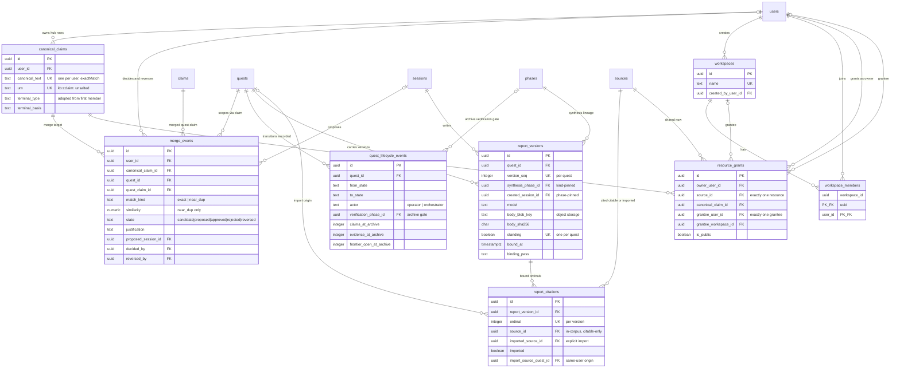
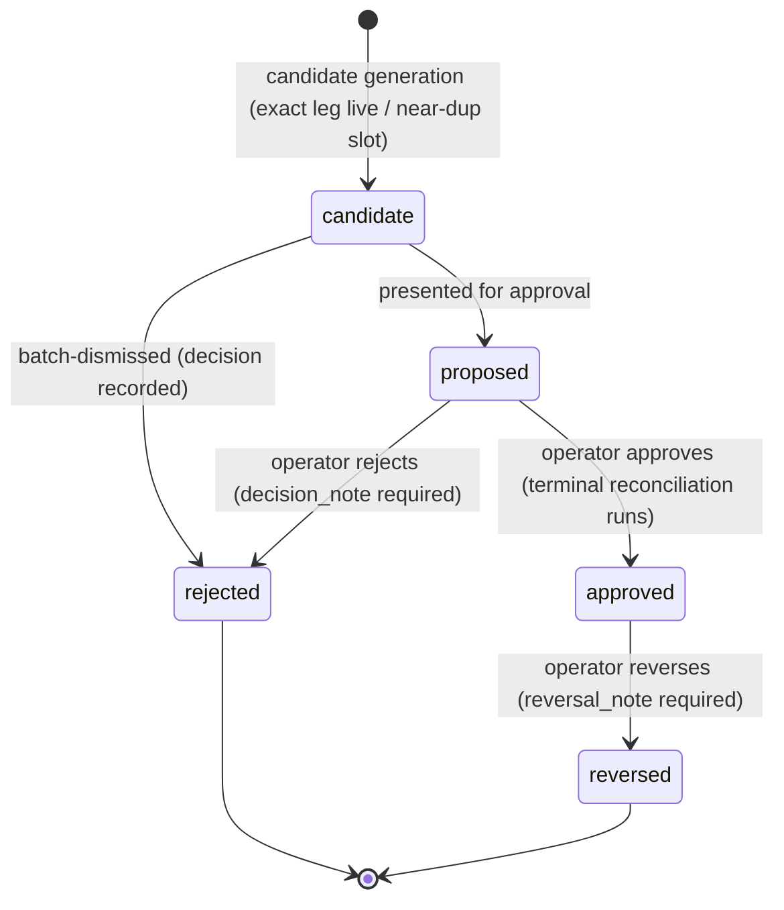

# I02 — cross-quest: DESIGN

Design document for everything that crosses quest boundaries: the canonical
hub and its propose-only merges, quest lineage and lifecycle, report
versioning with re-synthesis and stale-artifact hygiene, the sharing/
visibility access layer, and the citation-binding pass.

- Law: space BRIEF (§3 L11 reports-are-views, L4/L12 frontier semantics
  consumed as frozen; §4 D3 shared sources + quest-scoped graphs + canonical
  hub with propose-only merges, D6 multi-user with sharing as an additive
  access layer, D8 blob placement).
- Requirements owned: catalog §B R-019–R-027 (traceability in §11).
- Consumed as FROZEN law (read-only): ENTRY 1 design
  (`design/I01-core-model/`) — `v_claim_closure`, `v_frontier_mass`,
  `quest_sources`, `quests.provenance_kind`/`source_quest_id`,
  `claims.origin_quest_id`, DR-06 (quest-salted claim URNs; "the hub
  re-addresses on merge"), DR-18 (quest corpus membership). I01 is
  byte-identical after this run (check-coverage verifies; AC7).
- Artifacts: `artifacts/schema-i02.sql` (additive DDL + 4 ALTER-unique-keys,
  DR-15), `artifacts/seed-i02.sql` (fixtures + self-verification),
  `artifacts/queries-i02.sql` (four canonical query families + binding-pass
  algorithm), `artifacts/check-{ddl,constraints,coverage}.sh` (gates).
- Decision records: `DECISIONS.md` (DR-01…DR-15; DR-02 and DR-06 carry
  OPERATOR-RULING-NEEDED).

## 1. Scope and method

In scope: the canonical hub (`canonical_claims` + `merge_events`), the merge
workflow (candidate generation → presentation → approval → reversal;
terminal/evidence reconciliation), quest lineage semantics for the I01
provenance stamps (from_corpus inheritance, graph graft, drained
continuations), the quest lifecycle state machine with archive-immutability,
report versioning + re-synthesis + standing pointer + stale hygiene, the
visibility/access layer (workspaces, user grants, public door), and the
citation-binding pass with explicit import marking.

Out of scope, with destinations (§12): embedding-backed near-dup candidates
beyond the designated slot (ENTRY 3, R-036), agent/tool mechanics for any law
listed tool-time (ENTRY 4/5), phase transition law and stop rules including
the archive op's process home (ENTRY 6), verification/audit machinery
(ENTRY 7), application shape — UIs for merge review, workspace admin, report
rendering (ENTRY 8).

Method: every law this document states is either (a) enforced by a NAMED
constraint in `schema-i02.sql` (proven by `check-constraints.sh` — 41 probes
plus a positive control), or (b) a row in the constraint-catalog extension
(§10) with one named enforcement point and a destination artifact. Fixture
claims are proven by `check-ddl.sh` (38 seed-contract minimums) and
`queries-i02.sql` (9 non-empty + 8 zero assertions).

## 2. Model overview

Eight new tables, three new views, four additive unique keys on frozen I01
tables (DR-15). Four groups:

1. **Hub** (D3): `canonical_claims` (one row per distinct canonical text per
   user), `merge_events` (one row per quest-claim↔canonical-claim lifecycle:
   candidate → proposed → approved | rejected; approved → reversed).
2. **Lifecycle** (R-022): `quest_lifecycle_events` — the audited quest state
   machine; archive rows carry the verification gate and the frozen graph
   counts.
3. **Product** (L11, R-023/R-024/R-026/R-027): `report_versions` (the version
   chain about report bodies; bodies are object-storage blobs, D8),
   `report_citations` (the binding-pass output; in-corpus + explicit-import
   citation rows).
4. **Access** (D6, R-025): `workspaces`, `workspace_members`,
   `resource_grants` (one mechanism: sources now, canonical claims in the
   same shape, reports/quests later as additive kinds).

Views: `v_canonical_members` (hub membership = live approved merges),
`v_quest_lineage` (ancestor chain with per-hop provenance labels),
`v_resource_visibility` (effective scope per shared resource).

Cross-quest reads work PRE-MERGE by design (D3): every query family in
`queries-i02.sql` reads quest-scoped rows directly; the hub is an
additive index over them, never a gate.

### 2.1 ERD (new entities; I01 entities cited where related)

## 3. Entity specifications

Notation as I01: constraints named as they appear in `schema-i02.sql`, so
every claim here is checkable against `check-constraints.sh` output.

### 3.1 canonical_claims — the per-user hub (R-019, D3, D6)

| column | type | law |
|---|---|---|
| id | uuid PK | |
| user_id | uuid | `fk_canonical_claims_user`; `uq_canonical_claims_id_user` FK target |
| canonical_text | text | `ck_canonical_claims_text_nonempty`; `uq_canonical_claims_user_text` — one row per canonical text per user (exactMatch semantics) |
| urn | text | `ck_canonical_claims_urn_format` `^kb:cclaim:[1-9A-HJ-NP-Za-km-z]{10}$`; `uq_canonical_claims_user_urn` — DR-03 |
| terminal_type / terminal_basis | nullable | same pairing laws as claims (`ck_canonical_claims_terminal_pair`, `_basis_nonempty`) — adopted from the first approved member (DR-06) |
| created_at | timestamptz | |

The hub is **per-user** (D6 posture: sources are per-user now; the access
layer — §8 — is what would ever make cross-user merges visible, and they are
deferred behind it, DR-02). The URN is the UNSALTED content hash of the
canonical text — this is I01 DR-06's promised re-addressing: quest claims
keep their quest-salted URNs forever; a canonical claim holds the global
identity, and `v_canonical_members` is the mapping. Nothing is rewritten at
merge time.

### 3.2 merge_events — propose-only, operator-approved, reversible (R-019/R-020)

| column | type | law |
|---|---|---|
| id / user_id | uuid | owner = the operating user |
| canonical_claim_id | uuid | `fk_merge_events_canonical` composite (same-user) |
| quest_id / quest_claim_id | uuid | `fk_merge_events_claim` + `fk_merge_events_claim_quest` + `fk_merge_events_quest` — same-user AND claim-in-quest pinned |
| match_kind | text | `ck_merge_events_match_kind` ∈ {exact, near_dup} |
| similarity | numeric(5,4) | `ck_merge_events_similarity_pair`: near_dup ⇔ score present; `ck_merge_events_similarity_range` 0..1 — the designated slot's fixture surface (ENTRY 3 wires it) |
| state | text | `ck_merge_events_state` ∈ {candidate, proposed, approved, rejected, reversed}; default candidate |
| justification | text | `ck_merge_events_justification_nonempty` — what/why, mandatory at proposal |
| proposed_session_id | nullable | `fk_merge_events_session` (session in the claim's quest) — the "which session" half of R-019 |
| decided_by / decided_at / decision_note | nullable | `ck_merge_events_decision_pair`: decided states REQUIRE a recorded operator + time; undecided states carry none |
| reversed_by / reversed_at / reversal_note | nullable | `ck_merge_events_reversal_pair` + `ck_merge_events_reversal_note_nonempty`: reversal requires its own operator, time, and a nonempty reason |

Plus `uq_merge_events_active_per_claim`: at most one ACTIVE
(candidate/proposed/approved) lifecycle per quest claim. Rejected and
reversed rows never block a re-proposal — reversibility is structural
(DR-05). Per-row transitions are forward-only (candidate→proposed→
approved/rejected, approved→reversed): a workflow law the merge ops layer
enforces (catalog §10 M-TR); the schema carries the state/audit pairing.

### 3.3 quest_lifecycle_events — the audited state machine (R-022)

| column | type | law |
|---|---|---|
| from_state / to_state | text | `ck_quest_lifecycle_transition` — the legal pair set (below); both in the I01 `ck_quests_state` vocabulary |
| actor | text | `ck_qle_actor` ∈ {operator, orchestrator} — L13 parity: state changes record who drove them |
| verification_phase_id + kind/state literals | uuid + text | `ck_quest_lifecycle_archive_pair` (archive ⇔ phase present) + `fk_quest_lifecycle_verification` — the phase must be kind='verification' AND state='complete' (literals pinned by `ck_qle_verification_kind`/`_state` and the composite FK; DR-09) |
| claims/evidence/frontier_open_at_archive | integer | `ck_quest_lifecycle_archive_counts_pair` (archive ⇔ all three present) + nonneg CHECKs — the freeze fingerprint |
| occurred_at / note | | |

The legal transitions (the DESIGN §6 state diagram as a named CHECK):

| from | to | meaning |
|---|---|---|
| active | paused | interactive pause door (D5) |
| paused | active | resume |
| active/paused | complete | verification passed (never-reportless finisher honored, ENTRY 6) |
| active/paused | stopped | stop-rule/budget stop |
| stopped | active | phase-cap restart precedent (llm-trading v4) |
| complete/stopped | archived | the freeze (once-only: `uq_quest_lifecycle_archive_once`) |

Illegal by omission: complete→active (continuations are NEW quests, R-022),
archived→anything (immutable), active→archived (verification gate).

The ledger records transitions; keeping `quests.state` in sync is the
lifecycle op's job (catalog §10 Q-SYNC, ENTRY 6).

### 3.4 report_versions — the version chain about views (R-023, L11, D8)

| column | type | law |
|---|---|---|
| quest_id / version_seq | | `uq_report_versions_quest_seq` — dense chain per quest |
| synthesis_phase_id + kind literal | | `fk_report_versions_phase` over (id, quest_id, kind): the phase MUST be a synthesis phase — "report version without graph lineage" is structurally impossible |
| created_session_id | | `fk_report_versions_session` over (session, phase): the writer session ran in THAT synthesis phase |
| model | text | which model wrote this version — re-synthesis economics (R-061 consumes) |
| body_blob_key | text | `ck_report_versions_body_key` `^reports/<quest-uuid>/v<n>\.md$` — body in object storage (D8) |
| body_sha256 | char(64) | content hash of the blob (the storage seam proves equality, catalog §10 R-BSHA) |
| standing | boolean | `uq_report_versions_one_standing` (partial unique): the standing-artifact pointer — at most one per quest |
| bound_at / binding_pass | | `ck_report_versions_binding_pair` (paired); citations-exist ⇔ bound is the binding pass's invariant (catalog §10 R-BIND) |

Re-synthesis (R-023) = a NEW synthesis round over the SAME graph: a new
phases row (round_no+1), a new session, a new report_versions row with a
different model. The graph is never edited (Q-IMM, §10); the standing
pointer flips at finalization (catalog, ENTRY 5).

### 3.5 report_citations — binding output + import marking (R-026/R-027)

| column | type | law |
|---|---|---|
| report_version_id / ordinal | | `uq_report_citations_ordinal` (one row per inline ordinal; re-binding appends are refused), `ck_report_citations_ordinal` ≥ 1 |
| source_id + source_anchorable | nullable | `fk_report_citations_source` — the SAME citable-only conditional FK as evidence (R-003); tenancy pinned (owner's own source) |
| imported_source_id + anchorable | nullable | `fk_report_citations_imported_source` over (id, anchorable) — citable-only WITHOUT a tenancy pin: imports are the sanctioned cross-quest/cross-tenant read, visibility-gated at fetch time |
| imported / import_source_quest_id | | `ck_report_citations_import_pair`: imported ⇔ imported_source_id ⇔ origin quest present; origin quest is same-user (I01 §7 posture; cross-user origins open when quest sharing lands, DR-13) |
| resource exactly-one | | `ck_report_citations_resource_exactly_one`: a citation is in-corpus XOR import — never both, never neither |

### 3.6 workspaces / workspace_members / resource_grants (R-025, D6)

`workspaces`: named group (`ck_workspaces_name` slug, `uq_workspaces_name`),
creator. `workspace_members`: PK (workspace, user). `resource_grants`: ONE
mechanism — `ck_resource_grants_resource_exactly_one` (exactly one of
source_id / canonical_claim_id, each a real composite FK that also pins
ownership), `ck_resource_grants_grantee_exactly_one` (exactly one of user /
workspace / public). Private is the absence of a row. Scope ladder:
private < shared (user) < workspace < public; `v_resource_visibility`
computes the effective scope. Reports and quests are future additive kinds
(DR-14).

## 4. Hub model and merge workflow (R-019, R-020)

### 4.1 Canonicalization semantics

What merges: quest claims whose **canonical_text** (the I01 DR-05 GENERATED
normalization — NFC + ASCII-whitespace collapse + strip) equals a canonical
claim's text, byte-equal. That IS exactMatch on the normalized form: raw
whitespace variants are already collapsed by the core model, so "exact text
only?" and "normalized?" are the same question here, answered by reusing the
frozen normalizer (no second normalization to drift). Near-duplicates
(different wording) are the designated slot: `match_kind='near_dup'` with a
similarity score, generated by embeddings in ENTRY 3 (R-036); until then
near-dup events arrive only as tool/operator-minted rows. Cross-user merges
are deferred behind the visibility layer (DR-02, OPERATOR-RULING-NEEDED).

### 4.2 Merge state diagram

Forward-only per row. Re-merge after rejection or reversal = a NEW row
(`uq_merge_events_active_per_claim` permits it: only one ACTIVE lifecycle at
a time). Membership = live approved events (`v_canonical_members`), so
reversal drops membership without deleting any history.

### 4.3 Workflow (candidate → approval → reconciliation)

1. **Candidate generation** (`queries-i02.sql` M1): the adopt leg pairs
   every quest claim with an exact-canonical hub row lacking an active event
   (reversal reopens candidacy — the fixture proves it: k5 reappears after
   E4's reversal); the mint leg pairs same-user claims across ≥2 quests
   sharing a canonical text with no hub row yet. The near-dup leg's SQL shape
   is pinned as the designated slot (ENTRY 3 tables).
2. **Presentation**: candidates are promoted to `proposed` (operator or an
   agent with presentation rights — authz is ENTRY 8; the schema records
   who/when/which session). Presentation surfaces both texts, terminals,
   and evidence counts (union preview via `v_canonical_members`).
3. **Approval**: an operator row (`decided_by`) is mandatory — the schema
   half of propose-only. At approval the merge op (ENTRY 5) verifies the
   exact-match texts still hold and runs terminal reconciliation (DR-06):
   adopt the first member's terminal; refuse on terminal-type divergence.
4. **Reversal**: an approved merge flips to `reversed` with its own operator
   + note. Nothing else changes: quest claims and canonical rows are never
   mutated by a merge or its reversal (D3 "reversible" — the fixture E4
   proves membership drops).

### 4.4 Reconciliation rules

- **Terminals**: the canonical claim carries terminal_type/basis adopted
  from its first approved member. A later exact member with a DIVERGENT
  terminal_type is refused at approval (tool-time; DR-06 carries the ruling
  request). Basis wording may differ; divergence of TYPE is the refusal
  trigger — two byte-equal claims disagreeing on their typed terminal is
  evidence they are not the same claim.
- **Evidence**: NEVER copied to the hub. A canonical claim's evidence is the
  union of its members' evidence (query over `v_canonical_members` ⋈
  evidence_edges) — L11 all the way down; the hub is an index, not a graph
  copy.

## 5. Quest lineage (R-021)

I01 froze the stamps; this iteration fixes their semantics and proves them
queryable (`v_quest_lineage`, M2):

| provenance_kind | corpus (quest_sources) | graph (claims/evidence/edges/frontier) | precedent |
|---|---|---|---|
| fresh | staged at decompose | built fresh | every first quest |
| from_corpus | COPIED at init from the source quest (an at-init snapshot, never a live sync — the source may keep fetching) | built fresh — claims are question-relative; the frontier discipline stays honest only if the question is singular | muse-20261118T (risk-return: inherit corpus, fresh claim store); I01 seed quest B |
| graph_graft | copied at init (superset of from_corpus) | CLAIMS copied with `origin_quest_id` stamps (new quest-salted URNs — DR-06), evidence re-anchored (same spans, new quest — legal: span uniqueness is per-quest), open frontier entries re-posed with inherited scores | llm-trading v4 endgame continuation |

A **continuation quest** is any quest with `source_quest_id` set; a **drained
continuation** is a graph_graft quest that closes the inherited open frontier
(the fixture: quest D drains its single grafted entry to 0 via an internal
closure, exits drained, synthesizes, verifies, archives — the v4 arc in one
fixture). Provenance labels in `v_quest_lineage` name the DESCENDANT quest's
kind, because the stamp that created the edge is the child's.

The graft operation itself is tool-time (ENTRY 5: a `quest_graft` op that
copies rows within one transaction); the schema carries the stamps and the
laws the copy must respect (quest-scoped uniqueness surfaces take care of
re-posing; `uq_evidence_quest_span` permits same-span re-anchoring in a new
quest by design).

## 6. Quest lifecycle and archive-immutability (R-022)

**The law.** After a quest reaches `complete` its GRAPH is immutable — no
new claims, evidence, edges, derivations, frontier entries, or corpus
changes; synthesis/verification may still run (re-synthesis is exactly
this: new phases, sessions, report versions over the same graph). After
`archived` the quest is immutable in EVERY dimension — no new rows of any
kind reference it (reports, merges, citations), and existing rows never
change. Completed quests are never edited; continuations are new quests.

**The schema half** (what CHECK/FK/UNIQUE can hold, all probe-bitten):

1. The state machine itself: `ck_quest_lifecycle_transition` (X15 refuses
   complete→active — the continuations-are-new-quests law as a named
   constraint).
2. Archive is once-only: `uq_quest_lifecycle_archive_once` (X16).
3. Archive requires a COMPLETED VERIFICATION phase:
   `ck_quest_lifecycle_archive_pair` + `fk_quest_lifecycle_verification`
   with kind/state literal pins (X17, X18, X19 — the "after verification"
   half of the law).
4. The freeze fingerprint: `ck_quest_lifecycle_archive_counts_pair` +
   nonneg CHECKs (X20, X21) — claims/evidence/frontier_open counts pinned
   at archive, so any later graph mutation is DETECTABLE forever
   (`queries-i02.sql` X1_archive_drift = 0 on the fixtures; the sweep query
   is the drift detector).

**The tool-time halves** (catalog §10 Q-IMM, Q-SYNC): graph-op preconditions
refuse mutations on non-writable quests (ENTRY 5); the archive op (ENTRY 6)
re-verifies state, runs the drift sweep, and writes ledger+state atomically.
A pure-DDL insert/update guard on mutable parent state is impossible without
the DR-09-rejected trigger class — a pinned-state composite FK would make
archiving itself unrepresentable (the pin forbids the parent transition);
DR-09 in DECISIONS records the full analysis.

## 7. Report versioning, re-synthesis, stale hygiene (R-023, R-024)

Versioning shape: `report_versions` rows per quest, `version_seq` dense, the
body a content-hashed object-storage blob, the chain linked to the synthesis
phase and writer session (graph lineage). The **standing-artifact pointer**
is the partial-unique `standing` flag — at most one per quest; the
finalization transaction flips the new version's flag and clears the old
(ENTRY 5). Superseded versions keep `standing=false` forever — history is
never deleted (the PoC preserved every rewrite under backup dirs; here the
chain IS the backup).

**Re-synthesis** (R-023, the repeated operator pattern): repeat
synthesis+verification with a different model on the SAME graph — a new
synthesis phase round, a new session, a new version row stamped with the
model. The fixture: v1 (glm-5.3) superseded-unbound; v2
(openai/gpt-6.2-astra) standing and bound.

**Stale-artifact hygiene** (R-024 — the artifact-inheritance defect): a
prior report version must NEVER enter a new synthesis session's context.
Mechanism: the synthesis context is CONSTRUCTED, never inherited — the tool
surface (ENTRY 5) assembles context from the graph, the corpus, and the
agenda only; report bodies are read exclusively by the finalization/
rendering path. The PoC defect was environmental (report.md present in cwd
at spawn → the writer restructured the old report); the durable kill is
structural: synthesis sessions have no report-body read affordance at all
(catalog §10 R-STALE, ENTRY 5 enforcement; ENTRY 4 context assembly names
the exclusion). `m3_report_chain.stale` is the stale inventory (zero-config:
non-standing versions), and the seed's v1 (unbound, superseded) is the
fixture.

## 8. Visibility and sharing (R-025, D6)

Scope ladder: **private** (default — absence of a grant row; sources and
canonical claims are owner-only) < **shared** (grant to one user) <
**workspace** (grant to a named workspace) < **public** (the global door).
`v_resource_visibility` computes the effective scope per resource;
`resource_grants` is the ONE mechanism (exactly-one resource column, each a
real composite FK pinning ownership — a cross-visibility leak like bob
granting alice's source is structurally impossible, X38).

What is shareable now: sources (the D3 fetch-once-per-user corpus) and
canonical_claims (the hub) — the same table, the same query family, per
D6's "one mechanism serves sources now, canonical claims later". Quests and
report versions are additive future kinds: add a nullable column + FK to
`resource_grants` (or a parallel table in the same shape — DR-14 records the
trade); no migration of existing grants.

Workspace doors are additive modes, not baked scoping: no query outside the
visibility family filters by workspace; tenancy (I01 DR-01) remains the
only structural scope. The public door is what the fixture exercises
cross-tenant (bob's s6 public → carol reads it); imports (§9) consume
visibility at binding time, not by copying rows.

## 9. The citation-binding pass (R-026, R-027)

**The algorithm** (deterministic; `queries-i02.sql` B1 runs it as SQL over
the fixture):

1. **Citation index** (the synthesis context's source list): the quest's
   citable corpus — `quest_sources ⋈ sources WHERE role='citable'` —
   ordered by `(added_at, source_id)`. Ordinals 1..N are RESERVED for this
   index; the order is stable, cold-boot-recomputable, and independent of
   any embedding or ranking (L10).
2. **Import manifest**: sources a synthesis wants to cite OUTSIDE its
   corpus ride the synthesis phase's `result.imports` (ordinal beyond N,
   source URN, origin quest) — minted by TOOLING during context assembly,
   never by the model.
3. **Extraction**: the inline ordinal tokens `[^n]` are parsed from the
   body (the storage seam reads the blob; `body_sha256` pins which bytes).
4. **Binding**: ordinal n → the n-th citation-index source if n ≤ N; else
   the manifest entry with that ordinal. Each binding becomes ONE
   `report_citations` row (uq per version — re-runs append nothing).
5. **Footnote block**: rendered deterministically as
   `[^n]: <urn> — <title>, <canonical_url>, fetched <YYYY-MM-DD>` plus
   ` [IMPORT from quest <uuid>]` on imported lines (fetched = the I01 DR-21
   fetch-completion timestamp, date-granular — that deferral is discharged
   here).

**Determinism guards**: same body + same corpus + same manifest ⇒ same
citations and same footnote block, byte-for-byte (seed self-verification
re-derives both and compares; queries B1 re-proves). The schema guards:
dense-ordinal integrity is the binding pass's own invariant (tool-time,
catalog §10 R-BIND), duplicate ordinals are refused (`uq_report_citations_ordinal`),
the bound state is paired on the version (`ck_report_versions_binding_pair`),
and **the model never transcribes hashes** — the seed asserts no body
contains `kb:` (the model emits ordinals; URNs exist only in tool-minted
manifests and binding output).

**Never-silent imports** (R-027): a citation either resolves inside the
report's quest corpus (in-corpus shape, tenancy-pinned) or carries
`imported=true` + the origin quest (import shape). The binding pass refuses
an unmarked out-of-corpus citation (tool-time); the schema refuses an import
without its origin (`ck_report_citations_import_pair`, X30) and a row that
is neither/both (X31). Reports draw on own-quest evidence or marked imports
— the fixture imports s7 (staged in the parent quest AFTER the continuation
inherited the corpus) with the origin quest recorded.

## 10. Constraint catalog EXTENSION (new invariants → enforcement points)

Every new law maps to exactly one PRIMARY enforcement point (AC5). SHEMA =
named constraint in schema-i02.sql (probe letter = check-constraints.sh);
TOOL = tool-time refusal at the named surface; GATE = phase-gate sweep.

| id | invariant | primary enforcement | implementing artifact / destination |
|---|---|---|---|
| M-ACT | one ACTIVE merge lifecycle per quest claim | SCHEMA `uq_merge_events_active_per_claim` (X06) | schema-i02.sql |
| M-DEC | decided merges require a recorded operator+time; undecided carry none | SCHEMA `ck_merge_events_decision_pair` (X01/X02) | schema-i02.sql |
| M-REV | reversal requires operator+time+nonempty note | SCHEMA `ck_merge_events_reversal_pair`, `_reversal_note_nonempty` (X05) | schema-i02.sql |
| M-SIM | near_dup ⇔ similarity present (the designated slot's surface) | SCHEMA `ck_merge_events_similarity_pair` (X03/X04) | schema-i02.sql; ENTRY 3 wires generation |
| M-TR | per-row merge transitions are forward-only | TOOL: merge ops state-walk guard | ENTRY 5 (R-047-class merge ops) |
| M-TXT | match_kind='exact' pairs hold byte-equal canonical texts | TOOL: verified at proposal + approval; seed self-check `merge_exact_texts_equal` | ENTRY 5; seed-i02.sql |
| M-TEN | merges are same-user at both endpoints | SCHEMA `fk_merge_events_claim`/`_canonical` (X07/X08) | schema-i02.sql |
| H-TXT | one hub row per canonical text per user | SCHEMA `uq_canonical_claims_user_text` (X11) | schema-i02.sql |
| H-URN | canonical URN = unsalted content hash, format-checked | SCHEMA `ck_canonical_claims_urn_format`; seed re-derivation | schema-i02.sql; DR-03 |
| H-TERM | terminal reconciliation: adopt-first-member, refuse type divergence | TOOL: merge approval op (DR-06 OPERATOR-RULING) | ENTRY 5/6 |
| Q-TR | quest lifecycle transitions follow the legal pair set | SCHEMA `ck_quest_lifecycle_transition` (X15) | schema-i02.sql |
| Q-ONCE | archive is once-only | SCHEMA `uq_quest_lifecycle_archive_once` (X16) | schema-i02.sql |
| Q-VER | archive requires a COMPLETED VERIFICATION phase | SCHEMA `ck_quest_lifecycle_archive_pair` + `fk_quest_lifecycle_verification` (X17–X19) | schema-i02.sql; DR-09 |
| Q-CNT | archive pins graph counts (freeze fingerprint) | SCHEMA `ck_quest_lifecycle_archive_counts_pair` + nonneg (X20/X21) | schema-i02.sql |
| Q-IMM | post-complete: no graph mutations; post-archive: no new rows at all | TOOL: graph-op precondition (`quests.state IN ('active','paused')`) + archive op re-check; drift detectable via Q-CNT sweep | ENTRY 5 (R-047) + ENTRY 6 (R-056); queries-i02.sql X1 |
| Q-SYNC | quests.state changes only via ledgered lifecycle events | TOOL: lifecycle op writes state+ledger atomically | ENTRY 6 |
| R-SEQ | report version chain: dense seq, one standing, synthesis-phase lineage, session-in-phase | SCHEMA `uq_report_versions_quest_seq`, `uq_report_versions_one_standing`, `fk_report_versions_phase` (kind literal), `fk_report_versions_session` (X22–X25) | schema-i02.sql |
| R-BODY | body in object storage, content-hashed, layout-checked | SCHEMA `ck_report_versions_body_key`; hash equality TOOL at the storage seam | schema-i02.sql; ENTRY 5 (R-BSHA) |
| R-STALE | prior report versions never enter a new synthesis context | TOOL: synthesis context is constructed (graph+corpus+agenda only); no report-body read affordance in synthesis sessions | ENTRY 5 (R-053) + ENTRY 4 (R-042); stale inventory = `m3_report_chain.stale` |
| R-STAND | the standing flip is atomic and lands only on a BOUND version | TOOL: finalization transaction | ENTRY 5 (R-053); schema asserts one-standing |
| R-BIND | citations-exist ⇔ bound; ordinals dense per version | TOOL: binding pass is the only writer; sweep at finalization | ENTRY 5; SCHEMA half: `ck_report_versions_binding_pair` (X26), `uq_report_citations_ordinal` (X28) |
| R-CIT | citations resolve to CITABLE sources only | SCHEMA `fk_report_citations_source` / `fk_report_citations_imported_source` (X32/X33) | schema-i02.sql |
| R-IMP | imports are explicit: imported ⇔ import source ⇔ origin quest | SCHEMA `ck_report_citations_import_pair`, `ck_report_citations_resource_exactly_one` (X30/X31) | schema-i02.sql; unmarked out-of-corpus refusal TOOL (binding pass, ENTRY 5) |
| R-HASH | the model never transcribes hashes | TOOL: ordinals-only authoring surface + body scan at bind | ENTRY 5 (R-048); seed asserts fixture bodies clean |
| V-OWN | grants only by the resource's owner | SCHEMA `fk_resource_grants_source`/`_canonical` composite (X38/X39) | schema-i02.sql |
| V-ONE | a grant names exactly one resource and exactly one grantee | SCHEMA `ck_resource_grants_resource_exactly_one`, `ck_resource_grants_grantee_exactly_one` (X35–X37) | schema-i02.sql |
| V-PRIV | private is the default (no grant row = owner-only) | SCHEMA (absence semantics) + visibility query family M4 | queries-i02.sql |

## 11. Traceability — R-019–R-027 (machine-checked by check-coverage.sh)

| R-item | Status | Carried by | Destination |
|---|---|---|---|
| R-019 | DESIGNED | §3.1/§3.2/§4 canonical_claims + merge_events (what/when/session/justification/decision/reversal audit; exactMatch; propose-only; reversible); DR-01/DR-03/DR-04/DR-05 | near-dup generation → ENTRY 3 |
| R-020 | DESIGNED | §4 workflow (M1 candidate generation exact-live + slot, presentation, approval, terminal/evidence reconciliation §4.4); DR-02/DR-06/DR-07 | merge-review UI → ENTRY 8 |
| R-021 | DESIGNED | §5 lineage (from_corpus at-init copy, graph_graft stamps, drained continuation; v_quest_lineage; M2); corpus snapshot fixture | graft op mechanics → ENTRY 5 |
| R-022 | DESIGNED | §6 lifecycle (state machine CHECK, archive gates Q-ONCE/Q-VER/Q-CNT, immutability split Q-IMM); DR-08/DR-09 | archive op process home → ENTRY 6 |
| R-023 | DESIGNED | §3.4/§7 report_versions (chain, standing pointer, re-synthesis-as-new-round, model stamps); DR-10 | routing policy for re-synthesis → ENTRY 6 (R-061) |
| R-024 | DESIGNED | §7 stale hygiene (constructed context law R-STALE; stale inventory M3); DR-11 | synthesis tool surface → ENTRY 5; context assembly → ENTRY 4 |
| R-025 | DESIGNED | §3.6/§8 workspaces + resource_grants (one mechanism, scope ladder, private default); M4; DR-14 | workspace admin UI → ENTRY 8 |
| R-026 | DESIGNED | §9 binding pass (index, manifest, extraction, binding, footnote format; determinism guards; no-hash law); DR-12; B1 | bind-time tool wiring → ENTRY 5 (R-053) |
| R-027 | DESIGNED | §9 imports (in-corpus XOR import, origin quest pairing, never-silent); DR-13; X30/X31 | cross-user import origins → visibility-layer follow-up (DR-13 note) |

## 12. Deferrals and handoffs

| Concern | Destination |
|---|---|
| Near-dup candidate generation via embeddings (the designated slot) | ENTRY 3 (R-028–R-037; slot shape pinned in queries-i02.sql M1) |
| Synthesis context assembly (report-body exclusion = R-024's other half) | ENTRY 4 (R-042) |
| Merge ops surface (state-walk guard, exact-text verify, graft op, binding-pass tool, standing flip) | ENTRY 5 (R-047/R-053) |
| Archive op (state+ledger atomic write, drift sweep at freeze), never-reportless finisher wiring | ENTRY 6 (R-056–R-063) |
| Verification/audit sweeps over merges and bindings (terminal-divergence census, unbound-standing) | ENTRY 7 (R-066–R-072) |
| Merge-review / workspace-admin / report-rendering UIs; grant authz model | ENTRY 8 (R-073–R-081) |
| Cross-user merges and cross-user import origins (visibility-gated) | deferred door — DR-02/DR-13 record the mechanism (grants) and the ruling posture |
