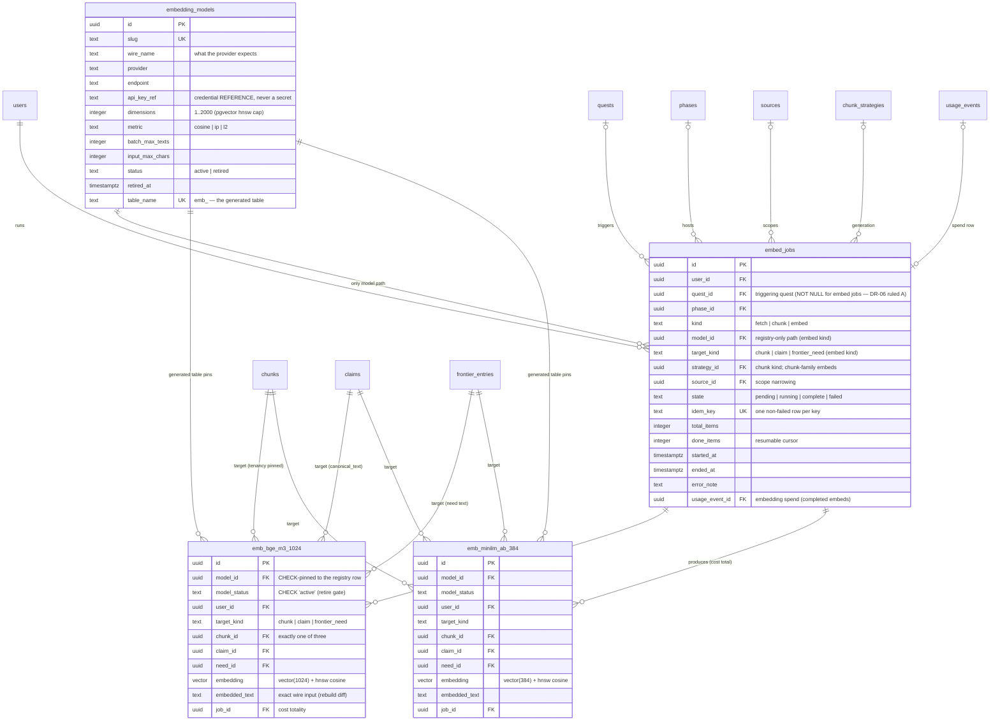

# I03 — retrieval: DESIGN

Design document for the retrieval subsystem: the embedding model registry
and its generated per-model pgvector tables, the fetch→chunk→embed pipeline
as an idempotent/resumable/cost-accounted job ledger, the embedding target
set (and its deliberate exclusions), hybrid search (dense + PG FTS legs,
RRF fusion), the BM25 designated slot, the sparse/multi-vector door, the
fast-embeddings consumer contract, dedup-by-construction with its seam into
I02's hub view, and mechanical relevance.

- Law: space BRIEF (§3 L1 offsets discipline consumed as frozen, L10
  derived-ness — embeddings derive from (target text, model) and are
  rebuildable; §4 D4 embeddings day one modular, D10 spend ledger, D2
  queries behind the storage seam). Requirements owned: catalog §C
  R-028–R-037 (traceability in §12).
- Consumed as FROZEN law (read-only): ENTRY 1
  (`design/I01-core-model/`) — chunks (verbatim, offsets, strategies),
  claims `canonical_text` (I01 DR-05 GENERATED normalizer), frontier needs,
  `usage_events` (D10), the tenancy `user_id` law; ENTRY 2
  (`design/I02-cross-quest/`) — `v_canonical_claims` (I02 DR-16: identity
  (user_id, canonical_text, terminal_type), the derived hub) and its
  near-dup growth slot. I01 and I02 are byte-identical after this run
  (check-coverage verifies both; AC7).
- Artifacts: `artifacts/schema-i03.sql` (additive DDL + 4 additive unique
  keys + the FTS substrate on frozen tables + the generated-table template
  with two concrete instantiations), `artifacts/seed-i03.sql` (fixtures +
  self-verification), `artifacts/queries-i03.sql` (the runnable hybrid
  prototype — five families, asserted), `artifacts/check-{ddl,constraints,
  coverage}.sh` (gates).
- Decision records: `DECISIONS.md` (DR-01…DR-16; DR-04 and DR-06 carry
  OPERATOR-RULING-NEEDED).
- Environment fact discharged live: pgvector **0.8.7** on local Postgres
  18.7 — `check-ddl.sh` re-proves `CREATE EXTENSION vector` and RECORDS the
  version in its output (R-035).

## 1. Scope and method

In scope: the registry model and lifecycle (register / retire / A-B as
data operations), the per-model table generator's contract, the pipeline
job ledger, embedding targets and exclusions, chunking-strategy defaults
and re-chunk/re-embed generations, the hybrid query families with RRF, the
BM25 slot, the sparse door, the fast-embeddings wire contract, dedup-by-
construction, mechanical relevance, and the constraint-catalog extension
mapping every new law to one enforcement point.

Out of scope, with destinations (§13): the fast-embeddings gem itself
(implementation arc entry 0; this iteration fixes only its consumer
contract), hub near-dup PROMOTION (the I02 DR-16 growth slot stays dark;
we design the seam), BM25 engine choice (slot designed, engine data-gated),
agent/tool mechanics for tool-time laws (ENTRY 4/5), phase contracts for
the topic-question carrier (ENTRY 6), UI (ENTRY 8).

Method: every law this document states is either (a) enforced by a NAMED
constraint in `schema-i03.sql` (proven by `check-constraints.sh` — 20
negative probes plus a positive control), or (b) a row in the constraint-catalog
extension (§11) with one named enforcement point and destination artifact.
The query families are executable and asserted (`queries-i03.sql`, 35
assertions); the fixture vectors are SYNTHETIC and deterministic (§14/
DR-15 — they prove the machinery, never model quality).

## 2. Model overview

Two new tables, one config registry, one job ledger, and generated
per-model vector tables (two concrete instances ship; the template in
`schema-i03.sql` is the generator's contract):

1. **`embedding_models`** — the registry (R-028). Global config rows (no
   `user_id` — the I01 chunk_strategies posture, DR-01 scope note): one row
   per model DEPLOYMENT (`provider + wire_name` unique), dims + metric
   pinned at registration, batch/wire limits as data, lifecycle
   `active | retired`. **The registry is the ONLY model path** (D4): jobs
   reference models by `model_id` FK; queries by registry id; the single
   sanctioned exception is the GENERATED table name itself (`emb_<slug>`,
   derived from the registry row — registry-derived data, never an inline
   model string).
2. **`embed_jobs`** — the pipeline ledger (R-031): fetch / chunk / embed
   kinds; idempotent by `idem_key` (exactly one non-failed row per key,
   ever — a rerun is a no-op resume; failed attempts don't block the retry
   row); resumable via the `done_items` cursor; progress-tracked
   (`total_items`/`done_items`); cost-accounted via `usage_event_id` into
   the I01 `usage_events` ledger (D10 — embedding spend is real spend;
   only completed embed jobs carry spend).
3. **Generated per-model tables** (R-029) — `emb_<slug>`: one row per
   (model, target) — `UNIQUE NULLS NOT DISTINCT (target_kind, chunk_id,
   claim_id, need_id)` so re-embed REPLACES, never duplicates; typed
   `vector(<dims>)` + hnsw (`vector_cosine_ops` for the cosine metric);
   every row pins its model (CHECK literal), the model's ACTIVE status
   (the retire gate), its producing job (cost totality), and its target's
   tenancy (three conditional composite FKs). Concrete fixtures:
   `emb_bge_m3_1024` (the D4 first registration) and `emb_minilm_ab_384`
   (the A/B challenger).

Frozen-law touches (strictly additive, DR-11; the I02 DR-15 pattern):
`uq_chunks_id_user`, `uq_claims_id_user`, `uq_frontier_id_user`,
`uq_usage_events_id_user` (composite-FK targets for target-tenancy and
spend-tenancy pins) and `chunks.search_tsv` — a GENERATED tsvector column
+ GIN index (the lexical leg's substrate; L10-clean: derived from chunk
text, no writer can drift it).

### 2.1 ERD (new entities; I01/I02 entities cited where related)



(`emb_minilm_ab_384` is the second instantiation of the same template —
the ERD repeats its shape to keep ERD↔DDL parity machine-checkable.)

## 3. Entity specifications

Notation as I01/I02: constraints named as they appear in `schema-i03.sql`,
checkable against `check-constraints.sh` output (probe ids E01–E22).

### 3.1 embedding_models — the registry (R-028, D4)

| column | type | law |
|---|---|---|
| id | uuid PK | fixed at registration; baked into the generated table's CHECK |
| slug | text | `ck_embedding_models_slug` `^[a-z0-9][a-z0-9-]*$`; `uq_embedding_models_slug` |
| wire_name | text | nonempty — the provider-side model string (data, never query text) |
| provider | text | nonempty; with wire_name: `uq_embedding_models_provider_wire` (one row per deployment) |
| endpoint | text | `ck_embedding_models_endpoint` `^https?://` |
| api_key_ref | text nullable | credential REFERENCE (e.g. `env:OPENROUTER_API_KEY`), never a secret — resolution is app-side (ENTRY 8; R-079 posture) |
| dimensions | integer | `ck_embedding_models_dims` 1..2000 — the pgvector ANN index cap, refused at the door |
| metric | text | `ck_embedding_models_metric` ∈ {cosine, ip, l2}; maps to the generated hnsw opclass (cosine→`vector_cosine_ops` day one — bge-m3 is cosine, D4) |
| batch_max_texts / input_max_chars | integer | >0; the fast-embeddings wire-call slicing parameters (R-034; DR-07) |
| status / retired_at | text / timestamptz | `ck_embedding_models_status` ∈ {active, retired}; `ck_embedding_models_retire_pair` (retired ⇔ retired_at) |
| table_name | text | `ck_embedding_models_table_name` `^emb_[a-z0-9_]+$`; `ck_embedding_models_slug_table` (=`emb_` + slug with `-`→`_`); UNIQUE — one table per model, ever |
| registered_at | timestamptz | |

`uq_embedding_models_id_status UNIQUE (id, status)` is the composite-FK
target for the ACTIVE-status pins from the generated tables (the retire
gate, §4.2).

**Register / retire / A-B are data operations** (R-029's "without code
changes"): registration = one INSERT + the generator emitting the table
DDL from the row (§4); retire = the op sequence in §4.2; A/B = two active
rows and queries that choose by registry id — demonstrated live in
`queries-i03.sql` family (a4), where the SAME query text runs against both
concrete tables (1024d and 384d) and agrees on the top hit.

### 3.2 embed_jobs — the pipeline ledger (R-031, D4, D10, L10)

One row per pipeline run. Shape laws (all named, all probe-bitten):

- **kinds**: `fetch | chunk | embed` (`ck_embed_jobs_kind`). Embed jobs
  carry `model_id` (FK to the registry — E01) and `target_kind`
  (`ck_embed_jobs_model_pair`/`_target_pair` — E02); chunk jobs carry
  `strategy_id` (`ck_embed_jobs_strategy_required`), and chunk-FAMILY
  embed jobs MAY carry one to scope a re-embed generation
  (`ck_embed_jobs_strategy_scope` — E19).
- **idempotency**: `idem_key` is caller-minted and deterministic for the
  scope (e.g. `embed:<model>:claim:quest:<qid>`); `uq_embed_jobs_idem_active`
  (partial UNIQUE, `WHERE state <> 'failed'`) allows exactly one non-failed
  row per key ever — E03. Failed attempts are exempt so the retry row is
  legal (the seed carries the pair: j08 failed → j07 complete, same key).
- **resumable + progress**: `done_items ≤ total_items`
  (`ck_embed_jobs_progress` — E05); completion is terminal and total
  (`ck_embed_jobs_complete_terminal` — E04: a "complete" job whose cursor
  never arrived is a lie the schema refuses); lifecycle pairing
  (`ck_embed_jobs_run_pair`/`_end_pair`/`_times` — E20), failure explained
  (`ck_embed_jobs_error_pair` — E06). A killed `running` row STAYS running
  until resumed/reaped (the I01 DR-12 cold-boot reasoning: no partial
  unique blocks restart); `done_items` is the durable resume cursor — the
  seeded j06 runs at 2/4 with exactly two vector rows (self-verified).
- **cost accounting** (D10): `usage_event_id` FK (tenancy-pinned via the
  additive `uq_usage_events_id_user`) links the job's embedding spend into
  the I01 ledger; `ck_embed_jobs_usage_kind` restricts the link to
  COMPLETED embed jobs (E08) — spend is reconciled once, at completion.
  Fetch jobs record web-call budget spend (not token spend) — no usage
  row, by design; chunk jobs are local computation.
- **attribution**: `quest_id` is the TRIGGERING quest (usage events follow
  it — the D10 chain session→phase→quest→user stays total). DR-06 was
  ruled A at ratification (2026-11-22): ALL embed jobs are quest-scoped
  by law (`ck_embed_jobs_scope`, probe E22 — corpus-wide re-embeds run
  as explicit per-quest jobs, one job per (strategy, quest), so every
  usage row lands on the quest that spent it). Cost tracking is
  reporting-only today; if budgets/quota ENFORCEMENT ever lands
  (ENTRY 7), attribution reopens per the operator's ruling note
  (`notes/ratification-20261122T1733-retrieval.md`).

### 3.3 The generated per-model table (R-029; template = the generator contract)

The registrar emits EXACTLY the template DDL in `schema-i03.sql`
(substitutions: slug, model uuid, dims, opclass). Row shape:

| column | type | law |
|---|---|---|
| model_id | uuid | `ck_emb_<slug>_model` CHECK = the registry row's id (rows cannot migrate between models) |
| model_status | text | `ck_emb_<slug>_status` CHECK `'active'` + composite FK to `(id, status)` — **the retire gate**: retiring refuses while any vector pins 'active' (E07) |
| user_id | uuid | tenancy; pinned to the TARGET's tenancy by the conditional FKs below (E13) |
| target_kind | text | `ck_emb_<slug>_kind` ∈ {chunk, claim, frontier_need} — evidence readings are structurally absent (E10, DR-05) |
| chunk_id / claim_id / need_id | uuid nullable | exactly one set (`ck_emb_<slug>_target_exactly_one` — E12), matching the kind (`ck_emb_<slug>_target_matches_kind` — E11); three composite FKs over `(id, user_id)` |
| embedding | vector(<dims>) | typed at generation — a wrong-dims insert is refused by the column TYPE (E09: "expected 1024 dimensions, not 384") |
| embedded_text | text | the EXACT wire input (see below) |
| job_id | uuid | FK (tenancy-pinned) — every vector has a producing job: cost accounting is total |

`uq_emb_<slug>_target UNIQUE NULLS NOT DISTINCT (target_kind, chunk_id,
claim_id, need_id)` — one row per (model, target): re-embed REPLACES
(UPDATE), never duplicates (E14). NULLS NOT DISTINCT is load-bearing: two
of the three target columns are NULL on every row, and default
NULLS-distinct uniqueness would never collide (found live by the probe
battery — the law now bites). Indexes: hnsw on `embedding` with the
metric's opclass (m=16, ef_construction=64 — pgvector defaults, DR-16;
`ef_search` is query-time, default 40, owned by the query seam), plus
`(job_id)` and `(user_id)` b-trees.

**embedded_text** captures the exact text sent over the wire. It is
derived state (L10: derivable from the target row) captured at write time
for two reasons: (1) audit — the usage ledger records tokens, not text;
debugging a wrong embedding without the input is guesswork; (2) rebuild
diffing — a re-embed generation can byte-compare old vs new inputs and
detect target-text drift (the rebuild job re-derives and must byte-match;
the seed self-verifies both directions: every vector re-derives from its
`embedded_text`, and every `embedded_text` byte-matches its target's
CURRENT text). DR-12 records the L10 tension and the rebuild-diff duty.

## 4. Registration, generation, retirement (R-029's data-operation law)

### 4.1 Registration → generated table

The registrar (app-side, implementation arc) runs one transaction:
INSERT the registry row, then emit the template DDL with the row's
substitutions. The two concrete tables in `schema-i03.sql` are
hand-instantiated exactly per the template (fixture proof of the
contract); `check-ddl.sh` asserts typed dims (`vector(1024)` /
`vector(384)` via `format_type`) and hnsw indexes
(`indexdef ~ 'USING hnsw' && 'vector_cosine_ops'`).

### 4.2 Retirement — retire means GONE (DR-04, flagged)

Retire is a sequence with a schema-enforced outcome: drain/cancel live
jobs (pending/running) → DROP the generated table (vectors die with the
model) → flip `status='retired'` + `retired_at` (the pair law, E15). The
vector tables' status pins make the flip REFUSE while any vector exists
(E07 — the fresh-model lifecycle probe registers a model, generates its
table, embeds one vector, and is then refused at retire); job LEDGER rows
deliberately survive (history: the plain `fk_embed_jobs_model` has no
status pin — retiring must not require deleting audit records). The
seed's retired model (nomic-s1-768) shows the legal terminal state: jobs
failed, table absent, pair set.

The flagged judgment call (DR-04): this makes retired vectors
unqueryable. The alternative — a `frozen` status (no new embeds, vectors
readable) — is the natural A/B-retention upgrade; deferred until real
A/B workflows ask for it.

### 4.3 A/B

Two (or more) active rows; retrieval/dedup queries name a registry id;
the query seam resolves id → table name (registry-derived data). Family
(a4) proves it: identical query text, two models, agreeing top hits.
Switching the default model is a pointer change in config, not code.

## 5. Embedding targets (R-030, DR-05)

| target | embedded text | scope | why |
|---|---|---|---|
| chunk | `chunks.text` (verbatim substring) | user (chunks are source-scoped; quest filtering at query time via quest_sources) | corpus retrieval — the dense leg's corpus |
| claim | `claims.canonical_text` (the I01 DR-05 GENERATED normalizer) | quest (embed job quest-scoped; dedup queries search the USER's rows) | dedup + canonicalization: the near-dup leg must key on the same normalized form the exact leg compares |
| frontier_need | `frontier_entries.need` | quest | semantic internal resolution + mechanical relevance (R-037) |

Agenda sources ARE embedded (their chunks) — agenda is readable and
retrievable by I01 law (§3.2); only ANCHORING is refused there. Closed
needs keep their vectors (history; re-entry comparisons).

**Excluded: evidence readings** (DR-05). Rationale: readings are
interpretation labels attached to spans, not retrieval keys — retrieval
enters evidence through the span text, which lives in the snapshot and
its chunks; no query family consumes reading vectors (dedup keys on
claims, relevance on needs, corpus search on chunks); embedding all
readings would roughly double corpus embed spend (E:K ≈ 2:1, the PoC
metabolism) with no consumer. The exclusion is structural:
`ck_emb_<slug>_kind` refuses any other kind (E10).

## 6. The pipeline: fetch → chunk → embed (R-031, L10)

The corpus pipeline is jobs all the way down: FETCH jobs (per source; the
web-call budget's unit — the web ops (ENTRY 5, R-052) enforce the budget;
the fetch job row is the pipeline's bookkeeping), CHUNK jobs
(strategy-scoped: a run of one strategy over a source set — re-chunk is a
NEW STRATEGY VERSION row + new chunk rows, old generations retained in
place, exactly the I01 §3.5/§3.6 law; the seed's para-800 day-one default
and para-400 re-chunk generation coexisting is the fixture — DR-10), and
EMBED jobs (model + target-family scoped; chunk-family embeds carry the
strategy so a generation's vectors are a coherent set). The pipeline never
re-chunks in place and embedding is READ-ONLY over chunks: embed jobs
consume `chunks.text` exactly as stored, so the L1 verbatim+offsets law
is preserved end-to-end — nothing downstream rewrites chunk text or
offsets.

Idempotency/resumability composition: an embed job's idem key names
(model, family, scope) — rerunning a completed scope is a no-op (the op
finds the completed row); a FAILED run's retry is a new row sharing the
key (legal — failures don't pin); a killed RUNNING row resumes from
`done_items` (the vectors it already wrote are correct by construction:
each row is complete or absent — per-target REPLACE semantics make the
cursor exactly "targets embedded"). Re-chunk generations compose the same
way: new strategy → new chunk job → new embed job (different idem key),
old vectors retained until their model is retired or a cleanup pass drops
them (a DR-12 note: re-chunk orphans nothing — old chunks stay queryable).

Cost: every completed embed job links ONE usage event (input_tokens = the
batch totals; cost from the provider, NULL for local). The fixture sums:
19 chunk + 14 claim + 6 need vectors under the 1024d model (the 17-chunk
para-800 generation complete; the para-400 re-embed generation mid-flight
at 2 of 4 — the resumable cursor), 8 claims under the 384d challenger, 9
new embedding spend rows into the I01 ledger (one cost-NULL — the local
TEI class; 10 embedding rows total with I01's), every row's chain
user→quest→phase→session total (D10).

## 7. Hybrid retrieval (R-032; the D4 ruling)

Two legs + rank fusion, all per-user scoped (tenancy is a property of the
query object — the cross-user probes in `queries-i03.sql` families a3/b/d4
return nothing), quest-scopable via `quest_sources` (family a2/c):

- **Dense leg**: cosine via pgvector `<=>` on the generated table, hnsw
  index; the query vector is ONE fast-embeddings wire call per query text
  (R-034), made by the query seam — no model name in the query. In the
  prototype the query vector is computed server-side by the deterministic
  fixture encoder (§14), which is what makes the prototype runnable
  offline and byte-reproducible.
- **FTS leg**: `chunks.search_tsv @@ plainto_tsquery('english', q)`
  ordered by `ts_rank` — the GENERATED column keeps the lexemes
  drift-proof (L10) and the GIN index serves recall. English is the
  day-one config (fixture corpus is English); multilingual configs are a
  registry/config question for the implementation arc.
- **RRF fusion** (formula visible in `queries-i03.sql` family c):

  ```
  rrf(d) = w_dense · 1/(K + rank_dense(d)) + w_fts · 1/(K + rank_fts(d))
  K = 60, w_dense = w_fts = 1.0
  ```

  Ranks are 1-based `row_number()` over each leg's ORDER BY with
  deterministic tiebreaks (chunk id); a document absent from a leg
  contributes 0. Rank fusion is the D4 ruling BECAUSE it sidesteps the
  score-scale mismatch among cosine distance, ts_rank, and any future
  BM25/SPLADE score: the fusion consumes ranks only. The prototype
  proves the point structurally: the two legs DISAGREE on the order of
  the top three documents (asserted), and every fused value equals the
  formula recomputed from its rank pair (asserted).

### 7.1 The BM25 designated slot (DR-09)

Day one: PG FTS ranks the lexical leg. The SLOT: BM25 (IDF + TF
saturation + length normalization) is the IR baseline and specifically
strong on kquest's query profile — rare terms, exact identifiers, numbers,
named entities (author-year citations, venues, percentages; the verified
research note §2). ts_rank has no corpus statistics: common terms rank
like rare terms. Two occupants, chosen when DATA justifies (the adoption
trigger: lexical-leg misses on identifier-style queries showing up in the
ENTRY 7 tripwire/relevance metrics):

- **ParadeDB `pg_search`** (v0.27.0, PG 15–18): real BM25 + hybrid in one
  index (BM25 fields and vector columns in a single `paradedb` index, RRF
  documented); AGPL-3.0 — acceptable under licenses-as-threats for
  private self-host; ops costs: `shared_preload_libraries` + background
  worker, one ParadeDB index per table, standby REINDEX-after-promotion
  caveats.
- **Hand-rolled SQL BM25**: GIN/tsvector for recall, then BM25-rerank a
  few hundred candidates using a `ts_stat`-derived term-stats table (IDF
  maintained on corpus change); no extension, no preload, no license
  question; corpus-stats maintenance is ours.

The slot's query shape is pinned so the swap is local: the lexical leg
EMITS (doc_id, rank); BM25 changes how rank is computed inside the leg;
RRF does not change. Rejected: external engines (Elasticsearch,
Meilisearch, RediSearch) — index-sync burden is what choosing Postgres
was meant to avoid (research note §2, ratified).

### 7.2 The sparse / multi-vector door (R-033)

Sparse (SPLADE) and multi-vector (ColBERT-shaped) are PROVIDER-ADAPTER
concerns, never a wire extension (D4): the OpenAI `/v1/embeddings` wire
stays pure dense (the verified-facts conclusion — Cohere's
`embedding_types` is quantization, not sparse; TEI's OpenAI-compatible
endpoint is dense-only). The door: a kquest-side adapter speaks TEI's
native `/embed_sparse` (SPLADE pooling; requires a MaskedLM-architecture
model, e.g. `naver/efficient-splade-VI-BT-large-query`) → pgvector's
native `sparsevec` type (exact search day one; ANN index support for
sparse has lagged — verify at adoption) → fused at the retrieval seam
LIKE ANY OTHER LEG: a sparse leg emits ranks into the same RRF. Registry
shape: a sparse model registers with its own generated table (the
template's `vector(<dims>)` becomes `sparsevec` at generation — a
template variant, the one place the generator branches). Implementation
stays dark until a retrieval-quality case demands it.

## 8. The fast-embeddings consumer contract (R-034; DR-07)

fast-embeddings (the fast-llm monorepo gem, implementation arc entry 0)
speaks the PURE OpenAI embeddings wire — `POST {base}/embeddings`,
`{model, input: [texts...]}` → `{data: [{embedding, index}...]}`; no
streaming (the wire has none), no dialects, no extensions ever (D4: a
wire extension is the designated-non-goal; sparse rides the TEI native
adapter, §7.2). kquest consumes it ONLY through the registry:

- request `model` = the registry row's `wire_name`; `base` = the row's
  `endpoint`; credentials resolved from `api_key_ref` app-side.
- **batch discipline**: the job runner slices work by the registry row's
  `batch_max_texts` and `input_max_chars` (admission control — a text
  over `input_max_chars` is split or refused before the call, never
  silently truncated by the provider). Retries/timeouts are the agent
  loop's retry classes (ENTRY 4, R-039); the embed call site records
  spend (R-046).
- The gem is model-transport: it never sees kquest concepts (targets,
  jobs, scoping) and kquest never holds a model name outside the
  registry (the `usage_events.model` column is an audit ECHO of what was
  called — a record, never an access path; DR-01).

`queries-i03.sql` obeys the same law mechanically: no model name appears
in it (check-coverage greps the seed's model strings against the queries
file; the generated TABLE names are the sanctioned exception).

## 9. Dedup-by-construction (R-036) and the I02 seam

The law (L5's dedup guard, made structural): claim creation runs a
TOOL-SIDE candidate check BEFORE the write — the PoC's model-discipline
version ("one search per candidate claim; fragment sweeps forbidden")
was a SKILL law that synthesis phases blew through ~8× (arc-run
20261122T-llm-trading-midarc §4: a phase-21 storm of 78 single-word
searches, 0 mutations, with the cap law in context from the boot read and
never re-read; the same arc's §2 phase-16 SCATTER storm and the quest-2
failure-taxonomy census are the earlier evidence class — read/dedup
territory, hundreds of fragment sweeps over the session's OWN claim
texts); when a law is provably unable to serve the goal, models
self-rescue by switching source. The structural fix is
a check the model cannot skip because the TOOL runs it.

The check (family d, executable): given the new claim text —
1. **exact leg**: canonical-text byte-equality against the user's claims
   (the I01 `uq_claims_quest_canonical` normalizer, hub scope per-user);
2. **near leg**: cosine neighbors in the registry's claim vectors,
   user-scoped, top-k under a threshold (policy constants: k=5, floor
   cosine-similarity 0.6 day one — TOOL CONFIG, calibrated against a real
   registry model in ENTRY 5; the fixture thresholds are
   methodology-limited, §14).

The result maps onto `v_canonical_claims` entries (the I02 hub view):
each candidate row carries (user_id, canonical_text, terminal_type) +
`match_kind ∈ {exact, near_dup}` + cosine. THAT is the seam to I02's
DR-16 growth slot: `near_dup` rows are the slot's data — surfaced to the
creating tool, adjudicated in quests, never auto-merged (the hub is
derived; nothing is adopted, nothing refused). The fixture proves the
seam on the I02-designated near-dup family (k5 vs d3): the exact leg
sees NOTHING (different canonical text — asserted), the near leg returns
both family members as the top two with a sharp gap to non-family claims
(asserted), and both map onto hub entries. Hub PROMOTION (materialized
identity) remains I02 DR-16's deferred era; when it happens, these
candidate rows are its input stream.

## 10. Mechanical relevance (R-037; the I20 origin)

muse-20261120T-i20: the agent's self-assigned `relevance` is supposedly
teleological — but the topic is WRITTEN DOWN. Embed each need-text
against the topic questions; cosine gives a consistent relevance with
zero self-assignment. "Crude-but-constant beats refined-but-drifting for
a stop-law currency."

The design (family e, executable): topic questions are the DECOMPOSE
OUTPUT (the operator's staged questions — the fixture mirrors the agenda
note s5, where they live in the fixture corpus); the carrier shape is
`phases.result` jsonb (the ENTRY 6 phase contract owns the schema —
DR-14 records the fixture stand-in). Score per OPEN need =
best-question alignment (min cosine distance over the question set).
Properties asserted: every open need scored; the crash-regime need
aligns with the crash question, the cross-market need with the magnitude
question (the ordering sanity); scores recompute from text alone. Mass
input: the ENTRY 6 stop law consumes `mechanical_relevance × uncertainty`
in place of the self-assigned product when configured — the currency
swap is config, not schema (frontier's `relevance` column stays; it
becomes the PRIOR, the mechanical score the audited override).

## 11. Constraint catalog EXTENSION (AC5)

Every new law → exactly one PRIMARY enforcement point. SCHEMA = named
constraint in schema-i03.sql (probe id = check-constraints.sh); QUERY =
asserted executable in queries-i03.sql; TOOL/GATE = named surface with
destination.

| id | invariant | primary enforcement | implementing artifact / destination |
|---|---|---|---|
| G-REG | the registry is the ONLY model path: jobs/queries address models by registry id; no model string in query text (the generated table name is the sanctioned exception) | SCHEMA: `fk_embed_jobs_model` (E01) + `ck_embed_jobs_model_pair` (E02); MECHANICAL: check-coverage greps model strings out of queries-i03.sql | schema-i03.sql; check-coverage.sh; usage_events.model documented as audit echo (DR-01) |
| G-DIM | dimensions pinned at registration; the generated table's column type enforces them | SCHEMA: `ck_embedding_models_dims` (1..2000, E16) + column type `vector(<dims>)` (E09) | schema-i03.sql; check-ddl asserts format_type |
| G-TBL | one generated table per model, name derived from the slug; typed dims + hnsw with the metric's opclass | SCHEMA: `ck_embedding_models_table_name`/`_slug_table` (E17) + `uq_embedding_models_table_name`; generator contract = the template | schema-i03.sql; check-ddl asserts hnsw indexes |
| G-RETIRE | retire means gone: jobs drained, table dropped, then the pair flip; vectors pin 'active' until then | SCHEMA: `fk_emb_<slug>_model` composite (E07) + `ck_embedding_models_retire_pair` (E15) | schema-i03.sql; retire op sequence = ENTRY 8 job runner (N3) |
| J-RET | new embed jobs are admitted against ACTIVE registry rows only; job LEDGER rows survive retire (history) | TOOL: pipeline job admission checks registry status before creating a job (job runner, ENTRY 8) — deliberately NOT a status pin on jobs, which would make retire require deleting audit history | DR-04/§3.2; N2 |
| J-IDEM | one non-failed job per idem key, ever; rerun = no-op resume; failure → legal retry row | SCHEMA: `uq_embed_jobs_idem_active` (E03) | schema-i03.sql; key-minting policy = job runner (ENTRY 8) |
| J-PROG | progress cursor bounded; completion is terminal and total; failure explained; times ordered | SCHEMA: `ck_embed_jobs_progress` (E05), `_complete_terminal` (E04), `_error_pair` (E06), `_times` (E20), `_run_pair`/`_end_pair` | schema-i03.sql |
| J-SPEND | embedding spend is real spend: completed embed jobs link a tenancy-pinned usage row of kind 'embedding' — BOTH directions schema law | SCHEMA: `ck_embed_jobs_usage_kind` (E08, usage⇒embed∧complete) + `ck_embed_jobs_complete_spend` (E21, complete∧embed⇒usage; judge F1) + `fk_embed_jobs_usage` (E18, tenancy-pinned) | schema-i03.sql; call-site recording R-046 (ENTRY 4) |
| J-QUEST | every embed job is quest-scoped: per-quest spend attribution (corpus re-embeds are explicit per-quest jobs) | SCHEMA: `ck_embed_jobs_scope` (E22; DR-06 ruled A, 2026-11-22 — tightened from claim/need-only to all embed jobs at ratification) | schema-i03.sql; ENTRY 7 budget design must cite the DR-06 ruling note (reopens if spend gains consequences) |
| V-ONE | one vector per (model, target): re-embed REPLACES | SCHEMA: `uq_emb_<slug>_target` NULLS NOT DISTINCT (E14) | schema-i03.sql |
| V-KIND | embedding targets are chunks, claim canonical_text, frontier needs — evidence readings structurally excluded | SCHEMA: `ck_emb_<slug>_kind` (E10) + `_target_matches_kind` (E11) + `_target_exactly_one` (E12) | schema-i03.sql; DR-05 |
| V-TEN | a vector row's tenancy is pinned to its target's tenancy (cross-user vector rows impossible) | SCHEMA: the three conditional composite FKs `fk_emb_<slug>_chunk/claim/need` (E13), enabled by the additive `uq_{chunks,claims,frontier}_id_user` | schema-i03.sql; DR-11 |
| V-TEXT | embedded_text byte-matches the target's current text (rebuild diff); vectors re-derive deterministically | QUERY: seed self-verification (both directions) + rebuild-job diff duty (DR-12) | seed-i03.sql; re-embed op (ENTRY 8) |
| H-SCOPE | every retrieval leg is per-user scoped (tenancy is a query-object property) | QUERY: cross-user probes return nothing (families a3, b, d4); enforcement at the query seam when wrapped (ENTRY 8 storage seam, ENTRY 5 R-054) | queries-i03.sql; N1 |
| H-RRF | fusion is by rank with K=60, weights 1.0; legs emit deterministic ranks | QUERY: family c asserts every fused value equals the formula recomputed + deterministic tiebreaks; named query object wraps it (ENTRY 8) | queries-i03.sql; N6 |
| D-DUP | claim creation runs the candidate check (exact + near legs) and returns hub-mapped candidates; no auto-merge | TOOL: the claim-creation op runs the check (ENTRY 5 R-036/R-047); QUERY: family d is the executable contract; thresholds = tool config (N4) | queries-i03.sql; ENTRY 5 |
| M-REL | mechanical relevance = need-text vs topic questions, zero self-assignment | QUERY: family e (ordering sanity + text-only recompute); carrier shape = ENTRY 6 phase contract (DR-14); stop-law consumption = ENTRY 6 config | queries-i03.sql; ENTRY 6 |

Not-schema-expressible remainder (named points, also listed in
check-constraints.sh's header): N1 read-side scoping at the query seam
(ENTRY 8/5); N2/J-RET pipeline admission (ENTRY 8); N3 retire op
sequence (ENTRY 8); N4 dedup threshold/top-k calibration (ENTRY 5);
N5 batch slicing per wire call (ENTRY 8 job runner); N6 RRF constants
ownership (ENTRY 8 query objects).

## 12. Traceability — R-028–R-037 (machine-checked by check-coverage.sh)

| R-item | Status | Carried by | Destination |
|---|---|---|---|
| R-028 | DESIGNED | §3.1 embedding_models (registry rows, dims/metric/wire/batch config, lifecycle; register/retire/A-B as data ops); DR-01/DR-04 | credential resolution shape → ENTRY 8 |
| R-029 | DESIGNED | §3.3/§4 generated per-model tables (template = generator contract; typed dims + hnsw asserted in check-ddl; A/B live in family a4); DR-02/DR-03/DR-16 | the generator app code → implementation arc (ENTRY 8 job topology) |
| R-030 | DESIGNED | §5 target set (chunks, claims canonical_text, frontier needs; evidence readings structurally excluded — E10); DR-05 | — |
| R-031 | DESIGNED | §3.2/§6 embed_jobs (fetch/chunk/embed; idempotent idem-key law, resumable cursor, progress, usage-ledger cost; chunking default + re-chunk generations — DR-10); DR-06 ruled A (per-quest attribution, all embed jobs quest-scoped) | job runner topology → ENTRY 8; retry classes → ENTRY 4 |
| R-032 | DESIGNED | §7 hybrid (dense leg, FTS leg via generated tsvector, RRF formula visible + asserted; per-user/quest scoping); BM25 slot §7.1 (pg_search vs hand-rolled trade table, adoption trigger); DR-08/DR-09/DR-11 | BM25 engine choice at adoption → operator ruling with data; lexical config → implementation arc |
| R-033 | DESIGNED | §7.2 sparse door (TEI /embed_sparse adapter → sparsevec; provider-adapter, never wire extension; fused as another RRF leg); template variant named | implementation dark until a quality case demands it |
| R-034 | DESIGNED | §8 consumer contract (pure OpenAI embeddings wire, batch discipline via registry config, registry-only model access — mechanically enforced by check-coverage's grep); DR-01/DR-07 | the gem itself → implementation arc entry 0 |
| R-035 | DESIGNED | DISCHARGED LIVE: check-ddl.sh proves CREATE EXTENSION vector and RECORDS the installed version (0.8.7, Postgres 18.7) | — |
| R-036 | DESIGNED | §9 dedup-by-construction (tool-side exact+near check at claim creation, hub-mapped candidates — the I02 DR-16 seam; retires the search-cap law); DR-13 | tool wiring + threshold calibration → ENTRY 5 (R-054); hub promotion stays I02's deferred era |
| R-037 | DESIGNED | §10 mechanical relevance (need-text vs topic questions, best-question score, zero self-assignment; family e asserted); DR-14 | question carrier schema → ENTRY 6 phase contracts; stop-law currency swap → ENTRY 6 config |

## 13. Deferrals and handoffs

| Concern | Destination |
|---|---|
| fast-embeddings gem implementation (pure OpenAI embeddings wire) | implementation arc entry 0 (D9); contract fixed here (§8) |
| The registrar/generator + job runner as application code; retire op sequence; batch slicing; corpus-level job sessions | ENTRY 8 (R-074 job topology) |
| Retrieval tools behind the seam (agent never names a model); dedup check wiring + threshold calibration; listing caps | ENTRY 5 (R-054, R-036) |
| Topic-question carrier (phases.result jsonb shape); mechanical-relevance stop-law consumption | ENTRY 6 (R-063 phase contracts; R-059 stop rules) |
| Relevance/quality metrics that justify (or not) the BM25 slot swap; type-divergence + near-dup tripwires over the seam's candidates | ENTRY 7 (R-068–R-072) |
| Hub promotion (materialized identity) — the seam feeds it, I02 DR-16 owns the era | I02 DR-16 growth path |
| Sparse/multi-vector adapter implementation | dark until a retrieval-quality case demands (R-033) |
| Multilingual FTS config; ef_search tuning | implementation arc (config), informed by ENTRY 7 metrics |

## 14. Fixture methodology: deterministic synthetic vectors (DR-15)

Every vector in the seed (and every query vector in the prototype) is
SYNTHETIC, derived deterministically from text by a hashing-trick
encoder: tokenize (lowercase, non-alphanumerics split, tokens ≥3 chars
minus a small stoplist that also drops the fixture corpus's shared
boilerplate), give each token a pseudo-random direction derived from
`sha256(token ‖ block)` (each 256-bit block → 8 signed dims, 4 bytes
per dim), sum the token directions, normalize. Similar
fixture texts share vocabulary ⇒ nearby vectors; identical texts ⇒
byte-identical vectors (cosine distance exactly 0 — asserted in family
a4); disjoint vocabularies ⇒ near-orthogonal.

**What this proves**: the query machinery — operators (`<=>`), the FTS
leg, RRF fusion with the formula, per-user scoping, dedup candidate
generation and ordering, mechanical-relevance alignment, and every
constraint in §11. **What it does NOT prove**: anything about a real
model's quality — there is no semantic component (no synonymy, no
paraphrase beyond shared tokens), similarity magnitudes are not
calibrated to any real embedding model, and the dedup floor (0.6) and
family-a thresholds are fixture-tuned constants, not transferable
policy. Threshold calibration against the real registry model (bge-m3)
is explicitly ENTRY 5's job (N4). The seed SELF-VERIFIES the methodology:
every stored vector re-derives byte-identically from its `embedded_text`,
and every `embedded_text` byte-matches its target's current text — the
determinism claim is executed, not asserted in prose.
