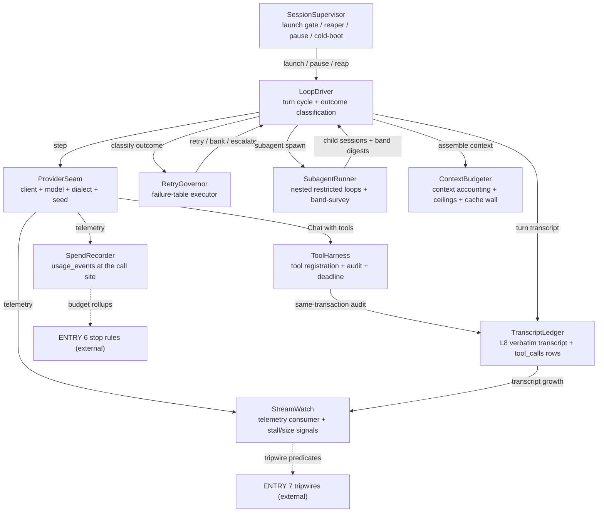

# I04 — agent-loop: the native engine loop (design)

The engine loop is the product's heart: every tool call, every phase, every
report is consumed through it. D1 ruled a native Ruby agent loop on
fast-completions (the gem as model transport — OpenAI wire, dialects,
streaming; no vendor SDKs); D5 ruled HITL core (pause required, one active
writer per quest, steer-while-running REJECTED); L7 cold-boot, L13
interactive/autonomous parity, L14 seed law; D10 cost honesty. The PoC paid
for this iteration's lessons in failed runs — empty completions, a measured
transcript-size ceiling, seed-0 replay loops, tool wedges, a 78% context
blowout — and this document turns them into a designed, machine-checkable
failure-handling contract instead of tribal memory.

**The executable heart is `artifacts/failure-modes.tsv`** — 25 failure
modes, each row a contract (`signature → required behavior → evidence`)
the implementation arc will test against (R-045). Every number in this
document carries its citation; nothing is laundered as folklore.

## 1. Scope and method

- **Owned requirements**: catalog §D, R-038–R-046 (traceability §11).
- **Inputs consumed as contracts, not posture**: the fast-completions gem
  (`repos/fast-llm/gems/completions/` — README, docs/, lib/, spec/) is the
  SUBSTRATE; this entry consumes its actual wire guarantees (error
  taxonomy, retry trigger set, watchdog semantics, salvage discipline,
  dialect vocabulary, telemetry hooks, tool-batch contract). tart
  (`20261110-knowledge-builder/repos/tart`, lib/tart session/spawn/
  subagents patterns) is REFERENCE ONLY per D1 — patterns cited, never
  imported.
- **Prior law consumed**: I01 `sessions`/`tool_calls`/`usage_events` chain
  (§3.14–§3.16, DR-12/DR-13/DR-14 — the D10 chain and the one-writer
  enforcement home this entry specifies); I02 quest lifecycle
  (`active → paused` is a legal, ledgered transition); I03 DR-07 (embed
  call-site retry classes deferred HERE) and J-SPEND/J-IDEM schema law.
- **No new schema is required.** Two additive prior-law amendments are
  PROPOSED as decision records (DECISIONS DR-12: usage_events cache/seed
  columns) — nothing in design/I01–I03 is edited.
- **Not this entry**: the tool API contract (ENTRY 5), phase state machine
  and stop-rule catalog (ENTRY 6), tripwire enforcement (ENTRY 7), job
  runner and app architecture (ENTRY 8), any gem implementation
  (implementation arc; entry 0 = gems).

### 1.1 Load-bearing substrate findings (verified against lib/ + docs/)

These shape the design; each is checkable in the cited gem file.

1. **Streaming-only, fiber-native.** No synchronous requests; one persistent
   `Async::HTTP::Client` per `Client`, requests run inside the caller's
   reactor (README "Fiber-native"; `docs/explanation/why-streaming-only.md`).
   Consequence: the loop is a reactor program; tool `execute` bodies must
   never block the reactor (§4).
2. **Bounded creation retry, immediate, pi's trigger set.** `Client`
   retries at most `max_retries` (default 1) on: `x-should-retry: true`,
   statusless errors (network at POST, TTFB watchdog fire), 408/409/429/5xx;
   `x-should-retry: false` is FINAL regardless of status; NEVER after a 2xx
   (`docs/reference/errors.md` §Request retry). Consequence: the loop's
   RetryGovernor layers jittered backoff ABOVE this (§2.5, DR-02).
3. **Mid-stream failures are never retried — they are salvaged.** Any
   exception after 2xx emits the client-level `:error` event carrying the
   salvaged partial (every streamed block + usage; reasoning_details
   serialized exactly as a completed finalize would) and then raises
   (`errors.md` §Mid-stream salvage). Consequence: FM-15 must persist the
   salvage and its usage — the only place mid-turn tokens are recoverable.
4. **The watchdog is two-deadline** (TTFB + read-inactivity re-armed per
   chunk; `raw_stream` splits the knobs; `stream` shares one `timeout`,
   default 30 s); a fired watchdog surfaces `TimeoutError`, never
   `CancelledError` (`errors.md` §TimeoutError).
5. **Tolerant inbound stream.** A malformed chunk is repaired at the seam
   or DROPPED and counted (`Client#dropped_chunks`), never raised; a
   missing finish still lands in the StreamError path; lost argument
   fragments finalize loudly as the `ToolArgumentsFailure` marker
   (`errors.md` §StreamError; `lib/fast/completions/errors.rb`). The loop
   must not re-add strictness the gem deliberately removed (FM-11/FM-14).
6. **`CancelledError` stands outside `Error`** — a rescue ladder for API
   failures never swallows a cancellation; cancel emits NO phantom
   terminal and the half-streamed turn is not appended
   (`docs/how-to/cancel-a-running-chat.md`). This is the pause mechanic's
   safe primitive (§5.2, FM-19).
7. **Telemetry is a 5-hook sink protocol with a terminal invariant**:
   exactly one `on_completion_end` XOR `on_completion_error` per
   completion, retries INSIDE the completion, tool execution OUTSIDE it
   (`docs/reference/telemetry.md`). This is the spend-recording seam
   (§9, FM-25) — a structural guarantee, not a convention.
8. **Usage rides the final Message** (`Usage`: input, output, cache_read,
   cache_write, reasoning, total_tokens — `lib/fast/completions/types.rb`),
   and the dialect flag `supports_usage_in_streaming` decides whether the
   wire carries it at all (`docs/reference/dialects.md`).
9. **Dialects are data — a closed 14-key vocabulary**; unknown keys/values
   raise `ArgumentError` at declaration time, "fail loud, never silently
   mistranslate"; `:zai`/`:deepseek`/`:fireworks` ship as declarations
   (`docs/reference/dialects.md`). There is no provider detection and no
   base-URL constant: the consumer declares, the codec obeys.
10. **The request vocabulary is CLOSED and carries NO seed.**
    `Protocol.build_request` emits exactly: model, messages, stream,
    stream_options, store, the dialect's max-tokens field, temperature
    (only when explicitly set), tools, thinking arms
    (`lib/fast/completions/protocol.rb`). There is no `seed` field, and
    `Client#stream` takes no seed kwarg. The ONLY seed-capable surface
    today is `raw_stream` (body verbatim, no accumulation, no tool
    interpretation). Consequence: the L14 seed policy REQUIRES a small gem
    extension — proposed as an exact patch in DECISIONS DR-07,
    destination implementation arc entry 0 (gems). This is the one place
    this iteration's law exceeds the substrate as it stands, and it is
    recorded as a patch proposal, not assumed.

## 2. Loop architecture (R-038, R-039, R-045)

### 2.1 Component registry

Ten components, all application code inside the Engine subsystem
(minted at the implementation arc; slice placement is ENTRY 8). Every
component below appears as a `destination` in `artifacts/failure-modes.tsv`
and vice versa (machine-checked; AC4).

```components
LoopDriver
ProviderSeam
RetryGovernor
ToolHarness
TranscriptLedger
SpendRecorder
SessionSupervisor
SubagentRunner
ContextBudgeter
StreamWatch
```



| component | role | owns |
|---|---|---|
| `SessionSupervisor` | quest-scoped session lifecycle: launch gate (one-writer, D5), cold-boot protocol (L7), pause delivery, reaper of orphaned sessions, orchestrator-vs-operator launch modes | R-043 |
| `LoopDriver` | the turn cycle: context assembly hand-off, `Chat#step` invocation, outcome classification (incl. empty completion), terminal conditions from the phase contract, turn-boundary checks (budgets, pause flag, ceilings) | R-039/R-040 |
| `ProviderSeam` | the ONLY component that knows providers: constructs `Client`/`Model`/dialect declarations from provider config rows — and wraps the Client in a ProviderSeam-owned DECORATOR whose `#stream` fill-injects the per-request seed (judge F1: `Chat#step` calls `#stream` with a fixed kwarg set, so a bare kwarg is dead code on the Chat path); per-provider ceilings and cache-wall values; model swap at pause | R-038, R-041 |
| `RetryGovernor` | executes `failure-modes.tsv`: signature → class → required behavior → bound; jittered backoff above the gem's immediate retry; the escalation ladder (retry → bank session → end phase attempt → pause quest) | R-039, R-045 |
| `ToolHarness` | registers ENTRY 5 tool classes into the gem's `Chat`; wraps every `execute` with the same-transaction audit write, per-call deadline watchdog (wedge guard), result-size caps, budget guards, and subagent profile restrictions | R-039, R-044 |
| `TranscriptLedger` | L8: appends the verbatim session transcript to `sessions/<uuid>/transcript.jsonl` (object storage) and writes `tool_calls` rows in the same transaction as the mutation; persists salvaged partials as audit | L8, R-013 |
| `SpendRecorder` | registers as a gem telemetry sink; writes `usage_events` rows at the call site for every completion (success, failure, salvage) and wires the embedding call site (I03 J-SPEND) | R-046, D10 |
| `SubagentRunner` | nested restricted-tool loops: run registry, spawn discipline, deadlines, the codified band-survey pattern | R-044 |
| `ContextBudgeter` | per-session context accounting: sliced-read caps, extract-as-you-read, retrieval-first, transcript ceilings, prefix-cache-wall policy | R-040, R-042 |
| `StreamWatch` | consumes telemetry + transcript growth: SLOWSTALL, SIZE-CEILING early warning, dropped-chunk counts, repetition signals; feeds ENTRY 7 tripwires | R-045, ENTRY 7 |

### 2.2 The turn cycle (dispatch)

One turn = one `Chat#step` + its tool batch (the gem's unit). The
LoopDriver runs turns inside a session until a terminal condition:

```
SessionSupervisor.launch(quest, phase)         # gate, session row, cold boot
repeat:
  context := ContextBudgeter.assemble(phase_contract)   # prompt text from ENTRY 6
  outcome := ProviderSeam.step(chat, context)           # Chat#step, tools registered
    on event:      TranscriptLedger.append + StreamWatch.observe
    on tool batch:  ToolHarness wraps (audit, deadline, caps, guards)
  classify(outcome):
    final + tools ran      -> next turn
    final, empty, no tools -> FM-01 empty completion -> RetryGovernor
    raise                  -> RetryGovernor classifies via failure-modes.tsv
  turn boundary:
    budgets (FM-17) · pause flag (FM-19) · ceiling check (FM-02) ·
    phase terminal contract (ENTRY 6)
until terminal
```

The loop NEVER re-implements streaming, request building, or tool
dispatch — those are the gem's (DR-13). The loop owns: session state,
outcome classification, retry/escalation policy, audit, spend, budgets,
subagents, and everything in the failure table.

### 2.3 Transport posture

- One `Client` per provider config row, built by ProviderSeam; one `Chat`
  per session; the reactor is the caller's (fiber-native law).
- `Chat#step` is the turn primitive; `Chat#cancel` is the pause primitive
  (§5.2); `Client#raw_stream` is NOT used by the loop — it is the
  gateway/proxy surface (no accumulation, no tool interpretation), and
  smuggling a seed through hand-built raw bodies would re-implement the
  Chat (rejected in DR-07). Until the DR-07 patch lands, the interim
  posture is the documented degradation in §8, not a raw_stream detour.
- Timeouts: `Client` `timeout` (default 30 s) with per-provider
  `ttfb_timeout`/`inactivity_timeout` overrides where prefill-scale waits
  are first-class (the gem documents 1400 s-class values as legitimate).
- Session-affinity headers: the gem sends them per-dialect when a
  `session_id` is supplied; ProviderSeam passes the kquest session id —
  affinity helps the provider's prefix cache, which is the cache-wall
  economics lever (§7).

### 2.4 Tool-call assembly

- Tools are ENTRY 5 classes (`Fast::Completions::Tool` subclasses); the
  ToolHarness registers the session's legal surface into `Chat#with_tools`
  — for subagent sessions, a restricted profile (DR-08).
- The gem's batch semantics are adopted wholesale: one reactor child per
  call, results append IN CALL ORDER, a raising `execute` isolates to that
  call's error result, `CancelledError` re-raises, **`ArgumentError`
  re-raises out of the batch** (dispatch-boundary arity failure = a
  tool-declaration defect — the harness surfaces it as terminal, never a
  per-call retry; it is an ENTRY 5 contract-test obligation).
- `execute` bodies must never block the reactor (no blocking syscalls, no
  CPU-bound loops): storage via the async storage seam, subprocesses via
  the deadline watchdog (FM-04).
- Audit: `before_tool_call` / `after_tool_result` hooks carry the
  tool_call id (registration-order dispatch, id attribution — no
  fiber-local pairing). The harness writes the `tool_calls` row in the
  SAME transaction as the mutation (I01 §3.15; the transaction shape is
  ENTRY 5's), and the TranscriptLedger appends the verbatim block to the
  transcript blob.
- Unknown tool name: in-band `"no such tool: <name>"` error result per the
  gem contract; the harness appends the session's legal-tools list so the
  refusal teaches (FM-12).
- Result caps: tool results over the cap are truncated with a teaching
  note (the PoC's result-economy table — graph ops 42–413 ch were
  exemplary, corpus reads 386–50,986 ch were the whole problem; ENTRY 5
  R-052/R-053 own the per-tool caps).

### 2.5 Retry policy — the structured spec (R-039, R-045)

**Classes** (the enum in the handling table):

| class | meaning | canonical examples |
|---|---|---|
| `retryable` | a bounded number of re-attempts with a FRESH SEED each, then escalate | empty completion, timeout, connection, 429, 5xx, malformed tool args, stream truncation |
| `terminal` | no retry; surface loudly, pause or fail the unit | dialect mismatch, one-writer violation, pause delivery, tool-declaration defect |
| `wedge-guard` | a *deadline + teaching refusal* pattern that makes the mode structurally impossible, plus an alert | tool wedge, seed-0 replay, dropped chunks, SLOWSTALL, subagent spawn wedge |
| `budget-guard` | a quantified ceiling whose crossing changes behavior (refuse ingestion / shrink / bank / route), never a silent continue | transcript ceiling, context length, context blowout, budget ceiling, cache wall, missing spend row |

**Layering** (who retries what):

- **L0 — gem transport retry** (immediate, `max_retries` default 1,
  creation-phase only, pi's trigger set, never after 2xx). Unchanged;
  kquest configures `max_retries` per provider.
- **L1 — RetryGovernor turn/transport retry**: jittered exponential
  backoff, `sleep = rand · min(cap, base · 2^attempt)`, per-class caps
  (`engine.transport_retry_cap` 3, `engine.rate_limit_retry_cap` 5,
  `engine.server_error_retry_cap` 3, `engine.stream_retry_cap` 2), each
  attempt a fresh seed.
- **L2 — phase attempt accounting**: exhausted L1 banks the session
  (turn boundary, committed mutations survive) and ends the phase
  attempt; the phase retry cap (`engine.phase_attempt_cap`, default 3 —
  the PoC's discovered `RETRY_CAP=3` default, later raised to 5/8 by
  operator ruling) counts attempts on `phases.attempt_no` (I01 schema).
- **L3 — escalation to pause**: exhaustion of a class that implies an
  operator-visible condition (rate limit storm, ceiling, budget) pauses
  the quest (`active → paused`, I02's ledgered transition) instead of
  silently looping. Budget stops route to the never-reportless finisher
  discipline (ENTRY 6) — the PoC proved organic budget exits were all
  reportless (FM-17).

**Never retried**: anything after a 2xx (gem salvages, FM-15), a user
cancel (never a failure), terminal classes, and any re-attempt with an
identical body+seed pair (that is the FM-03 mechanism — L14 makes it
structurally impossible; the dedup guard is the write-time complement,
I01's canonical-text uniqueness).

**Wedge guards are deadlines, not retries** (the I17 lesson, verified by
its judge: the escalation itself is bounded at every step — TERM → grace
→ liveness probe → KILL, worst case `timeout + ~17 s`): every tool call
runs under `tool_timeout_s` (default 120, the PoC's `TOOL_TIMEOUT_S`)
with process-group kill wherever subprocesses exist ("pgroup hygiene",
R-039); every subagent run under `subagent_timeout_s`; every request
under the watchdog.

## 3. Provider seam + dialect map (R-038)

**Gateway OpenAI-wire first, cloud-ready, no vendor SDKs (D1).**

- The default provider is the operator's local gateway speaking the plain
  OpenAI arm — no dialect declared, no API key needed (the gem sends
  `authorization` only when a key is present and non-empty, so a local
  engine needs none — README "Raw streaming"). The PoC's gateway probe
  discipline (`GET /v1/models` as the sanctioned read-only discovery, then
  a 1-token smoke POST) is the seam's health check, reused by RetryGovernor
  escalation (FM-06).
- Cloud providers are provider config rows with a dialect declaration —
  the gem's shipped `:zai`, `:deepseek`, `:fireworks` or a custom
  declaration from config data (`Fast::Completions.dialect(:acme) { … }`).
  The closed 14-key vocabulary is the entire variation space; unknown
  keys/values raise `ArgumentError` at declaration (boot) time — a
  dialect mismatch is a config defect caught at boot, and if it reaches
  the wire it is TERMINAL with a named-key error, never silently
  translated (FM-10).
- Provider config row (config carrier; DDL home is ENTRY 8's config
  layer — no schema change proposed here): `name`, `base_url`,
  `api_key_ref` (a reference like `env:…`, never a secret — R-079
  posture), `dialect` (symbol or declaration), `model_id`,
  `context_window`, `max_tokens`, `reasoning`, `thinking_level_map`,
  `timeout_s` / `ttfb_timeout_s` / `inactivity_timeout_s`,
  `max_retries`, `transcript_ceiling_warn_bytes` /
  `transcript_ceiling_hard_bytes` (FM-02), `cache_wall_tokens` (FM-24),
  `cost_per_mtok_in/out` (nullable — local = NULL, D10).
- Per-phase-kind model routing and mid-quest swap are ENTRY 6 (R-061);
  the seam provides the MECHANICS proven in the PoC: pause → reconfigure
  provider rows → resume; sessions provably on the new endpoint (the
  PoC's three-signal census: connection-counter freeze, transcript
  provider fields, established sockets).
- Strict mode (`supports_strict_mode`) and constrained sampling are
  dialect data the seam declares; the tool-schema consequences (strict
  rewrite, `"strict": false` verbatim) are ENTRY 5's contract.

**Dialect map** (from `docs/reference/dialects.md` — the gem's actual
contracts, not a kquest invention):

| key | default | note for kquest |
|---|---|---|
| `thinking_format` | `:openai` | `:zai`/`:deepseek` for those engines |
| `max_tokens_field` | `"max_completion_tokens"` | legacy engines want `"max_tokens"` |
| `supports_developer_role` | `true` | false on zai/deepseek |
| `supports_reasoning_effort` | `true` | thinking-effort arm |
| `supports_store` | `true` | zai/deepseek: false |
| `supports_usage_in_streaming` | `true` | **if false, spend recording degrades — FM-25** |
| `supports_finish_reason` | `true` | false ⇒ StreamError discipline shifts |
| `requires_reasoning_content_on_assistant_messages` | `false` | deepseek: true |
| `zai_tool_stream` | `false` | zai tool streaming quirk |
| `thinking_token_budget_field` | `nil` | three named alternatives |
| `supports_thinking_token_budget` | `false` | |
| `send_session_affinity_headers` | `false` | cache-affinity lever (§7) |
| `session_affinity_format` | `:openai` | `:openai_nosession` / `:openrouter` |
| `supports_strict_mode` | `false` | `:zai` declares true |

## 4. Streaming tool-call protocol handling (R-038)

The loop consumes the gem's event stream (`docs/reference/stream-events.md`)
as follows:

- **Transcript events**: `:start`, `:text_*`, `:thinking_*` stream into the
  TranscriptLedger's append buffer (flushed per turn, byte-verbatim — L8).
  `partial` is the ONE live accumulator Message; the ledger records events,
  never mutates the partial (the gem's read-only convention for sinks).
- **Tool-call events**: `:tool_call_start` opens a block;
  `:tool_call_delta` carries raw argument bytes (live-parsed by the gem —
  the loop does not parse fragments); `:tool_call_end` finalizes
  `{id, name, arguments}` — **the finalize is the sole authority**
  (whole-buffer parse, repair walk, then the loud `ToolArgumentsFailure`
  marker for a non-empty unparseable scratch, never a silent `{}`).
  The harness converts a marker to that call's `is_error` tool result and
  the model re-calls (FM-11).
- **Terminals**: `:done` (reason `:stop`/`:length`/`:tool_use`) closes the
  turn; `:tool_use` means the gem runs the batch before `step` returns
  (§2.4). `:error` precedes every raise-out — the loop treats the carried
  partial as audit and persists it with its usage (FM-13/FM-15).
- **Stream tolerance is the gem's law**: dropped chunks are counted
  (`Client#dropped_chunks`), never raised; the loop records the count and
  alerts at threshold (FM-14) but must not fail a turn for a chunk the gem
  deliberately tolerated. The two residual consequences are already
  failure modes: a dropped finish-carrying chunk ⇒ FM-13; a lost arguments
  fragment ⇒ FM-11.
- **Cancellation**: `Chat#cancel` — latch + task cancel; no phantom
  terminal; the half-streamed turn is never appended; a cancelled chat does
  not revive (build a new one — exactly the cold-boot successor session
  shape). This is the pause mechanic's primitive (§5.2).

## 5. Session lifecycle (R-043; L7, L13, D5)

### 5.1 Cold-boot protocol (L7)

Every session reconstructs from durable state; **no in-memory-only state
exists**. Boot sequence:

1. Resolve quest + phase attempt (I01 `phases`), read live config
   (provider rows, quest-local law overlays — ENTRY 6 R-064).
2. **Launch gate** (§5.3): refuse if a live writer holds the quest.
3. Insert the `sessions` row (mode, driver, model, phase_id NOT NULL — I01
   DR-13; initiation work runs as decompose round 1).
4. Reconstruct working state from store-backed reads ONLY: closure status
   (`v_claim_closure`), frontier (`v_frontier_open`), unmined sources
   (`v_unmined_sources`) — the PoC proved the EXPORTED file view stale
   while the store carried the truth ("the store-backed ops
   (`status`/`search`/`node_get`) are what actually carried the resume",
   2026-11-17-arc-decompose-review.md §Functionality verdict).
5. Assemble the phase prompt (ENTRY 6 contract; mode-conditioned; no
   config echoes — §5.5) and open the transcript blob for append.
6. Run the turn cycle (§2.2).

Kill semantics: a session may be killed at ANY moment; committed
transactions (graph mutations + their `tool_calls` audit rows + usage
rows) survive; the orphaned `sessions` row (ended_at NULL, worker gone) is
reaped at the next cold-boot scan (FM-21). I01 DR-12's ruling is
consumed exactly: no schema constraint marks liveness — the reaper does.

### 5.2 Pause semantics (D5) — steer-while-running REJECTED

- **Steering lands only through pause**: operator requests pause →
  quest lifecycle event `active → paused` (I02's ledgered transition) →
  the SessionSupervisor delivers it at the next TURN BOUNDARY when the
  in-flight turn can complete (banking it), else cancels the in-flight
  turn via `Chat#cancel` (FM-19: `CancelledError`, no phantom terminal,
  the half-streamed turn never appended; committed mutations survive).
- The steering payload (config changes, quest-local law text, briefing)
  is durable config, re-read at session start and at phase boundaries
  (R-060, ENTRY 6) — never injected into a running session.
- **Steer-while-running is REJECTED on first-hand experience** (BRIEF §4
  D5). The PoC evidence for why concurrent control surfaces are unsafe:
  during the v3 model swap the tender had to be stopped BEFORE the driver
  deliberately, because "the tend loop restarts a dead driver with its
  own env (no FRONTIER_* dials), which would have raced the swap"
  (arc-run-20261122T-llm-trading-v3-launch.md §Pause). A second actor
  mutating a running quest's configuration races the writer; the design
  does not paper over this — it forbids the shape.
- Resume: `paused → active` (ledgered), new session cold-boots with the
  re-read config; phase attempt numbering continues (the PoC's banked
  phase-86 → phase-87 continuation is the precedent).

### 5.3 One-writer-per-quest enforcement (D5)

I01 DR-12 pinned the enforcement HOME — "the orchestrator's launch path +
reaper, specified in ENTRY 4 (R-043)" — and rejected the schema partial
unique (it would block L7 cold-boot: killed sessions leave unfinished
rows) and rejected advisory locks ("runtime state, not durable law;
invisible to ops"). This entry specifies the mechanics of that home:

1. **Primary enforcement point — the launch gate** (SessionSupervisor):
   before inserting a `sessions` row, a transactional check refuses the
   launch if any session of the quest has `ended_at IS NULL` AND its
   owning worker is live (worker liveness from the job runner's worker
   registry — ENTRY 8; the loop never consults pidfiles, the PoC's
   repeatedly-broken artifact). **Serialization (judge F2 — a plain
   pre-insert check is a TOCTOU: two racing launches can both see
   no-live-holder and both insert):** the gate transaction takes the
   quests row `SELECT … FOR UPDATE` FIRST, then runs the liveness check
   and the insert — the row lock serializes concurrent launches for the
   same quest; the second racer blocks until the first commits, then
   sees the holder and refuses. (In-transaction row locking is not what
   I01 DR-12 rejected — it rejected an advisory-lock enforcement HOME.)
   The refusal names the holder session and
   its driver, so the operator can pause-and-resume (FM-16).
2. **Reaper**: sessions with `ended_at IS NULL` whose worker is gone are
   stamped `ended_at` (ledgered sweep, cold-boot scan + periodic —
   FM-21). After reaping, the launch gate is open again — this is the
   cold-boot restart path.
3. **Write-guard (defense-in-depth)**: the ToolHarness rechecks the gate
   before every mutation batch. A second writer that raced past the gate
   (e.g. via a stale liveness read) is caught before any write; a holder
   that DIED between gate and batch is not a violation (the reaper owns
   that transition). The guard NARROWS the race window; it does not
   close it. (Judge F2 corrected the earlier wording: a dead holder is
   not the race this guard catches.)

One writer holds for BOTH launch modes: an operator interactive attach and
an orchestrator phase attempt compete for the same gate — same tools,
same constraints, same audit (L13).

### 5.4 Orchestrator vs operator launch (L13)

| | orchestrator | operator |
|---|---|---|
| driver column value | `orchestrator` | `operator` |
| who starts it | the phase runner (job topology, ENTRY 8) | the steering console (ENTRY 8 UI) |
| mode | `autonomous` | `interactive` (the briefing/decompose initiation, R-062 — ENTRY 6) |
| tools / constraints / audit | identical (L13) | identical (L13) |
| pause | operator-initiated at any boundary | inherent — the session IS the pause-and-steer surface |

### 5.5 Prompt-echo prohibition (L13 corollary)

Prompts never carry model/config identity strings; identity lives in the
audit columns (`sessions.model`, `usage_events.model`). PoC evidence: the
mid-quest model-swap census needed three independent signals to prove the
endpoint switch because "the lone `glm-5.3-flash` string in the transcript
is the ledger's `quest.model` provenance echoed into the phase prompt"
(arc-run-20261122T-llm-trading-v3-launch.md §Resume). An echoed config
string is misinformation with a long half-life; the loop forbids the echo
and makes the audit columns the only identity source (constraint E-NOECHO,
§10).

## 6. Subagent pattern (R-044)

Nested restricted-tool loops, spawned by the parent session, prior art =
tart's subagent core (run registry, profiles, foreground/async,
steering inbox — lib/tart/subagents; **reference only, D1: cited, not
imported**).

- **Tool profiles (DR-08)**: a subagent runs a NAMED RESTRICTION of the
  parent's tool surface. Day-one profile: `survey` — read-only (status,
  search, list, paths, sliced reads, graph export reads); NO mutations, NO
  web fetch, NO subagent spawn (**no recursion**). Profiles are config
  data, not code.
- **Spawn discipline (wedge #3 lesson, FM-20)**: every spawn is a command
  that RETURNS IMMEDIATELY; verification is ALWAYS a separate command
  keyed by run id against the run registry; "no tool result" never implies
  "no process". Run deadline `subagent_timeout_s` (default 1800), status
  poll `subagent_status_poll_s` (default 30).
- **Child sessions are sessions**: each subagent run gets its own
  `sessions` row (same quest, same phase — `phase_id NOT NULL` is total,
  I01 DR-13), so the D10 chain (session→phase→quest→user) is total for
  subagent spend by construction, and L8 audit covers child loops
  identically.
- **Band-survey — codified** (the PoC's proven synthesis pattern,
  arc-run-20261122T-quest2-arc-summary.md §3 item 7): N survey-profile
  workers over DISJOINT numeric bands of the graph (the observed run: five
  workers, K1–199 … K750–821) + targeted reads, each returning a
  bounded band digest; the parent merges digests under the
  ContextBudgeter's accounting. Properties that made it win over the
  rejected digest alternative ("census without context"): complete
  coverage, parallel, and context-free per worker — the parent never
  ingests the corpus, only the digests.
- **Band partition integrity**: disjoint bands are checked at spawn
  (union = target id range, pairwise disjoint); digests carry their band
  so a merge gap is detectable (L15 blind-spot posture).

## 7. Context-budget policy (R-042)

**The 78% lesson** (2026-11-17-arc-decompose-review.md §Q5, the measured
decomposition): of a 79,677-token final turn context, corpus file reads
were ≈62,260 tokens (**78%**); SKILL prose 8.6%; the entire graph loop
only 5.1%. "The graph surface is not the context problem — corpus
ingestion via full-file `read`s is." Two aggravators: cold-boot re-reads
(~90K chars re-loaded that a predecessor had already read) and
read-then-extract ordering (S1 loaded ~122K chars before its first write).

Policy (hard-vs-advisory split in DECISIONS DR-09):

1. **Sliced reads default** (FM-22): corpus reads go through
   offset/limit slices, capped at `read_slice_cap_chars` (default 8,000);
   above the cap the tool refuses with a teaching refusal naming the
   slice form. The PoC's ONE observed sliced re-read (`limit=20
   offset=1`, 1.4K chars) "is the pattern that should have been the
   default".
2. **Extract-as-you-read**: the phase prompt (ENTRY 6) orders
   read→extract interleaved per source; the ContextBudgeter's accounting
   makes front-loading visible (ingested-bytes-per-extracted-node is a
   StreamWatch signal).
3. **Retrieval-first**: hybrid search (ENTRY 3 seam) before any full
   read; the agent never names an embedding model (R-054).
4. **Cold-boot economy**: successor sessions re-derive state from
   store-backed reads, never re-read what a predecessor extracted (the
   export/stale-view lesson — the store, not files, carries the resume).
5. **Transcript ceilings per provider** (FM-02, DR-06): measured cluster
   496,294 / 496,578 B (284 B apart) — the ceiling is a PROVIDER property,
   config per row: warn at 450,000 B (the PoC's SIZE-CEILING tripwire
   value), hard at 496,000 B default.
6. **Prefix-cache economics** (FM-24): within a session the prompt prefix
   stays APPEND-ONLY (stable prefix = cache hits); the gem's session
   affinity headers are sent when the dialect supports them. Measured
   wall: a 262k window with 8 GiB prefix cache has an effective wall
   ~205k; above it every turn pays ~7 minutes of re-prefill
   (arc-run-20261122T-quest2-arc-summary.md §3.6) — and the earlier run
   had `cache_write_tokens=0` throughout, re-prefilling ~75K context at
   ~380 tok/s every turn (the 75K/380 tok/s figures are from
   2026-11-17-arc-decompose-review.md §Q5 — attribution added at judge
   F8). Mega-context phases (synthesis) route to
   cache-capable / large-window remote models per routing config (ENTRY 6
   R-061); cache_read/cache_write are recorded per call (DECISIONS DR-12
   amendment) so the wall is measurable, not folklore.

## 8. Seed policy (R-041, L14)

- **Default: a fresh random seed per completion request, fill-if-absent;
  an explicit seed wins** (replay/determinism tooling). Mechanism: the
  engine pins `DEFAULT_SEED = 0`; identical (body, sampling params)
  replays byte-identically at ANY temperature — proven at temperature 2.0
  — so a failed call that does not mutate state produces an identical
  retry body, which replays exactly, which loops
  (gateway-20261118T-sampling.md §The falsification). Temperature is NOT
  the divergence lever; the seed is.
- **Every retry carries a fresh seed** — a retry with an identical
  body+seed pair is the FM-03 mechanism; RetryGovernor makes it
  structurally impossible.
- **The dedup guard is the write-time complement** (I01 L14 schema half:
  canonical-text uniqueness) — a guard refusal mutates the body at turn 1,
  breaking replay determinism at the source. Seed variation (statistical
  lever) + dedup guard (mechanical lever) are the two load-bearing fixes
  named in the PoC note.
- **Substrate gap, recorded as a patch proposal** (finding §1.1.10): the
  gem's request vocabulary has NO seed field. DECISIONS DR-07 proposes
  the exact minimal gem extension (`seed:` passthrough on
  `Client#stream` + `Protocol.build_request`, nil = omit; kquest fills a
  random Integer), destination implementation arc entry 0. Delivery path
  (judge F1): `Chat#step` calls `#stream` with a fixed kwarg set, so the
  seed reaches the wire through a ProviderSeam-owned Client DECORATOR
  whose `#stream` fill-injects it before delegating (§2.3; no Chat
  surface — mechanism choice flagged for ratification: decorator vs a
  widened Chat-level gem patch). Interim
  posture until landed: the SAME decorator injects a jittered temperature
  per request (the one sampling lever that CAN reach the wire through
  `Chat#step`'s fixed kwargs), and the loop's
  L14-dependent failure modes (FM-01/FM-03) degrade to
  temperature-jitter + dedup-guard-only — recorded, not hidden.
- **Audit**: the served seed is recorded per call (DECISIONS DR-12
  amendment: `usage_events.seed`) so replay diagnoses are mechanical.

## 9. Spend recording (R-046 into the R-014 ledger)

- **The call site is the gem telemetry seam.** SpendRecorder registers as
  a sink (`Client.new(telemetry: [recorder])`); the gem's terminal
  invariant — EXACTLY ONE of `on_completion_end` XOR
  `on_completion_error` per completion, retries INSIDE the completion —
  makes "one row per API call" structural (FM-25). Rows are written
  inside the loop's turn transaction, same-transaction with the
  TranscriptLedger append.
- **Every call is an event, including failures** (I01 §3.16: "Retries and
  failed calls each record their own row (they cost tokens too)"): a
  failed creation attempt records a zero-token row; a mid-stream salvage
  records the salvaged partial's usage (FM-15) — the only recoverable
  mid-turn token count; a dialect that cannot report usage
  (`supports_usage_in_streaming: false`) is a config-time warning AND a
  per-call zero-row honesty marker.
- **Row shape** (I01 `usage_events`): kind `llm`, model (the model
  actually served — `sessions.model` parity, no prompt echo), input/
  output tokens from `Message#usage` (cache_read/cache_write/reasoning
  proposed as additive columns, DR-12), `cost_usd` from provider pricing
  config (NULL = local, D10), chain session→phase→quest→user total by
  construction (I01 DR-13/DR-14 pins).
- **Embedding call site (I03 wiring)**: the embed job's wire call records
  `kind='embedding'` rows, tenancy-pinned per J-SPEND (schema law both
  directions: usage⇒embed∧complete, complete∧embed⇒usage); its retry
  classes are THIS entry's shared classes (I03 DR-07 deferred them here)
  — FM-23; resume idempotence is J-IDEM (rerun = no-op resume; failure →
  legal retry row), re-slicing by the registry's `batch_max_texts`.
- **Budgets read the ledger, never stored counters** (I01 L10): token
  spend caps and web-call caps are rollups over `usage_events` /
  `tool_calls` checked at turn boundaries (FM-17) — used counters are
  derived, so a crash can never strand a stale counter.

## 10. Constraint catalog EXTENSION — loop laws

Every new law → exactly one PRIMARY enforcement point. LOOP = an engine
component at runtime; SCHEMA = prior law (cited); TOOL = ENTRY 5 surface;
GATE = ENTRY 6/7 surface. Machine-adjacent ids continue the I01 §5.1 /
I03 §11 catalog.

| id | invariant | primary enforcement | implementing artifact / destination |
|---|---|---|---|
| E-SEED | every completion request carries a non-pinned seed (fill-if-absent, explicit wins); every RETRY carries a fresh seed | LOOP: ProviderSeam injects; RetryGovernor refuses identical (body, seed) re-attempts | this doc §8; DR-07 gem patch → implementation arc entry 0; dedup guard = I01 schema (L14 half) |
| E-SPEND | every API call lands a usage_events row at the call site — success, failure, salvage, zero-token | LOOP: SpendRecorder sink (gem terminal invariant, structural) | §9, FM-25; embed site = I03 J-SPEND schema law + FM-23 |
| E-AUDIT | every tool call lands a verbatim tool_calls row in the same transaction as the mutation; salvaged partials persist as audit | LOOP: ToolHarness + TranscriptLedger (transaction shape = ENTRY 5) | §2.4, FM-13/FM-15; I01 §3.15 schema |
| E-1W | one active writer per quest | LOOP: SessionSupervisor launch gate + reaper + ToolHarness write-guard | §5.3, FM-16; home pinned by I01 DR-12 (no schema constraint — L7) |
| E-PAUSE | steering requires pause; no config mutation reaches a running session | LOOP: SessionSupervisor pause delivery (turn boundary or Chat#cancel); lifecycle event active↔paused | §5.2, FM-19; I02 lifecycle table (schema); D5 |
| E-CEIL | transcript/context ceilings are tracked per provider and change behavior at the boundary (refuse ingestion, bank, compact) — never silent continue | LOOP: ContextBudgeter at turn boundaries; StreamWatch early warning | §7, FM-02; mechanism policy = DR-06 (operator ruling) |
| E-CBUD | context budget: sliced reads default; full-file reads above the slice cap refused with a teaching refusal; extract-as-you-read; retrieval-first | LOOP+TOOL: ContextBudgeter accounting + read-tool cap (ENTRY 5 R-052) | §7, FM-22; caps calibration → ENTRY 5 |
| E-WEDGE | every tool call, subagent run, and request runs under a deadline with bounded escalation (pgroup kill where subprocesses exist) — no unbounded wait exists in the loop | LOOP: ToolHarness watchdog (I17 pattern: TERM→grace→liveness→KILL, worst case timeout+~17 s) | §2.5, FM-04/FM-20; R-039 |
| E-SPAWN | subagent spawns return immediately; verification is a separate run-registry query; no result ≠ no process | LOOP: SubagentRunner spawn discipline | §6, FM-20; run registry = engine runtime state (ENTRY 8 worker topology hosts it) |
| E-RESTRICT | subagent tool surfaces are named profile restrictions of the parent's; no recursion (a subagent cannot spawn subagents) | LOOP: SubagentRunner profile gate (ToolHarness enforces the registered surface) | §6, DR-08, FM-12 |
| E-PROTO | dialects are declarations over a closed vocabulary; unknown key/value fails at boot; a wire-level dialect rejection is terminal, never silently translated | LOOP: ProviderSeam boot-time declaration (gem raises ArgumentError) | §3, FM-10; gem `docs/reference/dialects.md` |
| E-NOECHO | prompts carry no model/config identity strings; identity lives in audit columns only | LOOP: prompt assembly (ENTRY 6 contract) + SessionSupervisor boot config read; audit columns are the identity source | §5.5; `sessions.model`/`usage_events.model` (I01) |

## 11. Traceability — R-038–R-046 (machine-checked by check-coverage.sh)

| R-item | Status | Carried by | Destination |
|---|---|---|---|
| R-038 | DESIGNED | §2 architecture + §3 provider seam/dialect map + §4 streaming protocol (gem contracts consumed: retry set, watchdog, salvage, dialect vocabulary, event stream, batch semantics); DR-01/DR-13 | tool-schema consequences of strict mode → ENTRY 5; per-phase routing → ENTRY 6 |
| R-039 | DESIGNED | §2.5 retry policy (classes, layering L0–L3, jitter, wedge-guard deadlines, pgroup hygiene); FM-04/FM-05/FM-06/FM-07/FM-08; DR-02 | tripwire consumption of wedge/stall signals → ENTRY 7 |
| R-040 | DESIGNED | §7 context budget + FM-01/FM-02 (empty completion retryable AND size-correlated; per-provider ceilings with the measured 496,294/496,578 B cluster); DR-06 (mechanism ruling), DR-09 | ceiling mechanism execution + compaction shapes → implementation arc; phase session-slicing per source → ENTRY 6 |
| R-041 | DESIGNED | §8 seed policy (random per request, fill-if-absent, explicit wins; fresh seed per retry; dedup-guard complement); FM-03; DR-07 (+ gem patch proposal) | gem seed passthrough → implementation arc entry 0; seed audit column → DR-12 amendment (operator) |
| R-042 | DESIGNED | §7 (sliced reads, extract-as-you-read, retrieval-first, the 78% lesson, prefix-cache economics with the ~205k wall); FM-22/FM-24; DR-09 | read-tool caps + refusal texts → ENTRY 5; routing of mega-context phases → ENTRY 6 |
| R-043 | DESIGNED | §5 session lifecycle (cold-boot L7, pause semantics, one-writer enforcement mechanics per I01 DR-12, orchestrator vs operator launch, prompt-echo prohibition); FM-16/FM-19/FM-21; DR-04/DR-05/DR-11 | worker registry/liveness host → ENTRY 8; pause steering-channel config re-read → ENTRY 6 (R-060) |
| R-044 | DESIGNED | §6 subagent pattern (profile-restricted read-only loops, no recursion, spawn discipline, band-survey codified); FM-12/FM-20; DR-08/DR-10 | band-survey synthesis law text in the skill/prompt → ENTRY 6 (R-064); band-digest merge caps → ENTRY 5 result caps |
| R-045 | DESIGNED | artifacts/failure-modes.tsv (26 modes, signature→behavior→evidence, machine-checked by check-failure-modes.sh); §2.5 classification taxonomy | implementation-arc contract tests ("every row a test"); tripwire predicates → ENTRY 7 (R-069) |
| R-046 | DESIGNED | §9 spend recording (telemetry-sink call-site recorder, failure/salvage rows, embedding J-SPEND wiring, derived budget rollups); FM-15/FM-23/FM-25; DR-03 | usage_events cache/seed columns → DR-12 amendment (operator); pricing config rows → ENTRY 8 config layer |

## 12. Deferrals and handoffs

| Concern | Destination |
|---|---|
| Tool API contracts, result caps + refusal texts, strict-mode tool-schema consequences, read-tool slice caps | ENTRY 5 (R-047–R-055) |
| Phase state machine, stop-rule catalog, never-reportless finisher, per-phase-kind model routing, steering-channel config re-read, band-survey prompt law | ENTRY 6 (R-056–R-065) |
| Tripwire predicates over sessions/tool_calls (WEDGE, CHURN, SLOWSTALL, SIZE-CEILING, repetition, empty-completion storms, missing-spend-row), metric definitions, fast-prometheus integration | ENTRY 7 (R-069/R-070) |
| Job/worker topology hosting the worker registry (launch-gate liveness), provider config rows' DDL home, pricing config, SSE quest-watch | ENTRY 8 (R-073–R-079) |
| fast-completions `seed:` passthrough (exact patch, DR-07); any other gem change surfaced by implementation | implementation arc entry 0 (gems) |
| usage_events cache/reasoning/seed columns (exact patch, DR-12) | I01 amendment via operator ratification |
| tart subagent machinery (run registry, steering inbox, wake bridge) | reference only (D1) — never a dependency |

## 13. Method note: what was verified vs assumed

- **Verified by reading the substrate** (README, docs/, lib/, spec/ of
  `gems/completions`): every gem behavior this design relies on — retry
  trigger set, watchdog semantics, salvage discipline, error taxonomy,
  dialect vocabulary (14 keys), tool-batch contract, telemetry invariant,
  usage shape, cancellation discipline, and the ABSENCE of a seed field in
  `Protocol.build_request` (§1.1.10 — the design's one substrate gap,
  escalated as a patch proposal rather than assumed away).
- **Numbers carry citations in-line**: 496,294/496,578 B ceiling
  (v3-launch note, §Post-resume ground truth), 450,000 B early warning
  (same note, SIZE-CEILING tripwire), 78% / 79,677 tokens / ≈62,260
  (decompose-review §Q5), ~205k cache wall / ~7-min re-prefill (quest2
  arc summary §3.6), tool deadline 120 s + worst case +~17 s (I17 muse +
  verdict P1), DEFAULT_SEED=0 replay mechanism (gateway sampling note),
  RETRY_CAP=3 discovered default (v3-launch note), SLOWSTALL 100 B/20 min
  (v3-launch note), band-survey five-worker shape (quest2 summary §3.7).
- **Not verified, not claimed**: any behavior of a future gem version;
  any provider's actual ceiling values beyond the PoC-measured local
  engine (defaults are config, per provider row).
