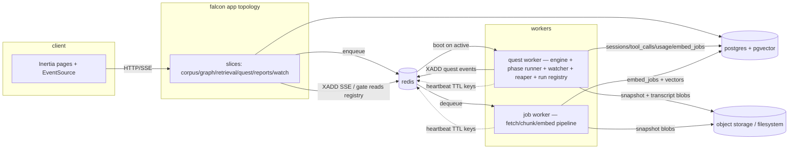
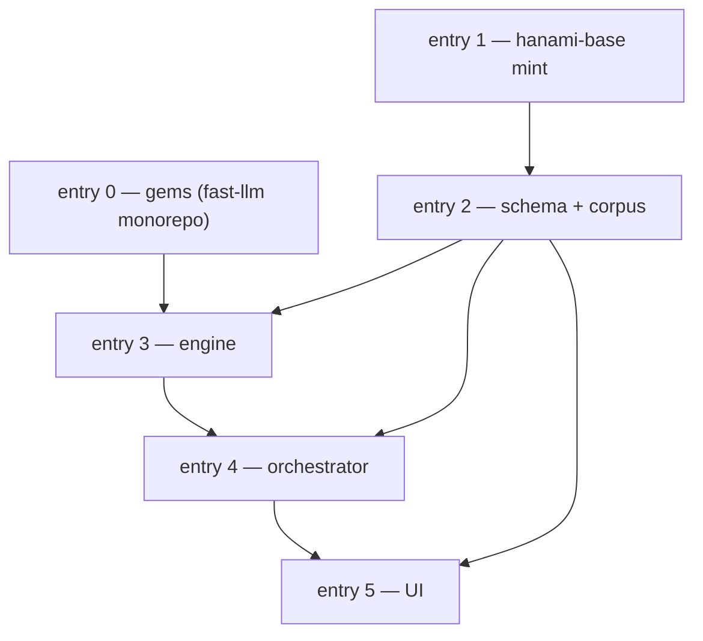

# I08 — app-architecture: DESIGN

> The application architecture that HOSTS the design phase's output: the
> Hanami slices, the job topology, the SSE event stream (the quest-watch
> successor), the UI surface map with the steering console, the deployment
> shape, the security posture, the PoC fixtures plan, the ladder_passes
> durable carrier decision, and the implementation-arc sequencing
> proposal. Owned requirements: catalog §H, R-073–R-081. This entry
> CONSUMES I01–I07; it re-litigates nothing. Owned rulings honored exactly:
> ProviderDesk naming ("seam" retired — no component below is named one);
> pause-and-present is the law for runtime decisions (the steering console
> PRESENTS choices, the operator decides, nothing auto-enforces);
> tripwires signal on the SSE `assurance_alert` slot; budget lines are
> advisory-default except the sliced-read cap; the ladder is an eval
> framework, never binding policy.

## 0. Method and what this entry consumes

This is the last design entry: nothing below is new law about the graph,
the loop, or the process — all of that is I01–I07, consumed as-is. What
is new here is only the HOST: which Hanami slice serves which subsystem,
which process runs which job, which event crosses the wire, which page
eats which view, and in what order the implementation arc builds it.
Every design surface below cites the prior-law artifact it consumes; the
consumption map (`artifacts/consumption-map.tsv`) is the machine-checkable
inventory of that consumption, and `artifacts/check-consumption.sh`
derives the minimum consumed set from the prior artifacts themselves
(tables/views from the three schema files, the I01 canonical query
objects, the I02/I03 query families, FM rows, I05 fixtures + parity
fields, SR ids + config keys + transition pairs, tw_* predicates,
I07 metrics + blind spots) and fails on any gap.

The hanami-base substrate (`repos/hanami-base/`) is read as CODE.
Adopt-vs-specialize decisions cite real files: `config/app.rb`,
`config/settings.rb`, `config/providers/{db,redis,job_queue}.rb`,
`app/stream_action.rb`, `lib/template/sse.rb`, `lib/template/sse/fanout.rb`,
`app/actions/ticker/{index,publish}.rb`, `app/attachment_uploader.rb`,
`app/jobs/process_document.rb`, `bin/worker.rb`, `falcon.rb`, `bin/serve`,
`Containerfile`, `gems/*`. D8's law: adopt, don't rebuild — the substrate
is the harness and transport every project wants, carrying no domain.

## 1. Slice map (R-073) — subsystems → Hanami slices

BRIEF §6 names the layers (app / engine / storage / tool surface /
retrieval) and §2 the subsystems (Corpus, Graph, Process, Product,
Engine, Retrieval). The Hanami 3 slice layout maps the HTTP-serving half
of those subsystems one-to-one onto slices; the Engine (I04's ten
components) is deliberately NOT a slice — see DR-01. The minted module
name is `Kquest` (bin/bootstrap renames `Template` → `Kquest`; the
substrate's two carry-overs the README flags — the `users.github_uid`
column and the `read:org` scope — ride the mint unchanged and are
revisited only if the authorization rule ever needs them).

| slice | subsystem (BRIEF §2) | hosts | adopted substrate | kquest adds |
|---|---|---|---|---|
| `slices/corpus` | Corpus | sources, fetch staging, chunk strategies, snapshot reads | `app/attachment_uploader.rb` (the Shrine storages switch is §7), ROM relation pattern (`app/relations/documents.rb`, `app/repos/documents_repo.rb`) | source registration actions (role law: citable vs agenda), chunk-strategy config actions, `v_unmined_sources` surfaces |
| `slices/retrieval` | Retrieval | embedding model registry, embed-job control, hybrid search service | the job-queue construction (`config/providers/job_queue.rb`) | registry pages (register/retire/A-B), embed-job launch actions, the hybrid RRF query service behind `retrieve` |
| `slices/graph` | Graph | claims/evidence/edges/frontier read surfaces | — (no substrate analog; plain ROM relations over the I01 schema) | graph browser data actions, canonical-query service (I01 Q1–Q4 objects), hub review tab over `v_canonical_claims` |
| `slices/quest` | Process | quests, phases, sessions, stop-rule/routing config, lifecycle, the steering console actions | session auth (`app/actions/sessions/`, `app/operations/authorize_user.rb`), cookie sessions (`config/app.rb` `SESSION_EXPIRE_AFTER`) | quest CRUD + lifecycle ops (pause/resume/archive — operator console surface, I04 §5.4), `process_config`/`model_config` editing, the interactive briefing |
| `slices/reports` | Product | report versions, citation binding, report rendering | the uploader (report bodies are D8 blobs) | version chain pages, binding-pass launch, standing flip, import marking |
| `slices/watch` | Assurance surfaces | SSE actions, metrics endpoint, alert queries | `app/stream_action.rb` + `lib/template/sse.rb` + `lib/template/sse/fanout.rb` (adopted wholesale) + the ticker pair as the wiring exemplar (`app/actions/ticker/{index,publish}.rb`) | quest-watch successor streams (§3), `assurance_alert` slot, `/metrics` (fast-prometheus shape, I07 §5), tripwire query surfaces |

Root `app/` keeps exactly what the substrate shipped: auth actions,
home, healthcheck mount (`config/routes.rb` `/up`), force-ssl,
credentials. The frontend kit (Vite + React + Inertia + Tailwind,
`config/providers/inertia.rb`, `config/providers/vite.rb`) is adopted
as-is; every slice's pages are Inertia pages over it. The two
configuration points the substrate README names — the OAuth provider map
(`config/app.rb` `OAUTH_PROVIDERS` + `config/settings.rb` `oauth_providers`)
and the sign-in authorization rule (`app/operations/authorize_user.rb`)
— are kquest's two adopt-then-configure points for D6: multi-user day
one means any authenticated identity may hold a workspace (the default
rule stands day one), with `v_resource_visibility` (I02) gating every
domain read; workspaces + grants (I02 §8) are the sharing layer.

**Engine placement (DR-01).** I04's ten components
(`LoopDriver, ProviderDesk, RetryGovernor, ToolHarness, TranscriptLedger,
SpendRecorder, SessionSupervisor, SubagentRunner, ContextBudgeter,
StreamWatch`) live in `lib/kquest/engine/` — plain application code with
no HTTP surface. The quest worker (§2.2) is their only host process;
slices never run the loop, they only read its durable output (the I01
ledgers) and drive its lifecycle through quest/steering actions. The
`ProviderDesk` name is used verbatim (the I04-ratified component name;
"seam" stays retired).

**Adopted wholesale, cited as code** (no kquest rebuild): the SSE
transport (`app/stream_action.rb` — gate in `#handle` before
`render_stream`, backlog-then-live-tail with the subscribe-first race
discipline; `lib/template/sse.rb` — `entry_bound`/`entry_key`/`frame`;
`lib/template/sse/fanout.rb` — one `XREAD BLOCK 0` task per key, the
dedicated-connection pattern, 15 s heartbeat), the falcon topology
(`falcon.rb` service `kquest.web` over `bin/serve`), the job queue
(`config/providers/job_queue.rb`: Inline in test, redis processor
otherwise; one shared Delegate construction — `app/jobs/process_document.rb`
`build_redis_processor(prefix:)`), the redis provider
(`config/providers/redis.rb`), the DB provider with fiber concurrency
(`config/providers/db.rb`), the five in-tree gems (`hanami-credentials`,
`hanami-force-ssl`, `hanami-healthcheck`, `inertia-hanami`, `vite-hanami`),
and the Containerfile's three-stage build. **Specialized:** the
uploader (§7), the worker topology (§2.2 — the substrate ships a
DEV-ONLY worker and says so: `bin/worker.rb` "deliberately carries NO
supervised/managed worker topology"), and the stream keys (per-quest,
§3). **Excised:** the ticker demo pair, the documents example, and the
example page — the README's mint law ("the script's own pattern strings
are the tokens it sweeps") removes template tooling; the demo actions
leave with it.

## 2. Job topology (R-074)

The PoC's bash driver splits into three process classes plus two
ledger-feeding side jobs. The named jobs (machine-checkable against the
surface index):

```jobs
phase runner
fetch→chunk→embed pipeline
re-chunk/re-embed job
transcript watcher
reaper sweep
cap telemetry job
```

```processes
app            — the falcon web topology (bin/serve → falcon.rb; Inertia pages + SSE actions + auth)
quest worker   — one OS process per ACTIVE quest; hosts the I04 engine + the phase runner + the run registry
job worker     — the adopted substrate worker (bin/worker.rb shape); dequeues corpus pipeline jobs
```

### 2.1 The phase runner (job: `phase runner`, process: quest worker)

The phase runner is the orchestrator of I04 §5.4 — it launches phase
attempts as engine sessions through the launch gate, and it is a pure
CONFIG CONSUMER of I06's two TSVs (I06 §14: "the implementation arc reads
both TSVs as the config source for the phase runner"):

- `design/I06-quest-process/artifacts/transitions.tsv` — the transition
  law: each phase-boundary evaluation resolves the guards
  (`bare_claims`, `unreferenced`, `dual_arm_claims` over `v_claim_closure`;
  `v_decompose_remaining`; `v_frontier_open`; `fb_eligible`;
  `mass_decay_sustained`; `plateau_flat`; `citation_coverage`;
  `verification_clean`) against the current quest and walks the matching
  `(from_phase, event, guard) → to_phase` row. The runner NEVER encodes
  a transition; it evaluates the table (the same law the `status` tool
  shows — I05 parity: the runner's boundary sweep fields are exactly the
  parity fields).
- `design/I06-quest-process/artifacts/stop-rules.tsv` — the 19 stop
  rules with their config keys: every boundary, the runner re-reads the
  live config (I06 §6.2: global defaults overlaid by
  `quests.process_config` + the three budget columns +
  `quests.model_config`), evaluates each rule's metric against the
  rollups (web calls counted at the tool — I05 §7.1; tokens/spend over
  `usage_events` at turn boundaries — I04 FM-17), and routes per the
  rule's action column: `route-to-synthesis` (never-reportless: the
  synthesis prompt carries the stop marker as provenance),
  `pause-and-present` (§5 — a pause plus a steering-console menu),
  `stop-loud` (graph_invalid only), `adjust` (behavioral change: refuse
  new corpus ingestion, bank at the next turn boundary — SR-15).
- Both TSVs ship as application seed data (checked into the repo, loaded
  at boot), not as prose: the implementation arc entry 2 lands them as
  the runner's config tables verbatim.

The runner's own lifecycle is a job: the quest worker boots when a quest
reaches `active` (lifecycle event → enqueue), cold-boots per I04 §5.1,
runs attempt loops until the quest leaves `active`, and exits when the
quest is paused/stopped/complete/archived (the worker exiting on pause
is safe: nothing is live; resume enqueues a fresh worker; L7 makes every
boundary recoverable).

### 2.2 The fetch→chunk→embed pipeline (job: `fetch→chunk→embed
pipeline`, process: job worker)

Consumes I03's `embed_jobs` ledger exactly as specified (I03 §3.2/§6):

- **fetch** — one job row per source fetch; the fetch itself is a
  `web_fetch` tool call (the web-call budget's unit, counted at the
  tool, I05 §7.1); fetch jobs record web-call spend, never token spend
  (no usage row, by I03 law). The snapshot blob + raw response land in
  object storage via §7's uploader in the same transaction as source +
  quest membership registration.
- **chunk** — strategy-scoped runs; re-chunk is a NEW strategy row + new
  chunk rows, old generations retained in place (L10; I03 DR-10).
- **embed** — model + target-family scoped (chunk-family embeds carry the
  strategy); the job worker slices batches per the registry row's
  `batch_max_texts`/`input_max_chars`, writes vectors into the generated
  per-model table, and advances the durable resume cursor `done_items`
  (per-target REPLACE semantics: each vector row is complete or absent).
- **Idempotency + resumability** (I03, consumed exactly): caller-minted
  deterministic `idem_key`; `uq_embed_jobs_idem_active` allows exactly
  one non-failed row per key — rerunning a completed scope finds the
  completed row and no-ops; a FAILED run's retry is a new row sharing
  the key; a killed `running` row stays running until resumed from
  `done_items` or reaped by the reaper sweep (the I01 DR-12 cold-boot
  reasoning applied to pipeline jobs).
- **J-SPEND both directions** (I03 constraint law E08/E21/E18,
  `ck_embed_jobs_usage_kind` + `ck_embed_jobs_complete_spend` +
  `fk_embed_jobs_usage`): a completed embed job links EXACTLY ONE
tenancy-pinned `usage_events` row of kind `embedding` (input tokens =
  batch totals, cost from the provider, NULL for local) — and
  conversely a usage row of kind `embedding` implies its embed job
  completed. The wiring direction matters: the job worker's SpendRecorder
  call site writes the usage row at completion in the same transaction
  as the job's terminal state, so both CHECK constraints hold by
  construction, never by repair.
- **Re-chunk / re-embed** (job: `re-chunk/re-embed job`): a re-chunk run
  is a new strategy + chunk job + embed job generation (different idem
  key — they compose, I03 §6); corpus-wide re-embeds run as explicit
  per-quest jobs (one per (strategy, quest), I03 DR-06 ruling A —
  `ck_embed_jobs_scope`), so every usage row lands on the quest that
  spent it. The re-chunk/re-embed job is launched from the retrieval
  slice's registry pages (register model / new strategy / re-embed
  generation buttons) and the corpus pages.

### 2.3 Worker processes + the worker registry (I04 DR-05's liveness source)

- **Worker registry** (named surface): a redis-backed liveness registry.
  Every worker process (quest worker, job worker) holds a heartbeat key
  `kquest:worker:<worker_uuid>` with a TTL of 3× the heartbeat interval
  (heartbeat interval 10 s, TTL 30 s), value = JSON
  `{pid, kind, host, boot_at, quest_id?}`. A dead worker's entry
  disappears with it (I04 DR-05's requirement, verbatim: "worker
  liveness is the honest crash signal ... unlike heartbeat columns (new
  schema) or pidfiles"); the TTL is the mechanism — no reaper can leak a
  stale liveness key. Redis is the right home because liveness is
  runtime state, never durable law (the I01 DR-12 posture), and because
  the launch gate's transactional check (§2.4) needs a source that is
  readable inside the gate transaction without a second PG round-trip
  that could itself go stale.
- **Launch gate wiring** (I04 DR-05, consumed exactly): the quest
  worker's SessionSupervisor runs the gate — `SELECT … FOR UPDATE` on
  the quests row FIRST (judge-F2 serialization), then the liveness
  check: refuse the session insert if any session of the quest has
  `ended_at IS NULL` AND its owning worker is live in the worker
  registry. The refusal names the holder session and driver (FM-16).
  The operator interactive attach (the briefing, §5.3) and the runner's
  phase attempts compete for the SAME gate (L13).
- **Reaper sweep** (named job, process: quest worker at boot + periodic;
  the job worker self-sweeps its own orphaned job rows): sessions with
  `ended_at IS NULL` whose worker is gone from the registry are stamped
  `ended_at` (ledgered sweep — FM-21); a killed `running` embed job row
  resumes from `done_items` or is marked failed with the error pair
  (`ck_embed_jobs_error_pair`) when its owning worker is gone.

### 2.4 The transcript watcher (job: `transcript watcher`, process: quest worker, in-process)

I07 DR-07 ruled the durable SQL projections (tw_slowstall,
  tw_size_ceiling) one-sided: audit bytes are a LOWER BOUND of live
  transcript bytes — firing is reliable, quiet is not proof. The
  byte-accurate LIVE half therefore rides THIS entry's watcher: the
  quest worker's StreamWatch tails the session transcript blob's byte
  growth (the same bytes TranscriptLedger appends — L8) and evaluates
  the same I06 stop-rule keys the SQL projections read:
  `engine.slow_stall_bytes` (100) over `engine.slow_stall_window_s`
  (1200), `engine.transcript_ceiling_warn_bytes` (450000),
  `engine.transcript_ceiling_hard_bytes` (496000), and
  `engine.unattended_pause_s` (3600). The watcher's signals ride the
  same rails as the SQL tripwires: the `assurance_alert` SSE slot (§3)
  and the I06 transitions rows that own the consequence
  (`transcript_ceiling → paused`, `slow_stall_unattended → paused`) — the
  watcher never kills anything (FM-18), never ends a session, never
  transitions a phase on its own; it DETECTS and SIGNALS. FM-14's
  dropped-chunk count is a gem/runtime counter the watcher also reads
  and reports (it is not a `tool_calls` error class — I07 named it here
  for the watcher, not as SQL).

### 2.5 Cap telemetry (job: `cap telemetry job`)

Every capped listing surface (frontier, search, corpus lists — L15,
  I05 DR-09/I03 caps) emits a per-request cap record
  `{surface, requested, cap, existed}` through the tool harness's audit
  transaction. The cap telemetry job folds these into the
  `capped_listing_overhang` blind-spot metric (I07 §6, deferred at I07
  DR-05 to "cap telemetry" wiring — wired here) and the
  `capped_listing_overhang` rows feed the dashboard's blind-spot panel
  and the frontier inspector's overhang badge (§4).

### 2.6 Subagent runs + the run registry

I04 E-SPAWN: the run registry is engine runtime state hosted by the
  quest worker process (in-process, like the PoC's driver-side registry;
  `subagent_spawn` returns immediately, `subagent_status` polls by run
  id, no result ≠ no process — FM-20). Children write their results to
  durable state through their own sessions' tool calls (L7), so the
  registry's loss on worker death loses bookkeeping, never data; the
  reaper sweep handles the orphaned children rows like any session. Run
  lifecycle events project to the `subagent.run` SSE event (§3) so the
  operator console can watch band-survey progress live.

### 2.7 Topology



Every arrow above is a consumed prior-law artifact: the enqueue path is
`config/providers/job_queue.rb`; the SSE XADD is the ticker pair's
capped-XADD idiom (`app/actions/ticker/publish.rb`); the heartbeat keys
are §2.3; the gate is I04 DR-05; the transcript blob writes are I04
TranscriptLedger; the vector writes are I03 §3.3's generated tables.

## 3. SSE event design (R-075) — the quest-watch successor

The PoC's `quest-watch` instrument panel (reference-claim-graph-mechanics
§7: claims/frontier counts per phase, the graph-check echo, the
fuse/queue reading) becomes a per-quest live event stream on the
adopted substrate. Everything `quest-watch` rendered by polling a
transcript file, the stream delivers as typed events the moment they
land.

### 3.1 Transport (adopted; DR-03)

- **Carrier**: one redis stream per quest, key `kquest:sse:quest:<uuid>`,
  `XADD` with `MAXLEN ~ 5000` (the ticker's capped-XADD idiom,
  `app/actions/ticker/publish.rb`; the cap bounds redis memory — history
  lives in PG ledgers, the stream is a live tail plus reconnect backlog,
  not a store). One GLOBAL stream `kquest:sse:user:<uuid>` carries
  cross-quest alerts for the dashboard's alerting panel (§4).
- **Envelope** (the substrate's shape, unchanged): each entry carries
  two fields, `type` (the event name below) and `data` (a single JSON
  object); the redis `ms-seq` entry id rides the SSE `id:` line verbatim
  so a reconnect's `Last-Event-ID` resumes exactly
  (`lib/template/sse.rb` `frame`).
- **Serving**: `Watch::QuestStream` subclasses the adopted
  `StreamAction` and gates in `#handle` FIRST (the substrate's law:
  gating before `render_stream` keeps the error response ordinary JSON;
  once SSE headers are set an error can only surface as a broken
  stream): the session user must pass the quest's visibility check
  (`v_resource_visibility` — I02) before the stream opens.
- **Fan-out**: `lib/template/sse/fanout.rb` adopted wholesale — one
  `XREAD BLOCK 0` task per key, one `Async::Queue` per connected client,
  15 s heartbeat comment, the dedicated-connection discipline the file
  documents.

### 3.2 Event catalog

```events
quest.state
quest.stop
phase.state
session.state
tool.event
spend.tick
frontier.mass
assurance_alert
subagent.run
watcher.bytes
```

| event | payload fields | when emitted |
|---|---|---|
| `quest.state` | `quest_id, from_state, to_state, actor, note, fingerprint?` | every `quest_lifecycle_events` insert (I02's ledgered state machine: active→paused, paused→active, →complete, →stopped, stopped→active restart, →archived with the freeze fingerprint) |
| `quest.stop` | `quest_id, rule_id, phase_no, phase_kind, reason, route` | every stop-rule firing that routes (the I06 §5 loud shape, item 3: "the operator surface ... as an alert-class event, not a log line to tail"; `route` ∈ route-to-synthesis / stop-loud / pause-and-present) |
| `phase.state` | `quest_id, phase_id, phase_kind, attempt_no, phase_state, bare_claims, unreferenced, dual_arm_claims, decompose_remaining, frontier_open, frontier_mass` | every phase attempt start/boundary/complete — the gate sweep fields are EXACTLY the I05 parity fields (the runner sweeps and the status tool shows the same numbers; no asymmetric validators) |
| `session.state` | `quest_id, session_id, driver, mode, session_state, banked?, note` | session insert / bank / pause-delivery / end (I04 §5; cold-boot rows are the durable truth, the event is the live mirror) |
| `tool.event` | `quest_id, session_id, tool, ok, error_class?, duration_ms` | every tool call (mirrors the `tool_calls` audit row — L8; the event is a projection, the PG row + transcript blob are the audit) |
| `spend.tick` | `quest_id, session_id, phase_id, model, input_tokens, output_tokens, cache_read_tokens, cache_write_tokens, reasoning_tokens, cost_usd` | every `usage_events` insert (the D10 ledger's live mirror; feeds the cost views) |
| `frontier.mass` | `quest_id, frontier_open, frontier_total, frontier_mass` | every phase boundary (the quest-watch line's descendant: claims N · frontier open/total) |
| `assurance_alert` | `quest_id, predicate, key fields` (predicate-specific: e.g. `tw_wedge` carries `last_tool`; `tw_size_ceiling` carries `band, bytes`; `tw_fingerprint_drift` carries `pin_kind`) | every I07 tripwire fire (SIGNAL ONLY — the I07 law: no tripwire ever transitions a phase, none ever auto-kills) + the transcript watcher's byte-accurate live signals (§2.4) under the same I06 stop-rule keys |
| `subagent.run` | `quest_id, parent_session_id, run_id, profile, band, run_state` | subagent spawn/first-result/done/failed (I04 E-SPAWN; the run registry's projection) |
| `watcher.bytes` | `quest_id, session_id, transcript_bytes, growth_bytes, window_s` | the transcript watcher's periodic byte census (the DR-07 live half; the operator sees growth, not just predicates) |

### 3.3 Resume semantics (adopted from the substrate, unchanged)

A reconnecting client sends `Last-Event-ID` = the last `ms-seq` id it saw;
`Template::SSE.entry_bound` turns it into the EXCLUSIVE xrange start
bound; the action replays the stream's backlog (≤ MAXLEN entries) then
live-tails. The subscribe-first-then-backlog discipline
(`app/stream_action.rb`: subscribe, then `xrange`, dedupe against the
delivered cursor with the numeric tuple compare) closes the
subscribe/backlog race; unparseable/absent ids replay from `-` (the
whole retained backlog). A client offline past the MAXLEN window finds
the next event's `id:` discontinuity and re-reads history from the PG
ledgers (the UI surface map marks which panel reads live events vs
ledger queries — the stream is a tail, the database is the truth).

### 3.4 The assurance_alert slot

I07 DR-10 named the slot; this design is its host. Two producers write
it: (a) the SQL tripwires — a poller on the watch slice evaluates the
13 `tw_*` views on a cadence (default 30 s per live quest; the
predicate's fire fixture proves the shape) and XADDs a fire with the
predicate id + key fields; (b) the quest worker's in-process signals
(transcript watcher byte-accurate half, StreamWatch dropped-chunk
counts). Both carry `predicate` names; the SQL predicates carry their
`tw_*` ids, the watcher's live half carries the SAME I06 stop-rule
config keys (`engine.slow_stall_bytes` etc.) so a UI filter by key
sees both halves of one signal. No consumer of this slot may act
automatically on an alert: alerts land on the alerting surface (§4) and
the steering console (§5) as REVIEWABLE choices — the standing lesson
(eval/pause surfaces, never binding policy) is the wiring law here.

## 4. UI surface map (R-076)

Eight surfaces (the catalog's names, verbatim). Every read is visibility-
gated (`v_resource_visibility` — I02; per-user sources, shared through
workspaces + grants); every write action is an HTTP action in its slice.
No surface is a mockup here — this is the data/action map; visual design
is the implementation arc's business.

| surface | reads | actions offered |
|---|---|---|
| `dashboard` | the user's quests (`quests` + `quest_lifecycle_events` state), live quest cards fed by `quest.state`/`phase.state`/`frontier.mass` events, blind-spot panel (I07 §6: `unmined_citable`, `fetched_never_cited`, `uncited_claims`, `aging_open_needs` — day-one SQL rows per I07 DR-05; `capped_listing_overhang` joins when §2.5 telemetry lands), the honesty-bounds panel (I07 §1's guarantee map: the ENFORCED/REDUCED/UNTOUCHED ladder as the assurance framing of everything below), workspace-admin reads (I02 workspaces/members/grants) | create quest (topic + agenda docs + budgets + routing map — the pre-briefing form), open quest view, pause/resume shortcuts, workspace + grant administration (the I02 deferral's grant authz UI) |
| `quest view` | one quest: lifecycle ledger (`quest_lifecycle_events`), phase history (`phases` + result JSONs + attempt accounting), sessions (`sessions`), the live event feed (all §3 events), `quest_status` parity lines (budgets used/cap, writer, quest/phase state — I05 parity), `v_unmined_sources`/`v_decompose_remaining` counters, `process_config`/`model_config` (the routing map editor cites `ladder_passes` evidence — §10), quest fingerprint (`v_quest_graph_fingerprint`) | pause/resume (lifecycle ops), launch briefing (the interactive briefing, §5.3), edit config through pause only (D5), request archive, launch re-synthesis (I02 §7: repeat synthesis+verification over the same graph), open frontier inspector / graph browser / report view |
| `frontier inspector` | `frontier_entries` + `v_frontier_open` + `v_frontier_mass` (open/total, the quest-watch fuse/queue reading), closure classes (`closure_type` fetch/internal/refusal), aging bands (`aging_open_needs`), the overhang badge (`capped_listing_overhang` via §2.5) | filter/sort by mass decile, age, state; add a frontier entry by hand (operator-authored need, an audited tool-call-shaped write); export the frontier snapshot |
| `graph browser` | claims/evidence/edges/derivations (`claims`, `evidence`, `evidence_edges`, `claim_derivations`), closure status per claim (`v_claim_closure`), neighborhood + paths via the canonical query service (I01 Q3/Q1/Q1V/Q2 objects), lineage (`v_quest_lineage` — origin quests, graft chains), the cross-quest hub tab (`v_canonical_claims`: reuse lookup, type divergence rows feeding `tw_hub_divergence`, the near-dup designated slot's candidates), conflicts ledger (`conflicts` + `conflict_sources` + resolution hypotheses — the I07 §3 courtroom workflow's docket) | traverse (node → neighbors → derivation paths), open the source snapshot at span offsets (the evidence's return address), record a conflict resolution hypothesis, adjudicate a divergence in the SOURCE quest (ledger a conflict row) |
| `report view` | the version chain (`report_versions` + pinned fingerprints), the standing body, `report_citations` (ordinals bound to URNs), the binding-pass manifest (I02 B1), staleness banner (`tw_fingerprint_drift`: pinned ≠ live fingerprint — I07's detected-not-prevented law), the arc's stop markers in the synthesis provenance (I06 §5 item 4: CUT AT MASS / DRAINED / STOPPED-LOUD as distinguishable forever) | draft new version (re-synthesis routing per I06 §7.3: cheap builder + strong writer), run the binding pass, flip standing (report_bind), mark imports explicitly, download the body blob |
| `steering console` | §5 in full — the pause surface, the runtime-decision menus, the steering payload editor | pause request, choose from every presented menu, edit `process_config`/`model_config`/quest-local law overlays, resume |
| `cost views` | `usage_events` rollups by the full D10 chain (session→phase→quest→user; `spend.tick` live), closure economics (`closure_economics_cost_per_class`), `cost_per_claim`/`cost_per_evidence`, `metabolism` ratios vs the R-018 constants (deviations are themselves signals), `empty_completion_rate`, embed spend via the J-SPEND-linked usage rows | filter by quest/phase/model/window; export CSV; NOTHING here throttles or blocks — reporting-only, the I07 DR-08 ruling verbatim ("these should not bind the operator") |
| `alerting` | the `assurance_alert` feed (both streams: per-quest + user-level), the 13 `tw_*` predicates' current fire sets, `refusal_rate_session` + `refusal_class_census` (the quest-2 taxonomy's classes), `transcript_audit_bytes`, `tripwire_fires` counts, `mass_curve` anomalies | acknowledge (a UI state, never a system state), open the steering console pre-loaded with the alert's quest + menu, mute a predicate per quest (a display filter, recorded in config with who/why — the override is RECORDED, never hidden, and never blocks the signal's ledger row) |

Surface placement: `dashboard` root `app/` (home redirects to it);
`quest view` + `steering console` in `slices/quest`; `frontier inspector`
+ `graph browser` in `slices/graph`; `report view` in `slices/reports`;
`cost views` in `slices/quest` (spend ledger) with the live tail served by
`slices/watch`; `alerting` in `slices/watch`.

Two I02-deferred UIs land here by name: the hub-review UI is the graph
browser's hub tab; the workspace-admin/grant UI is the dashboard's
admin panel (report-rendering is the report view).

## 5. THE STEERING CONSOLE FLOW (R-076/D5) — pause → interactive session → resume

The steering console is the HITL core's one surface (BRIEF D5): the
operator's hands on a quest, and the ONLY hands. Its interaction law is
ratified law, restated as wiring (DR-05 of the decision records):

1. **Pause is the only door** (I04 DR-04). The console's pause button
   writes the lifecycle request → the quest ledger records `active →
  paused` (I02's legal transition) → the quest worker's
   SessionSupervisor delivers it at the next TURN BOUNDARY when the
   in-flight turn can bank, else cancels it via `Chat#cancel` (FM-19:
   `CancelledError`, no phantom terminal, the half-streamed turn never
   appended; committed mutations survive — L7). Steer-while-running is
   REJECTED (D5) and the console enforces the rejection structurally:
   every config control is disabled while the quest is `active`, enabled
   the moment it is `paused` — the console cannot express a mid-run
   injection, so the race the PoC measured (the tender's restart
   "would have raced the swap") cannot be typed into it.
2. **Steering lands as durable config, never as a message.** Edits go to
   `quests.process_config`, `quests.model_config`, the three budget
   columns, and the quest-local law overlays (I06 §10.2) — re-read at
   session start and every phase boundary (I06 §6.2). Nothing is
   injected into a running session (there is no running session: the
   quest is paused).
3. **Resume** re-opens the gate: `paused → active` (ledgered), a fresh
   quest worker boots, the new session cold-boots (I04 §5.1) and reads
   the re-read config; phase attempt numbering continues across the
   pause (the banked phase-86 → phase-87 precedent).
4. **Interactive sessions are sessions** (I04 §5.4): the interactive
   briefing and any operator attach run through the same launch gate,
   same tools, same constraints, same audit (`sessions.driver =
  'operator'`, mode `interactive`) — one active writer per quest holds
   for both launch modes (L13).

### 5.1 The runtime-decision menu catalog (pause-and-present, AC4)

Every runtime decision the design accumulated lands here as a REVIEWABLE
menu. The console PRESENTS options with their evidence; the operator
picks; the choice is recorded in config provenance / lifecycle notes;
NOTHING auto-enforces (the standing lesson, third occurrence now law:
design the evaluation/pause surface, not binding policy). The menus:

| menu | trigger (prior law) | presented options |
|---|---|---|
| **transcript ceiling** | `any-phase transcript_ceiling → paused` (SR-16 hard bytes; I04 DR-06 as ruled: "the operator decides") | (A) swap at the wall — pause-and-route the remainder to a large-window model per the routing map (the PoC's executed ruling; presented first — the only option with live evidence) · (B) compact-and-continue — cold-boot a successor session from a compacted transcript on the same provider · (C) refuse-and-report — leave the quest paused for disposition. The warn band (SR-15) had already refused new corpus ingestion and banked at the boundary before this menu opens |
| **retry cap exhausted** | `any-phase retry_cap_exhausted → paused` (SR-08) | resume as-is (a fresh attempt on the same config) · raise `phase.retry_cap` (the v3 RETRY_CAP=8 precedent — a config edit recorded with who/why) · re-route the phase kind's model · stop the quest |
| **budget exhausted at a finisher phase** | `any-finisher-phase budget_exhausted → paused` (SR-02/03/04 + FM-17; synthesis/verification are cap-exempt — the finisher reserve, I06 DR-06) | raise the crossed line (a recorded config edit; the half-written report is preserved) · pause here and let the operator dispose (a budget stop is never silently reportless) |
| **budget signals, advisory** | SR-02/03/04 lines in advisory mode (I04 DR-09 as ruled: advisory by default, per-line toggleable to hard; I07 DR-08: reporting-only, "these should not bind the operator") | NO menu fires — advisory lines surface as quest view / cost views lines with the frozen `web_calls=<used>/<cap>` echo; the operator MAY pause and adjust on their own judgment. Making a line hard is itself an operator config decision, taken at pause, never automatic |
| **slow stall, unattended** | `any-phase slow_stall_unattended → paused` (SR-17/18/19; FM-18: alert-only by itself, NEVER auto-kill on growth alone) | resume (the stall may be a slow local model — expected pace) · re-route · swap model · stop. The alert text carries the FM-18 rule verbatim ("the driver is NOT to be killed on this alone") |
| **verification failed** | `verification verification_failed → paused` (rework-pause) | correct in place and resume (v4 astra corrected K227/E300 in-phase) · re-synthesize (the builder/writer routing, I06 §7.3) · leave paused. The drift between the pinned fingerprint and the reworked graph is detected, never prevented (I02 DR-17) |
| **graph_invalid (stop-loud)** | `any-phase graph_invalid → stopped` (the ONE stop that cannot route to synthesis: a broken artifact cannot be honestly reported on) | the refusal names the repair path ("needs repair, not a restart"); resume is the `stopped → active` restart precedent (I02's ledgered pair); the console shows the exact failing gate fields |
| **briefing-init caps** | `briefing-init budget_exhausted/phase_cap → paused` (SR-01/02/03/04) | raise the cap the briefing needs before autonomy, or abandon cleanly |
| **divergence / conflict findings** | `tw_hub_divergence` / spot-check findings on `assurance_alert` | adjudicate in the SOURCE quest via the graph browser's courtroom workflow (ledger a conflict, hypothesize, cross-examine) — a review workflow, never an automatic merge (the hub is derived, holds no state to fix) |
| **model qualification** | `quests.model_config` edit (any pause) | the routing map editor cites `ladder_passes` evidence per model (§10); the ladder's rung gates are the REVIEWABLE default — the operator may route a probe-only model anyway, the override recorded (who/why), never blocked (I07 DR-06 as ruled: eval framework, not binding policy) |

### 5.2 What the console is NOT

- Not an auto-enforcer: no menu pre-selects, no timeout auto-picks, no
  policy default fires on operator silence (the unattended window
  SR-19 PAUSES — it never chooses).
- Not a mid-run control: while `active`, the console is read-only live
  view (the quest view's event feed) + the pause button.
- Not a second ledger: every choice lands in the existing ledgers —
  `quest_lifecycle_events` (actor/note), config rows' provenance, the
  steering session's own `tool_calls`-shaped audit when it mutates
  graph state (L13: same tools, same constraints, same audit).

### 5.3 The interactive briefing (named surface)

I06 §8 is the contract, wired here: the briefing is the entry point —
an interactive session (`sessions.driver='operator'`, decompose round 1,
I01 DR-13) in which operator + agent stage agenda documents
(`quest_sources` role `agenda`: readable, NEVER anchorable or citable,
  natively excluded from the decompose gate by `v_unmined_sources`'
  citable filter — the C43 lesson is schema-native), freeze the topic,
  and write the topic questions (the ground truth I03's mechanical
  relevance embeds need-texts against). The `agenda_staged` gate then
  hands autonomy to the phase runner (the `briefing-init
  phase_complete → decompose` transition row); the operator watches on
  the quest view and steers only through pause from then on. The
  briefing's autonomy threshold is I06 DR-04's ratified call, not
  re-opened here.

## 6. Deployment shape (R-077)

Seven moving parts; dev and prod run the same seven (DR-07), with the
substrate's own environment switches as the only differences.

| part | dev | prod | prior law / substrate |
|---|---|---|---|
| `app` | `bin/dev` (falcon :3000 + Vite :3036) | `bin/serve` → `falcon.rb` service `kquest.web`, fronted by the `gateway` | `falcon.rb`, `bin/serve`, `bin/dev`; `FALCON_BIND` override for container deploys (falcon.rb comment) |
| `quest worker` | one terminal per active quest (`bin/quest-worker <quest_id>`) | same binary, supervised (DR-08) | §2.3; new (the substrate ships no worker topology and says so) |
| `job worker` | `bin/worker.rb` (adopted verbatim; a Delegate routing kquest's corpus jobs) | same binary, supervised (DR-08) | `bin/worker.rb`, `config/providers/job_queue.rb` |
| `postgres (+pgvector)` | local postgres + the pgvector extension, `DATABASE_URL` | managed/container PG with pgvector | D2/D4; the vector ops land with I03's hnsw indexes |
| `redis` | `REDIS_URL` localhost | managed/container redis | `config/providers/redis.rb`; required by the SSE transport + job queues + worker registry (DR-04) |
| `object storage` | Shrine `storage/{cache,store}` under the app root (filesystem day one) | same filesystem layout on a mounted volume, or S3-class = config swap | D8 + §7 (`app/attachment_uploader.rb` storages switch) |
| `gateway` | none (direct :3000) | TLS-terminating reverse proxy in front of falcon's TCP endpoint — the virtual-host topology falcon.rb's comment describes | force-ssl + host authorization ON in prod (`config/settings.rb` `force_ssl/assume_ssl/permitted_hosts`, `hanami-force-ssl` gem); off in dev per the substrate defaults |

**Dev/prod parity** (DR-07): the ONLY switches between the two worlds are
the substrate's own — `Hanami.env?` gates (Shrine memory storages in
test, filesystem otherwise; Inline job processor in test, redis
otherwise — `app/attachment_uploader.rb`, `config/providers/job_queue.rb`),
credentials (dev `bin/credentials edit` local master.key; prod
`TEMPLATE_MASTER_KEY`-style env + "production never wires the credentials
key — credentials.yml.enc stays inert" per the Containerfile header),
and the gateway/force-ssl pair. Same schema (`hanami db prepare`), same
redis keys, same stream keys, same worker binaries. The parity claim the
PoC could never make (files → Postgres, bash driver → jobs) is the point:
prod is dev plus TLS, supervision, and managed services — no bespoke
prod-only code paths.

**Supervision** is DR-08 (OPERATOR-RULING-NEEDED): the substrate's
Containerfile carries the app as one supervised falcon topology and
deliberately ships no worker supervision; kquest must decide (options:
falcon `service` blocks in `falcon.rb` for both workers — one config
file, one supervisor, falcon's own restart semantics; containerized
under an orchestrator per the Containerfile pattern; launchd/systemd
units). The decision record carries the recommendation (falcon service
blocks, with the orchestrator door open).

**Secrets/keys inventory at deploy time**: `DATABASE_URL`, `REDIS_URL`,
`SESSION_SECRET`, provider credentials — all via environment at runtime
("no secrets are baked in", Containerfile header) and the
hanami-credentials store; the LLM provider API keys live ONLY as
`api_key_ref` references (§8).

## 7. Shrine specialization (R-078) — sources are FETCHED, not uploaded

The substrate's uploader (`app/attachment_uploader.rb`) is adopted for
its STORAGE half only. The substrate's upload flow (the `documents`
example: POST a file → persist uploader JSON → enqueue) is NOT the
corpus ingestion path and leaves with the demo actions at mint.

- **What kquest keeps, cited**: the class-load storages switch
  (`Shrine.storages` set from `Hanami.env?` — memory in test, filesystem
  otherwise, resolved from `__dir__` so the path is cwd-invariant), the
  `store(io) → JSON string in a text column` representation, and the
  `uploaded_file` reconstitution pattern. This file IS the storage
  configuration point (R-078): swapping filesystem → S3-class is
  editing the storages assignment in one file (D8: "filesystem via
  Shrine config day one, S3-class later = config swap").
- **What kquest specializes**: the FETCH path writes through it. A
  `web_fetch` tool call (the only ingestion door — I05) fetches, saves
  the snapshot blob (`Kquest::BlobUploader.store(io)` — the canonical
  anchoring target, byte-pinned to `snapshot_char_count`), keeps the raw
  response blob (provenance), and registers source + quest membership
  in the SAME transaction (I05 §2 auto-indexing law); the sources row
carries the uploader JSON. Report bodies are stored the same way
  (D8's third blob class). Transcript blobs (`sessions/<uuid>/
  transcript.jsonl`, I04 TranscriptLedger) are append-mode files under
  the same store — appended, never truncated (L8).
- **Storage layout** (one name per concept):
  `storage/store/snapshots/<user>/<source-urn>`,
  `storage/store/raw/<user>/<fetch-id>`,
  `storage/store/reports/<report-version-id>`,
  `storage/store/transcripts/<quest>/<session>/transcript.jsonl`.
- **No upload UI exists**: there is no route that accepts a file for
  the corpus. Sources enter only through fetch (a budgeted, audited
tool call), which is the structural-containment point of §8 — the
  fetch layer is the single door through which outside text enters the
  system, and every byte of it is anchored, counted, and audited.

## 8. Security posture (R-079) — the PoC's four pillars, translated

The PoC's four pillars (kb-space BRIEF §2) were OS/harness invariants
of the quest agent's world. A multi-user web app cannot ask the OS to
contain a single trusted operator's process; it translates each pillar
into a STRUCTURAL containment of the web app's own surfaces. The four
pillars + the audit paragraph, translated one-for-one (consumers named
in the surface index):

| PoC pillar (kb BRIEF §2) | kquest translation | carrier |
|---|---|---|
| **§2.1 No bash** — the agent's loadout has no shell, enforced at both layers | the LLM's tool surface contains no shell/exec tool, by the I05 inventory (the 24 frozen tools; nothing else registers); subprocesses the WORKER needs (none planned — the engine speaks HTTP wires) would run under FM-04's pgroup deadline law anyway | `process containment` (named surface): the tool registry is closed — a tool not in the frozen inventory is never instantiated, never declared on the wire (the substrate's own settings-gating idiom applied to the harness); unknown tools get the frozen in-band refusal (I05 DR-05) |
| **§2.2 Egress: exactly two doors** — inference gateway + web API, for the process and every subprocess | the fetch layer egresses through exactly TWO doors: the configured provider gateway (OpenAI-wire, ProviderDesk — D1) and the configured web-search/fetch API; both live in config rows the worker reads at boot; per-user budget enforcement sits AT the fetch boundary: web calls are counted at the tool (`web_search`/`web_fetch` — exact counting, no rollup lag, I05 §7.1), the frozen `web_calls=<used>/<cap>` echo teaches, hard lines refuse BEFORE the wire (the frozen `budget-exceeded` refusal), advisory lines report (I04 DR-09 as ruled; the read_slice cap is the one hard line by default — I05 DR-04/A) | `fetch-layer budget boundary` (named surface) |
| **§2.3 Allowlisted reads/writes, not denylisted** — the space and nothing else under $HOME | TENANCY AS THE ALLOWLIST: every domain row carries `user_id` (I01 DR-01), every tool is tenancy-scoped by construction (no tool takes a user parameter — the session binds it), every UI read passes `v_resource_visibility`, snapshots/spans read ONLY through `source_read`'s sliced, offset-checked path against the pinned blob (L1 — no filesystem reads of arbitrary paths exist at all), writes confined to PG + the four storage roots (§7) | the slices' visibility gate + the closed tool surface |
| **§2.4 Key hygiene** — injected env, never in files, never in output/logs | credentials live in EXACTLY two places: the hanami-credentials encrypted store (app-level: OAuth, DB URLs, session secret — `bin/credentials`, inert in prod per the Containerfile) and `api_key_ref` REFERENCES in the registry/config rows (`env:OPENROUTER_API_KEY` — I03 §3.1: "a credential REFERENCE, never a secret — resolution is app-side"). Resolution happens in ProviderDesk at wire-build time; the resolved value never enters PG, logs, prompts (E-NOECHO — I04 DR-11), tool output, error text, or the transcript. A missing/expired ref fails the call LOUDLY (FM-26: final 401/403/404 classes, never retried) and the failure names the REF, not the key | `credentials boundary` (named surface) |
| **Audit paragraph** — the transcript IS the audit log | unchanged in kind, extended in scope: every tool call verbatim in `tool_calls` + the transcript blob (L8); every mutation + its audit row + transcript append in ONE transaction (I05 DR-10); every LLM/embedding call a `usage_events` row (D10) with the exactly-one-terminal-hook contract (FM-25) — and `tw_missing_spend` plus `tw_repetition` make the ledger's own completeness watchable; sessions/phases/lifecycle rows give every row its return address (which span, which fetch, which session, which phase) | `audit completeness` (named surface) |

**Web-app additions the PoC never needed** (multi-user day one, D6): the
substrate's own transport security is adopted — cookie sessions
(`SESSION_EXPIRE_AFTER` 30-day sliding window), OmniAuth sign-in, the
`authorize_user` policy point, force-ssl + host authorization in prod,
CSRF token discipline (the `X-XSRF-TOKEN` fetch idiom the ticker pair
exercises), and SSE stream gating in `#handle` before headers (§3.1).
Per-user isolation is the four-pillar allowlist at web scale: a user
sees only their quests/sources/grants — enforced at the query layer
(`v_resource_visibility`), not by UI hiding.

## 9. PoC fixtures plan (R-080, D7)

D7's law: NO migration path — PoC data is fixtures/examples, AD HOC, OUT
OF BAND: copied by hand into kquest's `db/seeds.rb` fixtures /
`test/fixtures/` / `examples/` when a specific test or demo needs them;
never imported by any automated job; never load-bearing for the app's
own behavior. The in-tree frozen fixtures (I05 `artifacts/fixtures/`)
are already kquest law — they seed the tool-surface tests directly and
are NOT PoC data. The PoC artifacts below are the out-of-band source
material, each named for the ONE thing it is uniquely good for:

| kb-space artifact (real path) | uniquely good for | lands as |
|---|---|---|
| `build/quest-arc-investing-bolt2/` (report.md + sessions/ + build/corpus/) | the finished-quest shape: 84/84 urn-bound footnotes, the self-caught C47→C48 citation fix, a complete verification-clean arc | `examples/bolt2-quest/` (read-only example quest: report + binding manifest for the report view) + report_citations binding-pass test seed |
| `build/quest-arc-llm-trading-v3/` (driver.log, ledger.json, sessions/) | the ceiling-band + failure-storm transcripts: the phase-105 empty-completion cluster, 496 KB ceiling deaths, SLOWSTALL windows, the v3 phase-87 wall kills | watcher + tripwire test fixtures (synthetic sessions seeded to reproduce the same signatures the real transcripts show) |
| `build/quest-arc-llm-trading-v2/` + `notes/arc-run-20261121T-quest2-failure-taxonomy.md` | the refusal/error taxonomy: 789 errored / 6,683 tool results, the class census, burst widths | `refusal_class_census` fixture values + alerting-surface demo data |
| `build/quest-medical-acurasys-2/`, `build/quest-medical-acurasys-3/` | the 78%-context full-file-read storm + the teaching-stack before/after (330+ → 24 turns) | context-budget test values (FM-22 fixture numbers) |
| `build/quest-arc-llm-trading-v4/` (+ v4-astra-20261123) | the drained-exit arc (86 → 0 open, mass 1199 → 0), astra re-synthesis, in-verification correction | descent-exit + re-synthesis test data; mass_curve example |
| `build/fleet-ladder/`, `build/glimmer-ladder/` | the qualification ladder's rung evidence (probe transcripts, the 12/12-vs-3/12 smoke discriminator, disqualified-candidate records) | `ladder_passes` example rows (§10) + ladder eval harness fixtures |
| `build/staging-llm-trading/`, `build/quest-arc-investing-bolt/` | corpus-clone / graft provenance shapes (urns re-keyed, inherited facets) | `v_quest_lineage` + hub reuse-lookup test seeds |
| `build/corpus/` (the investing corpus sources) | REAL source text for chunking/embedding pipeline tests (realistic lengths, headings, quote-density) | a handful of snapshots copied as blob fixtures for fetch→chunk→embed integration tests |
| `repos/hermit-kb/quest/quest-watch` | the watch surface's rendering contract (what the operator actually watched) | quest view layout reference only (no code copy — the SSE event catalog is the successor) |
| `repos/hermit-kb/quest/quest-driver` | the phase loop's behavioral reference (stop markers, RETRY_CAP handling, the WEB_BUDGET_RAISE precedent) | phase runner conformance-test scenarios (each transitions.tsv row gets a scenario trace modeled on a real driver incident) |

Every row above is: copied by hand when needed, cited by provenance in
the test that uses it, never fetched at build time, never in CI
network access (all tests hermetic — the PoC's own e2e-pillar rule).

## 10. The `ladder_passes` durable carrier (the I07 judge-F8 deferral, DECIDED here)

I07 deferred the rung-pass record's home to this entry with the shape
named. Decision DR-06: **adopt the named shape as a schema patch
proposal**, landing at implementation-arc entry 2 (this entry writes no
SQL — Grounds: "no new SQL schema expected (exceptions = decision-record
patch proposals)"). Proposed DDL (the arc's schema entry lands it
verbatim or amends it by decision record):

```sql
CREATE TABLE ladder_passes (
  id            uuid PRIMARY KEY,
  model         text        NOT NULL,          -- provider wire_name (data, never query text)
  rung          text        NOT NULL CHECK (rung IN ('probe','smoke','partial','full')),
  serving_stack text        NOT NULL,          -- a rung is (model, stack, date), never a title (I07 §7)
  passed_at     timestamptz NOT NULL,
  evidence_ref  text        NOT NULL,          -- the rung's transcript dir / ledger ids
  passed_by     text        NOT NULL           -- the operator who accepted the rung
);
CREATE UNIQUE INDEX uq_ladder_passes_rung ON ladder_passes (model, rung, serving_stack, passed_at);
```

The enforcement rule I07 recorded rides with it: **day one the rule is
REVIEWABLE, not machine-checked** — the quest view's routing-map editor
cites `ladder_passes` ids per model per phase kind (human-checked at
config time, recorded in the config row's provenance); a
`quests.model_config` row MAY carry the ladder_passes id as a column,
with the FK optional and OFF day one (an eval framework, never binding
policy — I07 DR-06 as ruled: the operator may override at runtime, the
override recorded, never blocked). The ladder's rung harness itself
(probe/smoke/partial/full scripts) is arc entry 4 work (the
orchestrator); its evidence feeds this table. A kill/revoke of a rung
(a model update invalidating a pass — the longcat/ tf-qwen
serving-stack precedents) is a DELETE + config re-review, visible in the
routing editor's evidence panel.

## 11. Traceability R-073–R-081

| R | Status | Carrier |
|---|---|---|
| R-073 | DESIGNED | §1 the slice map (six slices + root app; subsystem → slice; Engine placement DR-01; adopt-vs-specialize citing hanami-base files) |
| R-074 | DESIGNED | §2 job topology (phase runner consuming I06 transitions/stop-rules; fetch→chunk→embed + re-chunk/re-embed consuming I03 embed_jobs incl. J-SPEND both directions; worker processes + the worker registry I04 DR-05's launch gate reads; reaper; watcher; cap telemetry; run registry) |
| R-075 | DESIGNED | §3 SSE event design (10-event catalog with payload fields + emission triggers; adopted transport; resume semantics; the `assurance_alert` slot + DR-03 envelope) |
| R-076 | DESIGNED | §4 the eight UI surfaces (data reads + actions each) + §5 the steering console flow (pause → interactive session → resume; the §5.1 menu catalog — every accumulated runtime-decision menu presented, never auto-enforced) + §5.3 the interactive briefing |
| R-077 | DESIGNED | §6 deployment shape (app + quest worker + job worker + postgres(+pgvector) + redis + object storage + gateway; dev/prod parity table; DR-07 posture; DR-08 supervision) |
| R-078 | DESIGNED | §7 Shrine specialization (storage configuration point = the adopted storages switch; fetched-not-uploaded — no upload route exists; four storage roots) |
| R-079 | DESIGNED | §8 security posture (the four pillars + audit translated one-for-one; fetch-layer budget boundary at the tool; api_key_ref hygiene; audit completeness) |
| R-080 | DESIGNED | §9 the PoC fixtures plan (D7: ad hoc, out of band; per-artifact uniquely-good-for table; the in-tree I05 fixtures are law, not PoC data) |
| R-081 | DESIGNED | §12 the implementation-arc sequencing proposal (entry 0 → 5 with dependencies; the three ratified follow-up rulings folded in) |

No owned requirement is deferred; no prior-law amendment is proposed
(the ladder_passes table is NEW schema, not an amendment; DR-06 records
it as the arc's patch).

## 12. The implementation-arc sequencing proposal (R-081)

Six entries, ordered by dependency. The entry labels used across this
design and the consumption map: **arc entry 0** (gems), **arc entry 1**
(hanami-base mint), **arc entry 2** (schema + corpus), **arc entry 3**
(engine), **arc entry 4** (orchestrator), **arc entry 5** (UI). Every
entry lands runnable and gated (BRIEF §6's gates-must-bite law carries
into the arc: each entry ships its CI gates, and the prior entries'
checkers are adopted as regression gates from arc entry 2 on).



**Entry 0 — gems** (`repos/fast-llm`; no app dependency):
- `fast-embeddings` (D9): pure OpenAI embeddings wire client; the
  consumer contract is FROZEN by I03 §8/DR-07 (registry-row endpoint,
  `batch_max_texts`/`input_max_chars` slicing, token+cost telemetry per
  call — the J-SPEND call site).
- the `fast-completions` **seed passthrough patch** (I04 DR-07's
  recorded consequence: the gem ignores an unknown `seed:` kwarg today;
  the narrow Client-level patch is the decision record's adopted
  alternative, the widened Chat-level patch its recorded alternative).
- any other gem change implementation surfaces, by decision record only.

**Entry 1 — hanami-base mint** (`repos/kquest`): `bin/bootstrap Kquest`,
strip the demo actions (ticker pair, documents, example page) with the
mint's own sweep, configure the two substrate configuration points
(OAuth map, `authorize_user` — D6 posture day one), keep the five gems,
lands the deploy skeleton (§6). Produces a booting, authenticated,
SSE-capable shell with no domain.

**Entry 2 — schema + corpus** (depends on entry 1): the I01+I02+I03 DDL
as migrations VERBATIM (the SQL in `design/` is the contract), the
`ladder_passes` patch (§10/DR-06), the two I06 TSVs loaded as the phase
runner's config tables, ROM relations/repos per slice, the Shrine blob
uploader (§7), the fetch→chunk→embed job worker over `embed_jobs`
(idempotency/resumability/J-SPEND wired), first model registered (bge-m3
via OpenRouter, D4), the seed files runnable against a scratch postgres.
CI adopts the prior checkers as gates: every I01/I02/I03 checker, plus
I04/I06/I07's (failure-modes, transitions, tripwires) once their
consumers exist. The I01/I02/I03 `check-*.sh` suites are the regression
law; a schema change that breaks a prior checker is a prior-law
amendment and stops the line.

**Entry 3 — engine** (depends on entries 0+2): the ten I04 components in
`lib/kquest/engine/` (ProviderDesk, LoopDriver, RetryGovernor,
ToolHarness, TranscriptLedger, SpendRecorder, SessionSupervisor,
SubagentRunner, ContextBudgeter, StreamWatch); the I05 tool surface
implemented against the frozen fixture files (each fixture file is its
tool's acceptance test — the `check-fixtures.sh` 1:1 inventory carries
over); the **I05 DR-07 recalibration task — BLOCKING**: the k=5/cosine
≥0.6 dedup-surfacing defaults are provisional until calibrated against
the real registry model (I03 DR-15's synthetic-fixture limitation), and
the ruling recorded the calibration as a blocking arc step; refusal-
locates, burst law, span-copy discipline all wired. The engine is
exercisable headless (a session runs a scripted phase against the
schema from entry 2) before any HTTP surface exists.

**Entry 4 — orchestrator** (depends on entry 3): the quest worker
process + phase runner (both I06 TSVs as its config source — I06 §14),
the launch gate + worker registry (I04 DR-05), the reaper sweep, the
transcript watcher (the I07 DR-07 byte-accurate live half), the SSE
producers + the watch slice (§3), the `assurance_alert` poller, the
ladder rung harness (probe/smoke/partial/full) seeding `ladder_passes`,
the `/metrics` endpoint (fast-prometheus shape, I07 §5). Verification
machinery wired here: the I07 DR-01 cadence (every verification phase)
and DR-02 sampling law (n=20, seeded, stratified) are the verification
phase's runtime behavior, consumed as-is.

**Entry 5 — UI** (depends on entries 2+4): the six slices' Inertia pages
— the eight §4 surfaces with the steering console (§5) last (it needs
the lifecycle ops + the event feed + the menus' triggers all live).
Quest view + alerting first (they make the operator able to WATCH an
arc run), steering console + cost views last.

**After entry 5, CONDITIONAL (off by default): the consequence layer** —
I07 DR-08's re-pointed enforcement half (what repeated hard-line
crossings cost: quotas, throttles, quest-level lockouts) is
implementation-arc material with its reopen-condition recorded verbatim:
any consequence machinery formally REOPENS I03 DR-06 attribution by
decision record; day one ships signals, not consequences, and
consequences never bind the operator.

Dependency notes: entry 2 does not depend on entry 0 (the corpus
pipeline's wire client is the only entry-0 consumer and lands with entry
2's job worker only if entry 0 has shipped; otherwise the pipeline runs
its first jobs at entry 3 boot) — the dashed reality is that 0 is small
and lands first anyway. Entry 5 depends on 2 for the read surfaces (a
graph browser page can render seeded quests before the orchestrator
exists) — the proposal sequences pages accordingly.

## Surface index

Every consumer surface this design names. `artifacts/consumption-map.tsv`
consumes prior law through exactly these surfaces;
`check-consumption.sh` verifies each map consumer names one of these and
that each appears in the body of this document; `check-coverage.sh`
verifies the reverse direction (every surface here is consumed by at
least one map row).

```surfaces
slices/corpus
slices/graph
slices/retrieval
slices/quest
slices/reports
slices/watch
phase runner
fetch→chunk→embed pipeline
re-chunk/re-embed job
transcript watcher
reaper sweep
cap telemetry job
worker registry
launch gate
quest.state
quest.stop
phase.state
session.state
tool.event
spend.tick
frontier.mass
assurance_alert
subagent.run
watcher.bytes
dashboard
quest view
frontier inspector
graph browser
report view
steering console
cost views
alerting
interactive briefing
fetch-layer budget boundary
credentials boundary
audit completeness
process containment
deployment shape
dev/prod parity
PoC fixtures plan
arc entry 0
arc entry 1
arc entry 2
arc entry 3
arc entry 4
arc entry 5
```
